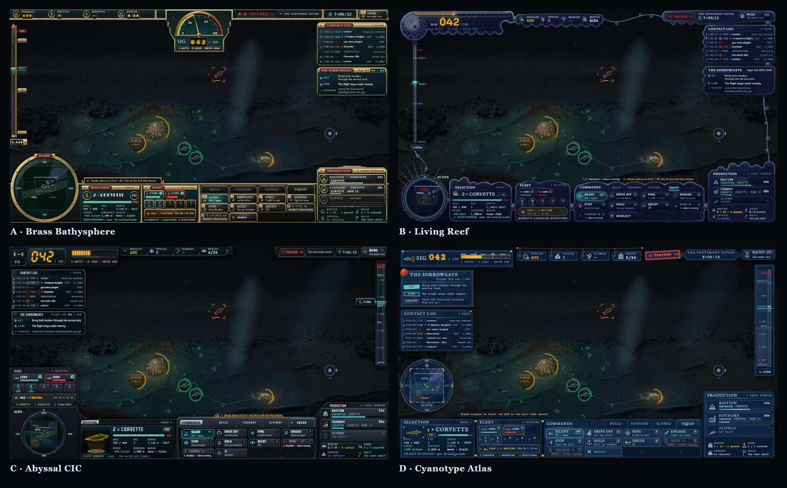

# In-match interface — four material directions

Four looks for the HUD a player holds during a mission, drawn for one request from the
repository owner: an interface "more like a lovely designed underwater RTS and less like
the minimalistic style it has today". It is concept art and a decision aid, not a
specification. [ui-ux.md](../../ui-ux.md) and [style-neon-noir.md](../../style-neon-noir.md)
stay the source of every rule cited below, and nothing here changes one until a direction
is chosen and those documents are edited to say so.

This is the second round. The [first](../hud-mockups/README.md) compared layouts and chose
the Console; this one keeps that moment and that content and asks what the chrome is
*made of*.

## What is held still

Every frame is the Console's "giving orders" moment: two Corvettes in Silent Running,
control group 1, ordered to the nodule field, 6 min 12 s into a mission on The Ventfront
Divide, with a break-silence confirmation up. The world behind it is one plate,
[world/world.png](world/world.png), painted for this round from the first round's scene
with every object at its old screen position. Only the chrome changes.

The content is October's client, not the September frame, which had gone stale in sixteen
places:

- The command card is today's SQUAD page: SILENT, DRIVE OFF, PING, ENGAGE, STOP, HOLD,
  DECOY, MINE, CHARGE and the deselect. Dive, Rise and Follow left it with #1132 (§9).
- MINE and CHARGE are greyed under silence and name their reason, `disabled — silent
  running` (§7).
- The selection reads SIG 8 and −45% speed, the Silent Running cap and cost, at 1,140 m in
  the duct with 1,200 m ordered.
- Berths read 6/24, a Bastion's 16 plus a Foundry's 8 ([economy.md](../../economy.md) §10).
- The objectives header carries the silence order's reading, `flight SIG 006 / 020`
  (§10.5), and the scope's camera box is the view's trapezoid (§5).

Every direction keeps every information law: own loudness always on screen as
`SIG 042 / 100` with stops snapping at 30 and 65 (§3); contacts no more precise than their
tier in the scope and the log (§1, §4); no hostile total anywhere; the ping previewed
before commit, in each kit (§6); no resident chrome in the centre box, x 384–1536 by
y 216–864 at 1080p; and every control at least 44 px on its short side (§11).

## The four

| | Direction | Made of | Chrome | Frame | Kit |
| --- | --- | --- | --- | --- | --- |
| A | Brass Bathysphere | Brass, verdigris, porthole glass, bakelite | 39.4% | [render](renders/BrassHero.jpg) | [render](renders/BrassKit.jpg) |
| B | Living Reef | Nacre shell, membrane, radiolarian lattice | 33.8% | [render](renders/ReefHero.jpg) | [render](renders/ReefKit.jpg) |
| C | Abyssal CIC | Gunmetal, titanium, water-tinted glass | 38.9% | [render](renders/CicHero.jpg) | [render](renders/CicKit.jpg) |
| D | Cyanotype Atlas | Prussian-blue paper, ice ink, brass pins | 39.8% | [render](renders/AtlasHero.jpg) | [render](renders/AtlasKit.jpg) |

Chrome is the share of a 1080p frame under resident panels; today's Console layout is
about 30%. Each kit is the sheet an engineer would build from: palette with roles, type
scale, the full icon set, the SIG meter in all three bands with its spike, every command
cell state, log rows per tier, production rows, the scope and the depth ladder close up.

### A · Brass Bathysphere

The commander sits in a riveted bathysphere and the HUD is its instrument panel, in
restrained ocean-liner Deco. SIG becomes a fan-gauge crest hanging from the top lintel,
its reading on odometer drums; the scope is a porthole sonar screen in a bolted bezel; the
depth ladder is a sight glass beside a fluted pilaster with engraved band plates. Warm
metal frames the cold water. The risk it names itself: brass sits close to the
Consortium's amber, so for a Bathyarch player the frame can read as faction dress.

### B · Living Reef

The interface is grown rather than built: a colony of nacre shells anchored to the screen's
edges, every margin facing open water lobed about 12 px deep. A Lituites coil is the SIG
crown's own outline, its last whorl straightening into the meter; a radiolarian eye holds
the scope; a coral crown rises off production. Pearl ornament carries no light, so light is
spent only on information. The lightest of the four, and the only one that drops the
rectangle.

### C · Abyssal CIC

The combat information centre of a deep-strike fleet: powder-coated gunmetal, one titanium
edge running the whole console, glass tinted like the water it holds back, and the bolted
pressure port as the family motif. SIG reads on a seven-segment pod, the selection stands as
an amber hologram over its pad, and the depth ladder becomes an altimeter tape. The closest
to today's grammar — cyan tells, magenta asks, red warns — with the hairlines replaced by
material.

### D · Cyanotype Atlas

A deep-sea naturalist's field kit: Prussian-blue cyanotype sheets carrying faintly glowing
ice ink, pinned and stamped around the chart. SIG is an engraved scale bar, the log a typed
ledger, the objectives a wax-sealed slip, the scope a chart on a compass card, the depth
ladder an engraved section of water, and the orders dog-eared index cards in a file tray.
Paper is opaque by nature, which is what lets its type sit at ledger size over the water.

## What every direction breaks

All four make the same four breaks, and adopting any one means making them in the bible
first:

- **"Neon is information, never decoration"** and the 85–90% darkness default
  ([style-neon-noir.md](../../style-neon-noir.md), "Why neon-noir"). Material and ornament
  are decoration by definition; each direction keeps glow on information only.
- **The §2 chrome budget**: 33.8–39.8% against about 30%. The shapes that buy the look —
  a crest, a coil, wings — are what cost it.
- **The SPEC display face**, Big Shoulders Display ("Typography"). Each direction brings
  its own pairing, with data kept in a tabular mono or typewriter face.
- **Palette discipline** ([graphics-standards.md](../../graphics-standards.md), gate 4).
  Each material ramp needs tokens in [style-neon-noir.md](../../style-neon-noir.md) before
  it ships.

Each also re-shapes the SIG meter and the depth ladder (§3, §8) while keeping their values,
stops and readouts. C and D move the ladder to the right edge.

## How they were checked

Each direction had three rounds of critique, an art-direction review and an
interface-rules review, each by a reviewer that did not draw it. The final round passed A
(8.9 art, 9.1 rules) and D (8.5, 9.0). C passed on art (8.5); its rules review (8.5) left
one fix, applied after it. B was still marked for revision on both (7.5, 8.4) after its last change, which
moved it off the rectangle; that round's fixes were applied but not re-reviewed.

Every artboard was measured in headless Chromium: no resident panel enters the centre box,
no control is under 44 px, and no text is under 12 px. None was checked inside the Design
canvas runtime. B leans on CSS `clip-path` and masks, and C references SVG definitions
across inline SVGs, so those two are the first to look at if a canvas draws one wrongly.

## Reading the artboards

`artboards/` holds the eight frames as static `.dc.html` files, the Design canvas format the
first round used. Each opens directly in a browser from this folder: the world plate
resolves by a relative path, fonts load from Google Fonts, and the missing `support.js` is
the canvas runtime's and harmless. Nothing generates them; edit them in place. `renders/`
holds each at 1920 × 1080.

Related: [ui-ux.md](../../ui-ux.md) · [style-neon-noir.md](../../style-neon-noir.md) ·
[art-direction.md](../../art-direction.md) · [graphics-standards.md](../../graphics-standards.md) ·
[the first round](../hud-mockups/README.md)
