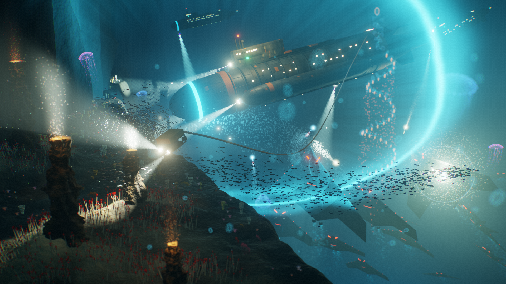

# The High slice's target frame (#1799)

The owner named this frame in session on 11 November 2026. It is the target every look
step of the High slice is judged against, as `dev-loop`'s "Look work" asks: one reference
image, committed with the cameras it is judged at.



`target.png` is #975's key-art frame, 1920 × 1080, a byte copy of
`optional-skills/dream-loop/issue-975/target.png`. That file stays where its study left it.

## What transfers

- Light with a source: searchlight cones in the water, and pools on the ground under them.
- Lit ground and rock, with shadow between them.
- Water as a medium: particulate near the eye and a far wall that fades.
- Life in the water: schools, drifting bodies, vents at work.

## What does not

- **The camera.** This is a low cinematic eye. Play is commanded from above and behind
  the fleet.
- **The blur.** Depth of field stays off the playfield
  ([art-direction.md](../../art-direction.md#two-layers-two-laws), limit 7).
- **The cyan ring as a light.** Cyan is an interface hue, and no world light wears one
  (limit 3 there).

## Cameras

Each round shows three frames beside this one, in the free-water crater, with the HUD
present.

| Frame | Camera |
| --- | --- |
| Home | The study's opening pose, `FREE_WATER_OPENING` in `packages/shared/src/constants.ts`: a low orbit behind the fleet at hull depth |
| Close | A low eye composed like the target: the rim in the foreground, the hulls across the frame, open water behind. Fixed by #1801's first round: the focus at 542 / 1,958, the opening fleet's centroid, at the hulls' 300 m; a 420 m dolly; `yawDeg` −60, which looks 60 degrees east of north over the west rim into the bowl; `pitchDeg` 2. The eye is then about 233 m deep over the rim's 600 m floor |
| Survey | The study's survey dolly, north up, the whole bowl in frame |

One clip of the camera moving from Home to Close goes with them.

## Who captures

Frames offered for acceptance are captured on the owner's desktop, the named GPU of
[graphics-standards.md](../../graphics-standards.md) gate 6: a GTX 1070, in Edge, headed.
A round built in the cloud container shows a software rasteriser's frames, labelled so,
and never offers them for acceptance.

The capture is [issue-1801/frames.mjs](../issue-1801/frames.mjs), a run-game steps module
that holds the three cameras above at Low and at High and writes each frame's reading
beside it. With the dev servers running (`npm run dev`):

```bash
UNPACED=1 VIEW_W=1920 VIEW_H=1080 node .claude/skills/run-game/scripts/drive.mjs \
  --headed --channel msedge --url 'http://localhost:5173/?study=free-water' \
  --out docs/screenshots/issue-1801/gpu --steps docs/screenshots/issue-1801/frames.mjs
CLIP=1 RECORD_VIDEO=docs/screenshots/issue-1801/gpu VIEW_W=1920 VIEW_H=1080 \
  node .claude/skills/run-game/scripts/drive.mjs --headed --channel msedge \
  --url 'http://localhost:5173/?study=free-water' \
  --out docs/screenshots/issue-1801/gpu --steps docs/screenshots/issue-1801/frames.mjs
```

The first writes `high-home`, `high-close` and `high-survey` beside their Low controls and
`readings.json`, whose `queued` GPU time is gate 6's reading. The second records the clip,
the camera moving from Home to Close at High. Unpaced, a run's frame times are no budget.

## Related

- [art-direction.md](../../art-direction.md#two-layers-two-laws) — what a look may and may
  not do
- [graphics-standards.md](../../graphics-standards.md) — gate 6, the High graphics quality
- [free-water-slice.md](../../free-water-slice.md) — the crater the slice is built in
