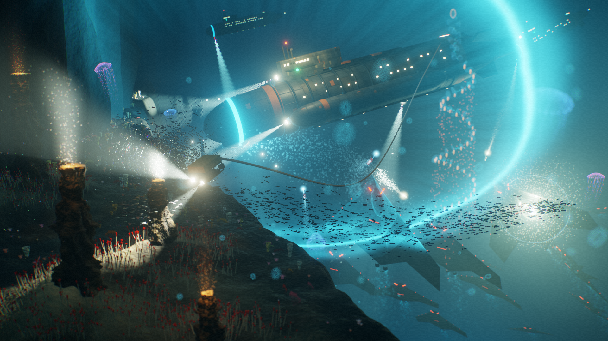
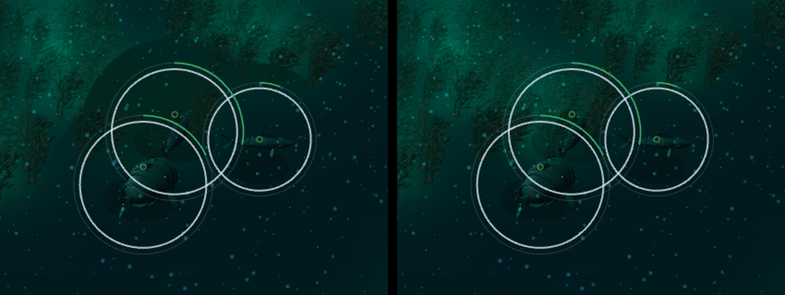

# The High slice, step 1: the crater's ground and water lit (#1801)

Frames for the first look step of the High graphics quality
([art-direction.md](../../art-direction.md#what-is-built-at-high)), beside
[the target frame](../issue-1799/README.md) at its three cameras, in the free-water crater
with the HUD on.

**A software rasteriser drew every frame here**: SwiftShader, in headless Chromium, in the
cloud container that built the step. They guide a round and are not offered for
acceptance. The frames the owner accepts against are taken on the named GPU, with the
command under "Who captures" in [the target's README](../issue-1799/README.md).

## Reproduce

```bash
SETTINGS_JSON='{"reducedMotion":true,"reducedMotionChosen":true}' VIEW_W=1920 VIEW_H=1080 \
  node .claude/skills/run-game/scripts/drive.mjs --url 'http://localhost:5173/?study=free-water' \
  --out docs/screenshots/issue-1801/software --steps docs/screenshots/issue-1801/frames.mjs
```

[frames.mjs](frames.mjs) sets each camera with `__perspectiveCamera`, switches the
quality with the development switch beside the setting, `__perspectiveQuality`, and
writes [readings.json](software/readings.json): each frame's passes, calls, triangles and
the bytes High holds. Reduced motion holds the camera's sway, so two runs frame alike.

[plates.mjs](plates.mjs) is the second module, run the same way with `--out
docs/screenshots/issue-1801/software/plates`. It sends the three hulls into the garden,
selects them, and takes the High frame with its marks' plates and without them, by
`__perspectivePlates`. [read.py](software/plates/read.py) reads a pair.

## The frames beside the target



| Camera | Low | High | What High shows so far |
| --- | --- | --- | --- |
| Home | [low](software/01-low-home.png) | [high](software/04-high-home.png) | The garden beyond the rim glowing in the flora's own green: its stands pool on the ground and scatter in the water over it, and the glow blooms. The rim under the hulls is dark, lit by the Lid's glow alone, and reads as silt: scours and dune troughs darker than the crests between them, with the survey ink over it |
| Close | [low](software/02-low-close.png) | [high](software/05-high-close.png) | The rim in the foreground, the three hulls across the frame, and the bowl's open water behind, the water in the Coral Ruins' hue. The rim's dunes lie across the frame as dark bands that close up toward the horizon. No source of the world's stands near this camera: the frame's brightest is Low's, and its ground is darker than Low's |
| Survey | [low](software/03-low-survey.png) | [high](software/06-high-survey.png) | Depth still reads as luminance: the rim, the garden, the bowl's flanks and the black pocket. Each of the garden's stands has its pool on the ground and its glow in the water. The silt's relief is gone by this dolly, as Low's detail is |

The clip is [clip-home-to-close.mp4](software/clip-home-to-close.mp4): the camera moved
from Home to Close at High, at 1280 × 720 and six times the speed the rasteriser drew it.

## The ground under the Lid

The second pull request of the step lit the silt. Through #1807 the lit ground took the
Lid's glow flat, and the crater's ground carried no silt detail at either quality: the
bake's rim and lee lines crossed the rim, and nothing finer. The lit ground now takes the
dunes, ripples and scours as
relief ([art-direction.md](../../art-direction.md#what-is-built-at-high)), and the Lid's
level went from 3 to 3.3, just under its two bounds.

Read off the High frames before and after, with Low beside them: the median and the 5th
to 95th percentile of luma, out of 255.

| Where | Low | High, #1807 | High now |
| --- | --- | --- | --- |
| Home, the rim left of the hulls | 22.9, 20.9 to 23.9 | 17.9, 14.3 to 18.8 | 16.0, 10.1 to 19.8 |
| Close, the rim under the hulls | 22.9, 21.1 to 23.7 | 18.7, 15.2 to 18.9 | 17.0, 10.0 to 20.4 |
| Survey, the west rim | 23.2, 21.4 to 24.2 | 17.8, 12.5 to 17.9 | 18.7, 13.5 to 19.8 |
| Survey, the bowl's west flank | 18.8, 17.8 to 19.6 | 13.2, 12.2 to 14.0 | 14.0, 11.4 to 14.9 |

The boxes are 100, 560 to 560, 780 at Home, 500, 700 to 1400, 860 at Close, and 660, 300
to 790, 480 and 830, 500 to 880, 640 at Survey. The marine snow and the hulls' ground
shadows are in the first two.

Two things to read there. The spread on the rim doubled, which is the relief: 4.5 to 9.7
at Home. And the ground the Lid alone lights is still darker than Low's, by 4 to 7 of
255. That is the Lid's bounds and not a setting left low. Its brightest ground may be no
paler than the palest ground a plate holds the world to, 29.6, nor reach the bloom's
knee, and that ground is the palest fill, level, at the Lid itself. The rim is Coral Ruins
under 600 m of water. Low shades a map's shallowest ground at its fill's own level,
whatever its depth.

The relief shows most where a source lights the ground. In
[the garden frame](software/plates/01-garden-plates.png) the stands' pools lie over dune
troughs, which stay dark under them.

What the target shows and these do not: the searchlights of the player's own hulls and
their pools, which are the target's brightest light and the issue's next step; shadow
cast between the rocks; and life at work in the water. No mark stands over a light in
these three frames. "The plate under a mark" below has the frames where three do.

## What the frame costs

Counted, not timed: a software rasteriser's milliseconds measure the rasteriser.

| Camera | Low: calls, triangles | High: calls, triangles | High's passes |
| --- | --- | --- | --- |
| Home | 44, 593,684 | 56, 660,446 | `high-world`, `high-scatter`, `high-occlusion`, `high-bloom`, `high-plates`, `high-composite`, `high-tactical`, then the halo's and the split's |
| Close | 44, 593,684 | 56, 660,446 | The same |
| Survey | 45, 594,970 | 57, 661,726 | The same |

High draws twelve calls more, as it did before the relief, which is the lit ground's own
fragment shader. On a standard map it fetches no more than Low's painted detail does. In
the crater Low paints none, so the relief is new work there: its fetches on every
fragment of the lit ground, which gate 6's reading on the named GPU has to cover, a
texture of the cells' strengths, 1,024 bytes for this map, and the detail's noise
lattice, 65,536, which the page holds once. None of that is in the bytes below. It drops
the water backdrop. It adds the survey ink's own
draw, which is the ground's 32,768 triangles a second time, and the ink's plate, which
is those triangles a third. It adds one instanced draw for the crater's 71 sources and
one for the bands and discs of the marks' plates, 534 of them at Home, and nine
full-screen draws: the
occlusion, the bloom's seven and the composite. At 1920 × 1080 its targets hold
144,439,680 bytes: four samples of half-float colour and of depth and one resolve of
each, the half-size and smaller targets of the scatter, the occlusion and the bloom, and
the plates' mask at the frame's size. The lit ground's two textures hold 2,796,203. Gate 6 bounds
High by GPU time, at most 8 ms read queued and unpaced on the named GPU. That reading is
owed: the capture takes it on a GPU and records `insideBudget` beside it.

## Low does not move

The Low quality is the non-target control. `low-control/` holds `main`'s Low frames at
the second pull request's base, 9945c1fb, taken by the same module with `QUALITY=low`.

A match is live, so two runs never match pixel for pixel. A second run of `main` against
the first gives the floor, read as [issue-1800](../issue-1800/README.md) reads it: the
mean, over the world area, of each pixel's largest channel difference, out of 255
([diff.py](low-control/diff.py)).

| Camera | `main` against `main` | `main` against the branch | Calls and triangles |
| --- | --- | --- | --- |
| Home | 0.01 | 0.04 | 44 and 593,684, both |
| Close | 0.03 | 0.09 | 44 and 593,684, both |
| Survey | 0.00 | 0.00 | 45 and 594,970, both |

The figures move run to run with the snow. #1807 read the same comparison against its own
base, 96180933f, four times: 0.15 to 0.19 and 0.31 to 0.36 at Home and Close on three, and
0.04 and 0.08 on one.

The difference maps paint a pixel red where any channel moved by more than 2. At Close
both maps are marine snow and nothing else: the motes sink, and a later frame finds them
lower ([main against main](low-control/diff-close-main-vs-main.png),
[main against the branch](low-control/diff-close-main-vs-branch.png)). No ground, hull,
ring, lamp or ink pixel moved, and the survey frame matches to the pixel.

In counted work, `packages/frontend/test/rendererSmoke.test.ts` holds the rest: at Low the
frame is the canvas pass it was, and at High every draw of the tactical pass is one Low
makes, in a material of the kind Low makes it in. The same file holds the relief off Low:
the crater's Low ground draws with no silt detail before High and after it, and a
standard map's Low ground paints the detail in the program it always had.

## The plate under a mark

The owner took the third reading of limit 6 on 11 November 2026: a mark carries its own
ground ([art-direction.md](../../art-direction.md#the-plate-under-a-mark)). Under a
mark's plate the world layer is shown no brighter than the palest ground the ladder
weighs, 11.6% encoded luminance, which is 29.6 of 255. The ceiling that first held the
lit ground is gone, so a stand's pool now reads on the ground: over the garden at Survey
the 99th percentile of encoded luminance is 14.8% at Low and 30.0% at High, and the
cores reach 45.0% at the 99.9th, read over 800, 290 to 1115, 470. That is past every figure the ladder holds to, which is
what the plates are for.

`plates.mjs` puts three marks over that light: the hulls sent into the garden and
selected, so each wears its selection ring and collar, and the selected hulls' detection
ring crosses the glow.

| Camera | With plates | Without | The pair's centre | Where they differ, ×12 |
| --- | --- | --- | --- | --- |
| Over the garden | [plates](software/plates/01-garden-plates.png) | [bare](software/plates/02-garden-bare.png) | [zoom](software/plates/garden-zoom.png) | [map](software/plates/garden-diff.png) |
| Survey | [plates](software/plates/03-survey-plates.png) | [bare](software/plates/04-survey-bare.png) | [zoom](software/plates/survey-zoom.png) | [map](software/plates/survey-diff.png) |



Read by `read.py` over the world area:

| Camera | Pixels held | Brighter with plates | Held pixels' median, bare | With plates |
| --- | --- | --- | --- | --- |
| Over the garden | 17,113, 1.09% | none | 39.7 of 255 | 29.6 |
| Survey | 3,584, 0.23% | none | 47.7 | 29.9 |

The difference map over the garden is two things: a disc under each hull that stands in
the glow, and the band along the detection ring where it crosses the glow. At Survey it
is the discs and the garden's north rim, where the ink's plate crosses the brightest
stands. A plate changes no pixel that was under the level, so the rest of each pair is
the same to the byte: 20,582 of the world area's 1,570,560 pixels differ at all over the
garden, and 4,166 at Survey.

The held pixels that still stand over the level are, by this session's reading of the
pair, a plate's soft edge and what the tactical pass blends over the world after the
hold: a ring's stroke, a lamp's halo and the marine snow. The counted half of that claim
is `packages/frontend/test/rendererSmoke.test.ts`: the composite holds the world under
the mask before the tactical pass draws.

`packages/frontend/test/markPlates.test.ts` holds the level to the ground the ladder
weighs and runs the ladder's comparisons for rungs 4 to 7 at every grey from black to
it, in all four palettes. It also pins how pale a ground those comparisons hold over:
11.8% in tritanopia, 17.3% in deuteranopia and protanopia, 18.8% in the standard
palette.

In the three frames beside the target, the 99th percentile of the world area's luma, out
of 255, is 63 at Low and 60 at High at Home, 64 and 64 at Close, and 50 and 55 at Survey.

No frame here shows a contact. A contact's disc, and every agent's, is held by two tests
instead. `rendererSmoke.test.ts` measures the shapes each symbol of a canned frame draws
against the disc under it, far and close up: a hull, a structure, both shots and six
contacts. `silhouetteReach.test.ts` draws every structure kind and every hull, and holds
each outline inside the reach a plate takes for it.

## Gate 7, asked of the lit frames

[graphics-standards.md](../../graphics-standards.md) gate 7 asks of any new visual whether
a player who has read nothing can tell whose it is, how loud it is and whether it is
theirs in under a second, and at the survey dolly whether the plateau, the trench and the
rock can be named from the ink alone. Read off the High frames above, by the session that
built them, on a software rasteriser:

| Camera | Whose, how loud, theirs | The ink |
| --- | --- | --- |
| Home | Yes. The three hulls stand in their navy's green under their rings on the dark rim, each ring's arc short, which is quiet. The garden's glow is beyond them, and nothing of theirs stands over it | Not the survey's question at this dolly |
| Close | Yes. Each hull fills its ring, its lamps and its ring's arc say quiet, and no world light is in the frame | Not the survey's question at this dolly |
| Survey | Yes. The three hulls and their rings read on the west rim as at Low | Yes. The coast round the rim, the pocket, the garden and the rock wall, and the isobaths down each scarp, are drawn as at Low |
| Over the garden, with plates | Yes. Each hull stands on a dark disc inside its white selection ring, its collar's green arc over the disc and not over the glow. Without plates the upper hull's ring and collar cross the flora's green, which sits near the Pelagia hulls' own | Not the survey's question at this dolly |

The frames taken on the named GPU are where this is judged. Three things to look for
there. A disc holds a hull's collar and its bar's slot, so it is a little wider than the
collar, and three hulls close together make one dark patch. At Close each hull's disc
stands over water Low draws paler than the plate's level, and its upper edge shows: the
luma steps 3.5 of 255 across it where Low's own gradient is 2.2
([#1816](https://github.com/gunnargehtab/Echoes-of-the-Abyss/issues/1816)). And the rim's
relief runs under the hulls at Home and Close, where it stands against the one dark mark
the study draws: a hull's ground shadow, which is its depth
([art-direction.md](../../art-direction.md), "Depth is drawn, not implied"). A trough is
now as dark as a shadow.

| Frame | The shadow's median luma | The ground's 5th percentile beside it |
| --- | --- | --- |
| Home, Low | 17.4 | 20.9 |
| Home, High at #1807 | 12.5 | 14.3 |
| Home, High now | 10.7 | 10.1 |
| Close, Low | 19.7 | 21.5 |
| Close, High at #1807 | 17.0 | 17.0 |
| Close, High now | 14.4 | 15.2 |

At Home the shadow is the left hull's, 625, 765 to 680, 785, against the rim's box
above. At Close it is the middle hull's, 810, 690 to 940, 705, against the ground either
side of it on the same rows. At Close the shadow already stood at the ground's 5th
percentile before the relief; at Home the relief took that margin away, and the rim's
1st percentile is 8.0. The round's critic could not tell the middle hull's shadow from
the dune bands at Close.

This is not settled here. Three options are written for the owner in the pull request:
bound the relief so its deepest trough stays above a shadow, which leaves about the
spread the rim had; hold the relief out from under each hull's shadow, which is a new
hold keyed to agents; or keep it and judge the two on the named GPU's frames.

The ink was checked directly, since at the survey dolly it is faint at both qualities.
[ink-survey.png](software/ink-survey.png) is the Survey frame at High less the same frame
with the ink's draw hidden by a switch that was not committed, amplified twelve times: the
coastlines and the scarps' isobaths, and nothing else. It was taken at #1807's third
commit, where the ink moved 1.80% of the world area's pixels by more than 2 of 255 at
Survey, and 0.46% at Home.

## Related

- [The target frame](../issue-1799/README.md) — the cameras, and who captures
- [art-direction.md](../../art-direction.md#two-layers-two-laws) — what a look may and may
  not do, and what is built
- [graphics-standards.md](../../graphics-standards.md) — gate 6, the two graphics qualities
