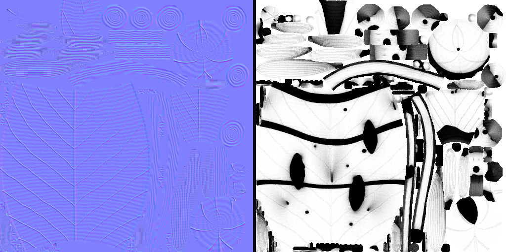
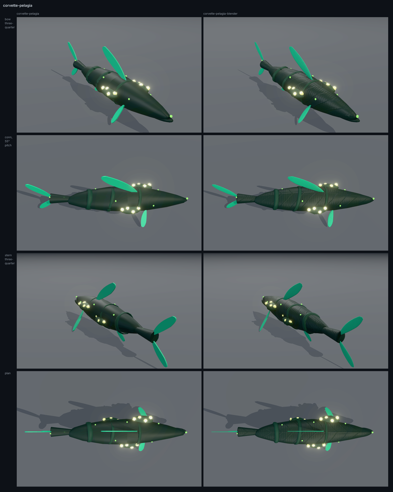
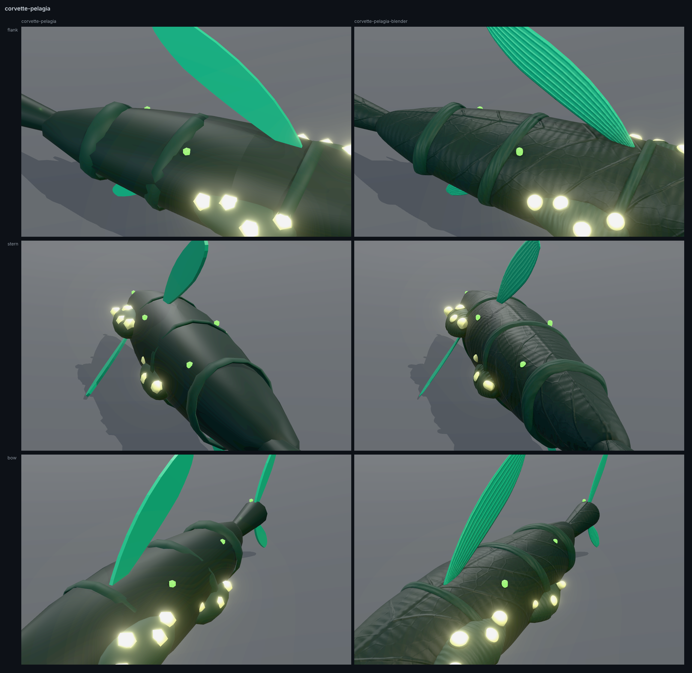
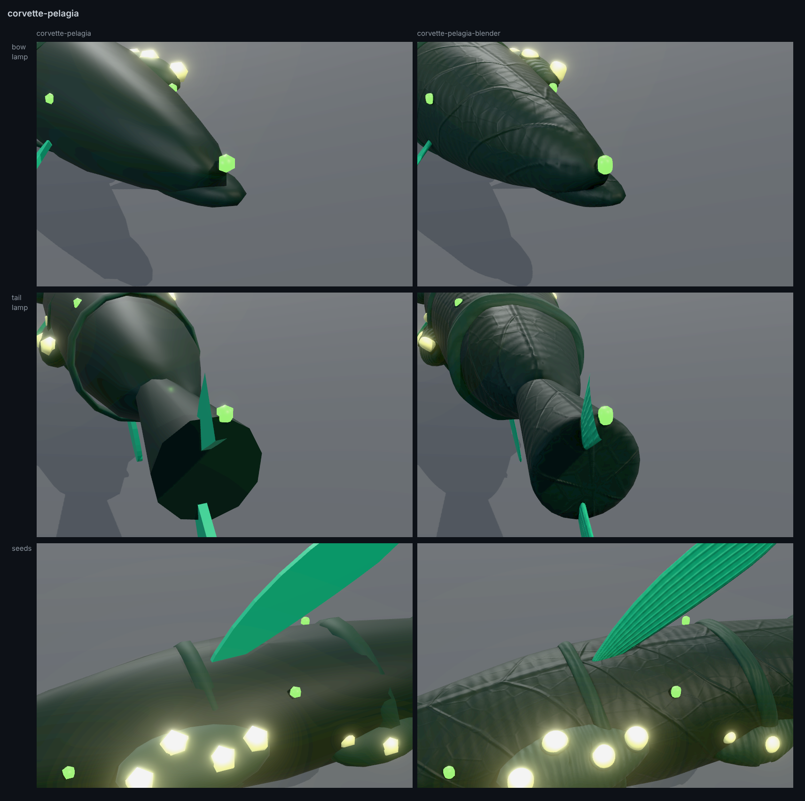
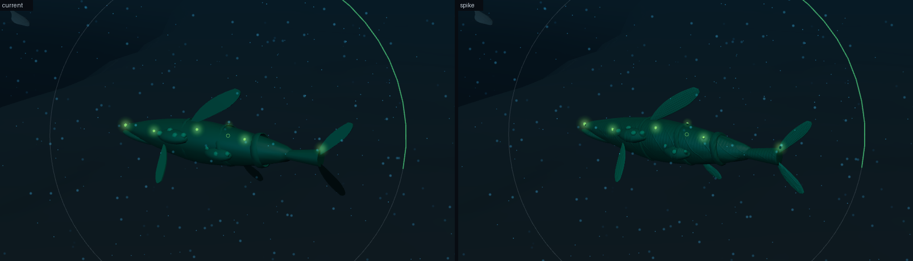
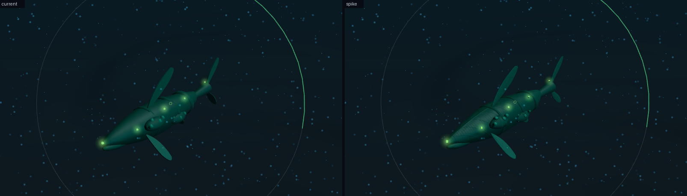
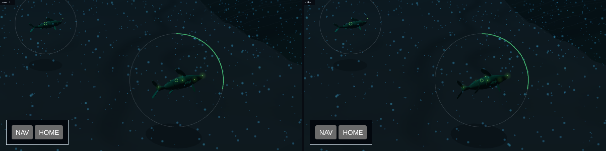
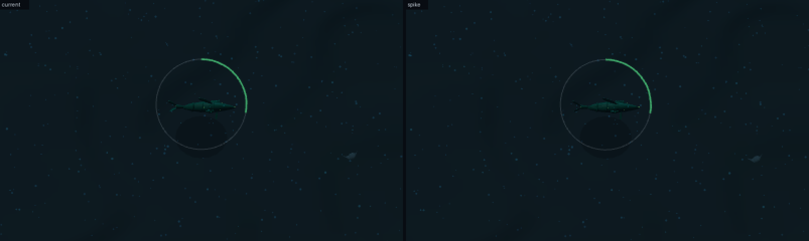
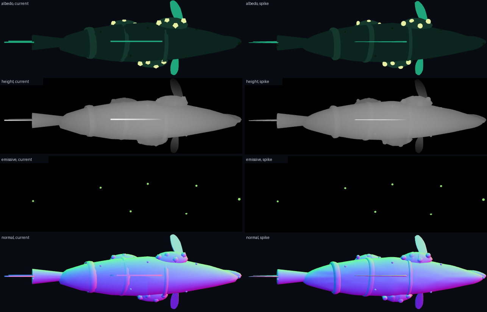

# A hull built in headless Blender (#1802)

A spike. It asks whether a script running Blender with no window can lift a hull to a
higher surface bar than `tools/hull-models/kit.mjs` reaches, and still pass through
`hull-intake`. It replaces no shipped model: `docs/concept-art/models/` is untouched, and
adopting any of this changes the pipeline of record in
[graphics-standards.md](../../graphics-standards.md#the-pipeline-of-record), which is the
owner's decision.

The hull is the Commune's Corvette, one of the three in the free-water crater
([free-water-slice.md](../../free-water-slice.md)), so it stands where the High slice's
Close camera will look. The script is `tools/hull-models/blender/corvette_pelagia.py`, on
`tools/hull-models/blender/kit.py`, and its output is
`docs/concept-art/spikes/corvette-pelagia-blender.glb`.

## What was built

The script reads the approved `docs/concept-art/models/corvette-pelagia.glb` as its
blockout and rebuilds each part inside that part's own frame. Nothing is a new hull: 80 m,
the 33 parts by their names under the same nodes, the five materials at the navy's values,
the seven lamps at their sites.

| | Current | Spike |
| --- | --- | --- |
| Generator | three.js r169 primitives | Blender 5.3.0 as `bpy`, Cycles on the CPU |
| Parts | 33 | 48 |
| Triangles | 2,652 | 44,884 |
| Materials | 5 | 5, the same names and values |
| Maps | none | normal 1,024², occlusion 512², one atlas at 15.7 texels a metre |
| File | 100,964 bytes, 26,156 at gzip level 9 | 3,049,168 bytes, 2,615,691 at gzip level 9 |

Each change below is a shape decision. The spike takes them so there is a hull to look at,
and each is the owner's to keep or refuse.

- **The hull** is a subdivision cage fitted to the blockout's 16 × 11 table. Its box is
  within 7 cm of the table's.
- **The three growth rings** are bands laid on the skin, with a lip whose edges are
  bevelled 0.12 m. Each blockout ring is an ellipse round a hull that is not one: it floats
  up to 1.23 m off the skin and sinks up to 0.32 m into it. A band's box moves up to 0.68 m.
- **The six membranes** keep the blockout's outline and become a lens with a round rim.
  They are 0.19 m a side thicker at the root and thin to the tip, where the blockout has a
  0.42 m slab.
- **The eleven seeds and the seven lamps** were spheres cut to five facets by three. Each
  is rebuilt as a smooth barrel that shows what its blockout showed from above and from the
  side, and within 5% of it at camera pitches from 15° to 55°. An ellipsoid misses by 15.7%.
- **Each lamp is moved to stand off the smoothed skin what it stood off the blockout's**,
  which is a light placement moved. The bow lamp moves 0.19 m, since the table's nose under
  it was a two-vertex wedge and the smooth nose is not. The tail lamp moves 0.09 m, since
  the peduncle's end is rounded under it. The other five move 5 cm or less.
- **Fifteen rings are added** that no block of
  [asset-prompts-3d.md](../../asset-prompts-3d.md) names: nine collars where a seed leaves
  its sheath and six calyxes where a lamp leaves the skin. A ring is not built where a
  growth ring would cross it (`launcher_starboard_seed_4`) or where less than 15% of it
  would show (`launcher_port_aft_seed_3`, which the hull covers, and
  `hullline_starboard_2`). The hull takes part of three collars, as it takes part of
  their seeds: 73 to 75% of each stands clear of it, and 97% of a fourth.
- **The chitin's surface is veins over growth lines**, on the normal map alone: a midrib
  down the back, laterals trailing aft down each flank and a fine net between. The Pelagia
  block names "growth rings and living bioluminescent veins". These veins are relief and
  emit nothing.
- **Kept as they were**: the growth rings still run through the three launchers at five
  pairs, as they do in the approved hull.
- **Dropped**: the blockout's two unnamed point lights. The conn view keeps a model's
  meshes alone when it merges one.



## On the lit table

`tools/hull-renders/inspect.mjs`, the current hull on the left and the spike on the right,
from cameras that do not move between them. This sheet shows shape and authored finish. Its
lamps are bloomed, so glow is not read here.

```bash
node tools/hull-renders/inspect.mjs corvette-pelagia \
  --with docs/concept-art/spikes/corvette-pelagia-blender.glb
```







## In the game

**A software rasteriser drew these frames** (SwiftShader, the container's only one). They
show what the Low renderer does with the file and are not offered for acceptance. The
shipped model was swapped for the spike for the run and restored after, as
`tools/hull-models/blender/frames.mjs` describes. Left is current, right is the spike.

The nearest the conn camera comes, a low eye off the port quarter and off the bow:





The whole frame of the first, HUD on:
[current](conn-near-port-current-full.png) · [spike](conn-near-port-spike-full.png).

The study's opening pose, and gate 6's close station at 1,800 m and 55° of pitch, each
enlarged twice:





The High slice's own Close camera is not fixed yet
([issue-1799](../issue-1799/README.md#cameras)), so the two near frames stand in for it.

| Camera | Draw calls | Triangles, current | Triangles, spike | Lamps, current | Lamps, spike |
| --- | --- | --- | --- | --- | --- |
| Home | 44 | 593,684 | 635,916 | 12.0 px² | 12.4 px² |
| Gate 6's close station | 43 | 593,674 | 635,906 | 2.7 px² | 2.6 px² |
| Near, port | 39 | 589,674 | 631,906 | 123.7 px² | 127.0 px² |
| Near, bow | 36 | 588,378 | 630,610 | 135.6 px² | 141.5 px² |

Draw calls do not move, since the conn view merges a model by material and the spike has
the same five. One Corvette adds 42,232 triangles to a frame. The lamp columns are the
client's own reading of the area the Corvette's seven lamps project at each camera
(`packages/frontend/src/game/lampScreen.ts`). Its other reading, a lamp site's radius, is
6 to 8% smaller on the spike, 1.40 px against 1.51 for the bow lamp at Home: a barrel
holds a spindle's area and is about a tenth shorter. `readings-current.json` and
`readings-spike.json` hold all of it.

## Through intake

```bash
node .claude/skills/hull-intake/scripts/bake.mjs \
  docs/concept-art/spikes/corvette-pelagia-blender.glb --length-m 80 --out <dir>
```

The bake is warning-free: 80.0 m by 25.2 m at a scale of ×1.00002, length on X, 7 emissive
materials by intake's count of 48, and no material whose meshes disagree on attributes. The
current hull reads 80.0 m by 24.9 m.



Each lamp shows from above the plan area its blockout showed, to 0.002 m²: the script
measures both with every part in place. Gate 3's raw energy then agrees from 8 px/m up and
differs below it, where a lamp is a pixel or two wide and a round one samples differently
from a pentagon.

| Map density | Raw E, current | Raw E, spike |
| --- | --- | --- |
| 2 px/m | 3.41 | 2.87 |
| 4 px/m, the shipped density | 3.35 | 3.13 |
| 8 px/m | 3.31 | 3.30 |
| 16 px/m | 3.36 | 3.37 |

Calibrated at 4 px/m to the Corvette's SIG 28, a target of 3.33, the current hull takes a
gain of ×0.993 and the spike ×1.061, against a cap of ×64.

`tools/hull-models/contacts.mjs` finds 79 pairs that meet where the current hull has 45.
Every collar meets its seed and its sheath, every calyx its lamp and its seat, and every
lamp its seat.

## The hull-reviewer's reading

The reviewer was asked to judge the file as if it were offered for
`docs/concept-art/models/` today, and failed it three times. Each round was a fresh
reviewer. What the three rounds found in the build itself is fixed:

- The bow lamp floated 0.38 m off the smoothed nose, and the tail lamp stood 0.25 m off
  the rounded peduncle where the blockout's stood 0.12 m. The cage now reaches the table's
  tip, each lamp is moved to stand off its seat what it did, measured to the skin itself,
  and the script asserts each crosses its seat.
- A new collar was cut by a growth ring, three stood off their seeds, and one lay wholly
  under the hull. A collar now follows the line where its seed leaves its sheath, and one
  a band would cross or a camera could not see is not built.
- The maps were on the first UV set. They are on the second, as the kit's occlusion map
  is, and the first is left for a trim sheet.
- The launchers' three group nodes were missing. They are kept.
- The lamps projected a fifth less area from the side than the approved ones. They now
  match, as the table above reads.
- The first surface, plates, read near the Directorate's shell, and the second, a net
  alone, as scales. The veins now have a midrib and laterals, with the net under them.

Three of its findings stand, because they are what the spike was run to measure:

- **Gate 6, triangles.** 44,884 a hull against Low's 400,000 a frame. Eight such hulls fit
  under it and nine exceed it; the berth ceiling is forty.
- **Gate 6, texture memory.** About 6.7 MiB on the GPU, against the 1.33 MiB a model that
  gate 6 of [graphics-standards.md](../../graphics-standards.md) allows.
- **The pipeline of record.** An approved model is `THREE.GLTFExporter` output with no
  texture but an occlusion map. This file is neither, and `npm run check:models` would
  fail it over the kit script's.

## What it costs

- **The toolchain.** `bpy` 5.3.0 installs from PyPI into Python 3.13: a 427.5 MB wheel,
  1.1 GB installed. It imports, bakes and exports in the cloud container with no display
  and no GPU.
- **Time.** 86 s a hull on four threads: 5 s to build, 81 s to bake at 64 samples. A
  build beside a full gate run took up to 233 s.
- **Bytes.** 30 times the current file. The 128 approved models are 12,671,968 bytes
  together at `5f2a23404`, so five hulls like this one outweigh the library. The two PNGs
  are 1,763,580 bytes of it. The wheel carries no Draco or meshopt library, so the exporter
  cannot compress the geometry.
- **Triangles and texture memory**, as the reviewer's findings above give them. It is a
  High asset.

## What it does not prove

- **That `npm run check:models` can hold it.** Repeated builds on one machine gave one
  SHA-256. Another machine was not tried, and CI installs no `bpy`.
- **That it reads at High.** High's lighting is not built (#1801). Under Low's rig at the
  nearest camera the gain is visible and small. The lit table is the fairer reading of
  what the surface holds.
- **A second navy.** The Commune is the navy primitives serve worst. A plated hull would
  lean on bevels, which this hull uses on three lips and nowhere else.
- **A frame on the named GPU.** Every frame here is a software rasteriser's.

## Related

- [graphics-standards.md](../../graphics-standards.md) — the pipeline of record and the
  gates
- [art-direction.md](../../art-direction.md#two-layers-two-laws) — what the world layer
  may do at High
- [asset-prompts-3d.md](../../asset-prompts-3d.md) — the Corvette and Pelagia blocks the
  hull answers to
- [issue-1799](../issue-1799/README.md) — the High slice's target frame and its cameras
