# A navy's surface on the kit hulls (#1811)

[#1802](../issue-1802/README.md) rebuilt the Commune's Corvette in Blender, and its control
showed that the baked surface carried most of the gain at the kit hull's own 2,652
triangles. The owner declined the roster rebuilt that way. This is the route that record
left open: a relief drawn once a navy material, tiled, and worn by every kit hull of the
navy at the High graphics quality.

It is look work in development. **Nothing here is accepted, and a software rasteriser drew
every game frame below** (SwiftShader, the container's only one). The frames to judge are
taken on the named GPU, by the commands under "Who captures".

## The decisions

The owner decided three things in session on 13 November 2026.

- **The surface is built before the step that lights a hull.** The issue was filed as
  waiting on that step. The other reading was to build the step first, in a pull request
  of its own. It is filed as
  [#1814](https://github.com/gunnargehtab/Echoes-of-the-Abyss/issues/1814), and the
  verdict on the named GPU waits for it.
- **A hull wears the surface without a layout.** A fragment reads it by its place on the
  model, on three planes. The other reading was a UV0 layout the kit writes, as a trim
  sheet has. That layout packs a part's width into strake bands, so it does not tile
  across a part, and each laid hull is re-exported:
  the Consortium's Corvette went from 132,708 to 301,128 bytes when it was laid.
- **The midrib runs down a bow and a stern, not across them.** The first cut read the
  fore-and-aft plane with the image's `v` along the height, so the chitin's midrib, drawn
  where `v` is 0, crossed every end face as a band. It showed as a lit stroke on the
  bow-on Corvette at the Close camera. That plane reads the beam now, so the midrib comes
  down the bow at the centreline. The other readings were the midrib from above only,
  which loses the line along each flank, and the band left and written down.

[art-direction.md](../../art-direction.md#a-navys-surface) says what the surface is and
what it may touch.

## What was drawn

`tools/hull-models/surface.mjs` draws one image a material from the `SURFACE` table in
`tools/hull-models/factions/pelagia.mjs`. `node tools/hull-models/surfaces.mjs` writes
them, and `npm run check:models` holds each to its draw.

| Material | Pattern | Image | Tile | Relief | File |
| --- | --- | --- | --- | --- | --- |
| `chitin_hull` | A leaf's venation over growth lines | 512² | 16 m | 14.1 cm | 483,992 bytes |
| `growth_ridge` | Rings square to the keel, with a fibre along them | 256² | 8 m | 11.1 cm | 122,664 bytes |
| `spore_pod` | A mottle with pores | 256² | 8 m | 4.2 cm | 130,977 bytes |
| `algae_membrane` | A fin's rays and the web between | 256² | 8 m | 7.6 cm | 64,159 bytes |

Every texel is 3.1 cm. Above, each image as it is stored: red and green are the slope along
the tile's two axes, and blue is the height. Below, the height alone.

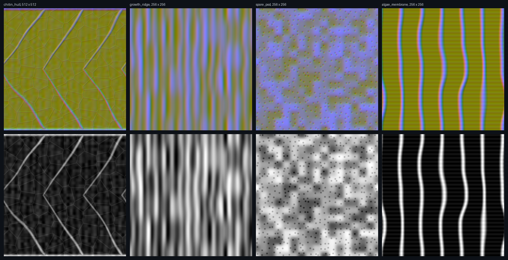

Twenty-seven of the Commune's twenty-eight models carry at least one of the four, and
each wears them by its materials' names: twenty-three carry `chitin_hull`. The Bastion,
the Foundry, the Refinery and the Spore Veil carry `spore_pod` alone, and the Sentinel
Turret none. Their `algae_hull` and `deep_chlorophyll` wear nothing yet: the issue starts
with these four materials.

## On the lit table

`tools/hull-renders/inspect.mjs` took a `--surface` column for this: the same file once
more, wearing its navy's surfaces through the client's own shader patch. Left is the kit
hull, the middle is the kit hull surfaced, and right is #1802's Blender hull, which keeps
its own baked maps. The cameras do not move between them. The lamps are bloomed on this
sheet, so glow is not read here.

```bash
node tools/hull-renders/inspect.mjs corvette-pelagia --surface pelagia \
  --with docs/concept-art/spikes/corvette-pelagia-blender.glb
```

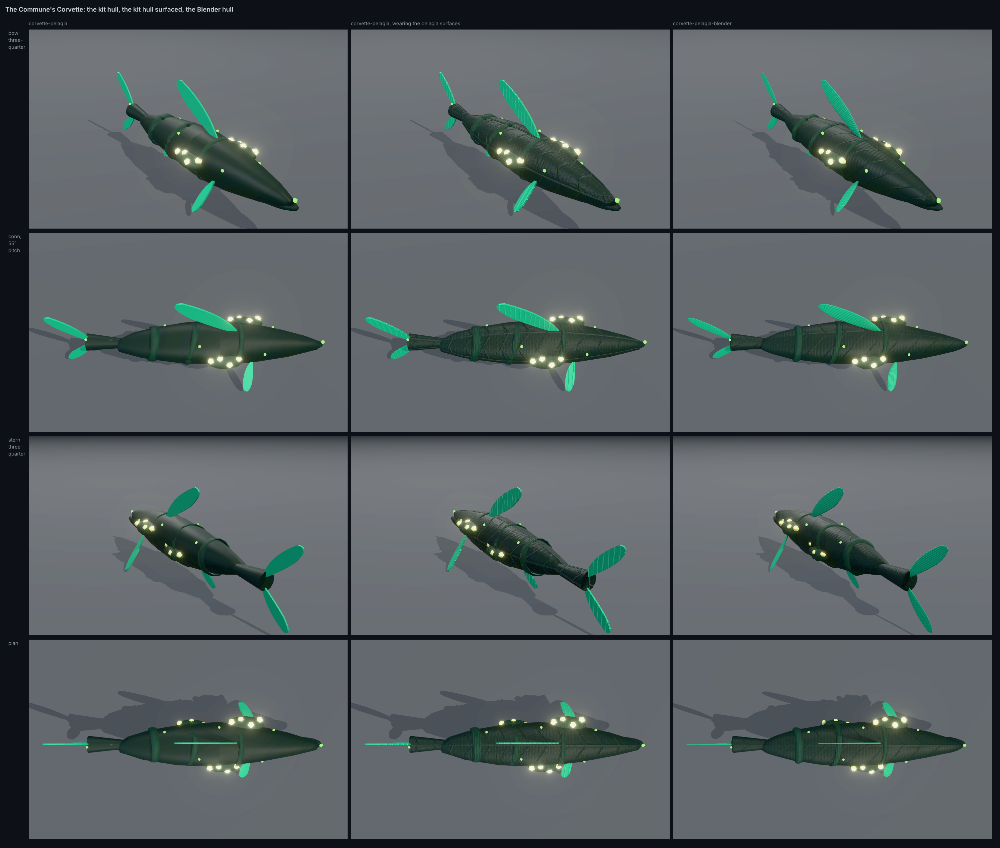

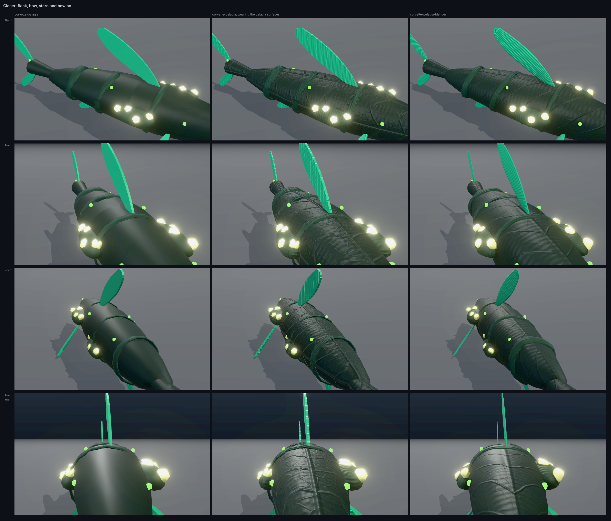

On the table the tiled surface holds what the baked one holds: the midrib and the
laterals on the back, the net between them, the grain on the rings and the rays on the
fins, at 2,652 triangles and no bytes a hull. Bow on, the midrib comes down the nose at
the centreline on both. What the Blender hull still has is its
modelling. Its seeds and lamps are round where the kit's are faceted, its rings lie on
the skin, and its fins have a rim. Two things the tile does worse. Its rays stand square to
the keel, so on the raked dorsal blade they cross the fin instead of following it. And its
net is drawn bolder than the baked one, because the client leans every slope 2.5 times.

## In the game

**A software rasteriser drew these frames. They guide a round and are not offered for
acceptance.** Each is one run of `tools/hull-models/blender/frames.mjs` at 1440 × 900 in
the free-water crater, HUD on. "Main" is `9945c1fb`'s two client files under the same
run. The Blender set swapped the shipped model for the spike for its run and restored it
after, as that module's header describes.

At High the hull still draws in the tactical pass, under the rig Low lights it by (#1814).
So these show the surface in that rig's light, not in the world's.

The nearest the conn camera comes, off the port quarter and off the bow, each enlarged
twice:

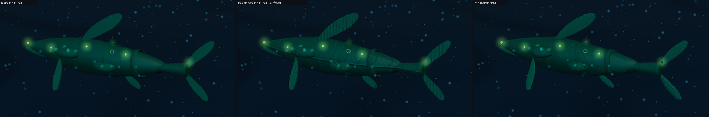

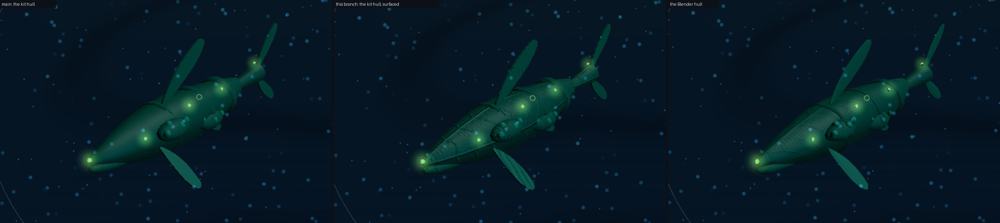

[The whole frame](high-near-port-full.png) of the first, surfaced, with the HUD.

At these two cameras the surfaced kit hull shows the most surface of the three: the
laterals as diagonals down the flank, the midrib's line along the flank at the hull's
axis, the rays on every fin and the bands on the rings. #1802 found its baked surface
showed only faintly here. Most of the difference is the lean of 2.5. The line along each
flank is the route's: a tile draws its midrib wherever `v` is 0, and the baked hull has
none there. The Blender hull's modelling still shows: rounder seeds and a smoother
outline.

The High slice's Close camera, the Corvette enlarged three times, and Home:


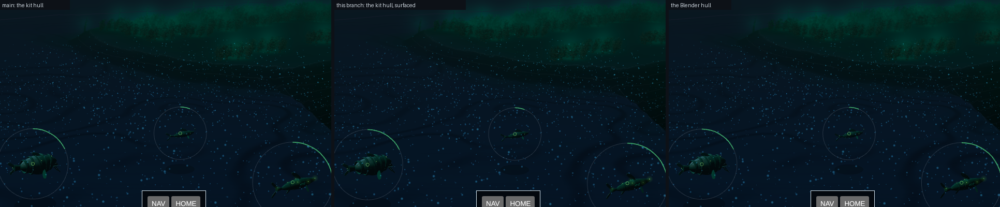

At Close the Corvette is bow on and about 70 pixels across. No vein, ring or ray can be
picked out on any of the three there, as #1802 found: a slope averages to level down the
mip chain. The surfaced hull is not identical to main's at that size: down the middle of
the bow its rows differ from main's by up to 27 levels of summed RGB, where an edge falls
a row later than main's, and no band crosses it. Whole frames, surfaced:
[Close](high-close-full.png) · [Home](high-home-full.png).

The Survey camera, at half size, at both qualities on main and on this branch. A hull is
a few pixels there, and the four differ by the quality alone:

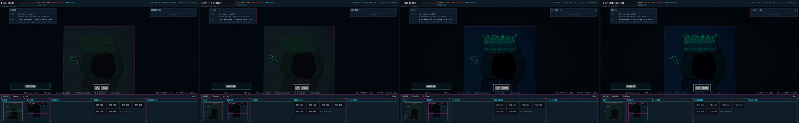

[The clip](clip-near-orbit.mp4) swings the eye 60° round the Corvette at the nearest
camera's range, at High, at 1280 × 720 and three times the speed the rasteriser drew it.
It is Playwright's screencast, so its compression takes most of the relief with it. It
shows the hull and its lamps steady under a moving camera, and it is no evidence about
shimmer.

### Readings

The five `readings-*.json` files hold a run each. Main and this branch agree on every
count at every camera, at both qualities, and on the Corvette's seven lamps to the pixel
(`packages/frontend/src/game/lampScreen.ts`).

| Camera | Calls, High | Triangles, High | Calls, Low | Triangles, Low | Lamps |
| --- | --- | --- | --- | --- | --- |
| Home | 56 | 660,446 | 44 | 593,684 | 8.3 px² |
| The High slice's Close | 56 | 660,446 | 44 | 593,684 | 35.6 px² |
| Gate 6's close station | 55 | 660,430 | 43 | 593,674 | 1.8 px² |
| Near, port | 51 | 656,432 | 39 | 589,674 | 85.9 px² |
| Near, bow | 48 | 655,140 | 36 | 588,378 | 94.2 px² |
| Survey | 57 | 661,726 | 45 | 594,970 | 0.8 px² |

The hull's own brightness does not move. Over the pixels the Corvette covers at the two
near cameras, the mean linear luminance at High is 0.0412 on main and 0.0416 surfaced off
the port quarter, and 0.0492 and 0.0498 off the bow. The surface shades about its own
mean, so it moves light between a hollow and a crest and adds none.

### Low does not move

Low builds the template it built before, and
`packages/frontend/test/navySurface.test.ts` holds that: no hook, no key and no texture
differs. The frames agree, main on the left:

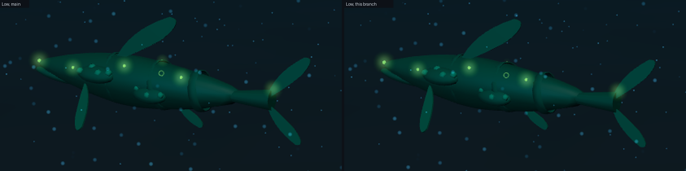

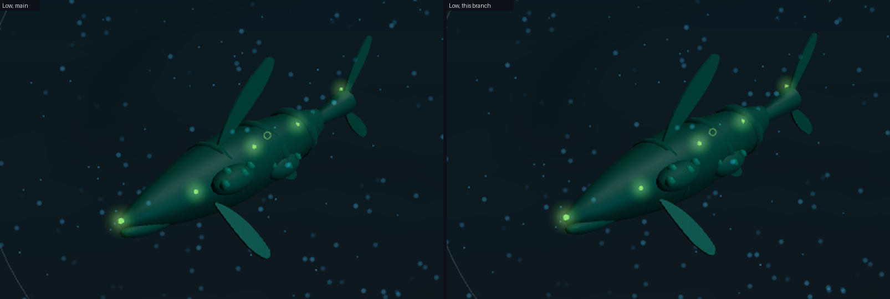

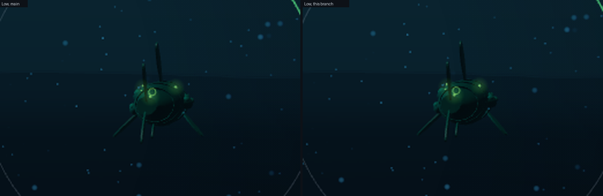

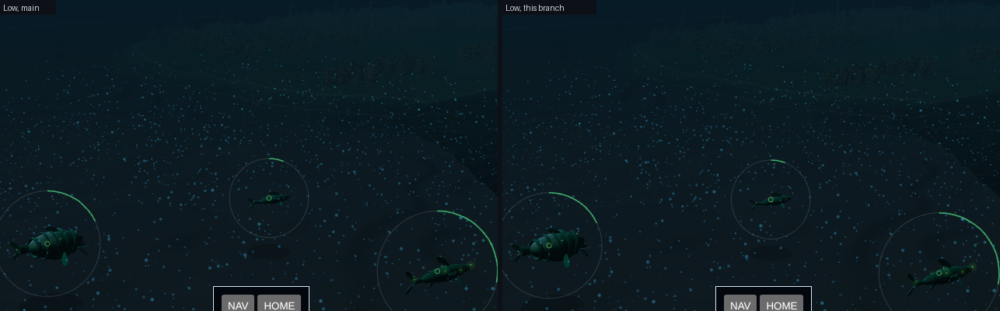

The two runs are not pixel for pixel, since the marine snow drifts between them. Over the
hull's pixels the mean linear luminance reads 0.04112 and 0.04099 off the port quarter,
and 0.04867 and 0.04869 off the bow.

## What it costs

- **Bytes.** 801,792 for the four images, once, in the client's assets. No GLB changed.
  A map a hull was 1,924,152 bytes a hull in #1802's control.
- **Texture memory.** 2.33 MiB once a Commune model has loaded at High: 1.33 MiB for the
  512² image with its mipmaps and 0.33 MiB for each of the three at 256². None at Low,
  where no image is fetched.
- **Three taps a clad fragment**, and no pass, call or triangle. Its GPU time is not
  read: a software rasteriser's milliseconds measure the rasteriser.
- **A second template a Commune model** while a page has drawn both qualities. Geometry
  is merged a template, so a hull switched from Low to High holds its vertices twice.

## What it does not prove

- **A frame on the named GPU.** Every game frame here is a software rasteriser's.
- **Gate 6's 8 ms.** Three taps a fragment over every Commune hull on screen is unread.
- **That it reads once High lights a hull.** The lean of 2.5 was set under Low's rig.
  It is TUNABLE, and #1814 will want it set again.
- **Whether Blender still clearly wins on a hero hull.** The issue keeps Blender for a
  short list only if it does. That is the owner's reading of the named GPU's frames.
- **A second navy.** A plated hull wants seams that follow a part, which a tile read by
  place cannot give. The trim sheets already draw those.
- **That nothing shimmers.** The relief is fixed to the model and fades by mip, which is
  the reason to expect none. The clip here is too compressed to show it either way.

## Who captures

On the owner's desktop, the named GPU of
[graphics-standards.md](../../graphics-standards.md) gate 6, in Edge, headed, with the
dev servers running (`npm run dev`). The first run is the tree as it stands. For the
second, copy the Blender hull over the shipped one and restore it after:

```bash
QUALITY=high VIEW_W=1920 VIEW_H=1080 node .claude/skills/run-game/scripts/drive.mjs \
  --headed --channel msedge --url 'http://localhost:5173/?study=free-water' \
  --out docs/screenshots/issue-1811/gpu/surfaced --steps tools/hull-models/blender/frames.mjs

cp docs/concept-art/spikes/corvette-pelagia-blender.glb docs/concept-art/models/corvette-pelagia.glb
QUALITY=high VIEW_W=1920 VIEW_H=1080 node .claude/skills/run-game/scripts/drive.mjs \
  --headed --channel msedge --url 'http://localhost:5173/?study=free-water' \
  --out docs/screenshots/issue-1811/gpu/blender --steps tools/hull-models/blender/frames.mjs
git checkout docs/concept-art/models/corvette-pelagia.glb
```

`02-close.png`, `04-near-port.png` and `05-near-bow.png` of each set are the frames the
issue asks to be judged side by side. `CLIP=1` with `RECORD_VIDEO=<dir>` on the first
command records the swing round the hull instead. Gate 6's time is read by
[issue-1799](../issue-1799/README.md)'s unpaced command, on this tree.

## Related

- [art-direction.md](../../art-direction.md#a-navys-surface): what the surface is, and
  what it may touch
- [issue-1802](../issue-1802/README.md): the Blender hull and its control
- [issue-1799](../issue-1799/README.md): the High slice's target frame and its cameras
- [graphics-standards.md](../../graphics-standards.md): gate 6, the High graphics quality
