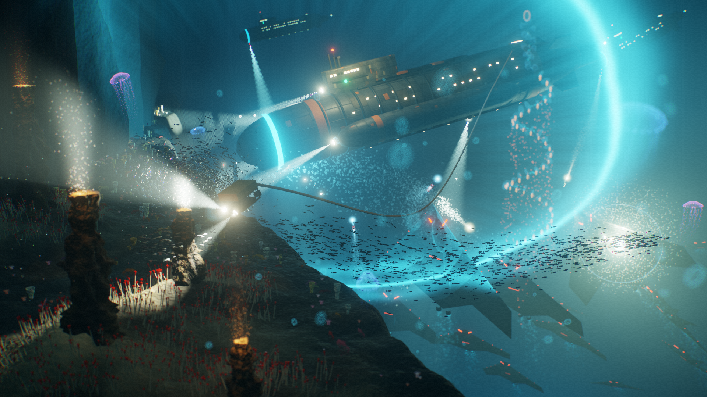
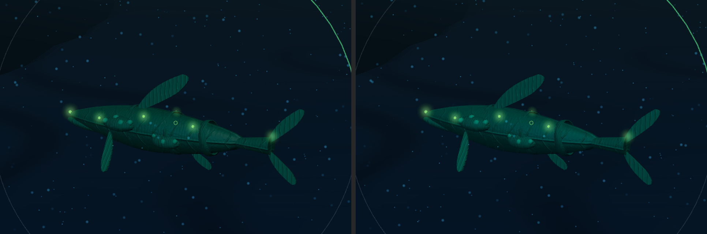
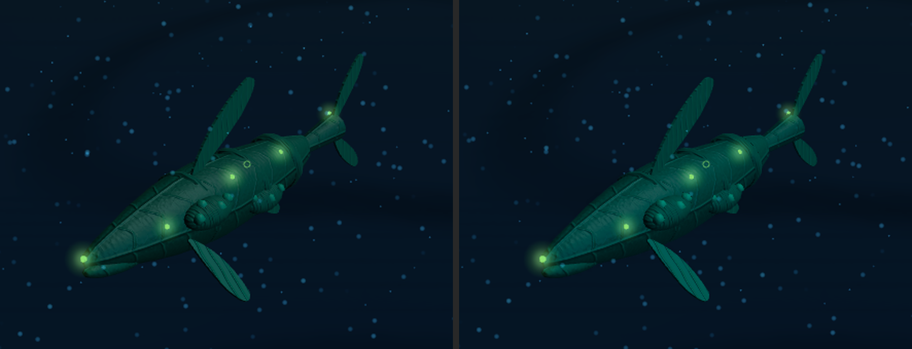
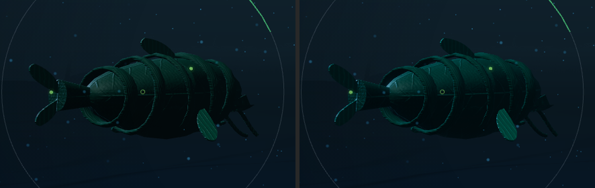
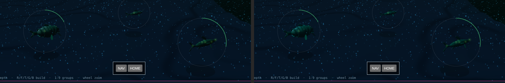
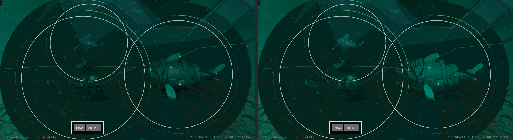
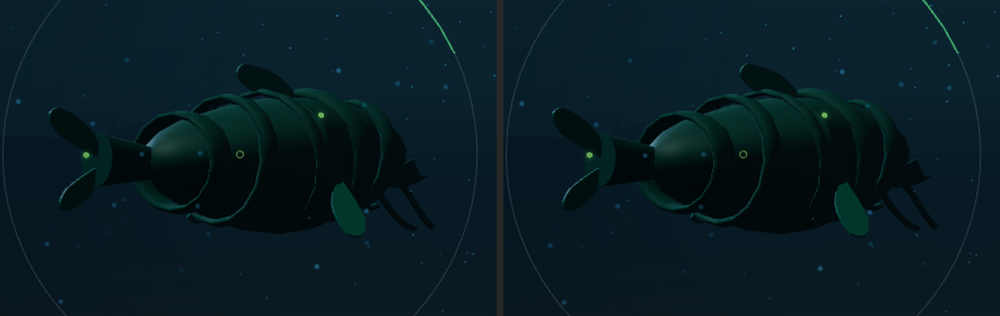

# A hull's cladding in the world pass (#1814)

At the High graphics quality a hull drew whole in the tactical pass, under the rig Low
lights it by. This step moves the cladding of the player's own models into the world
pass and lights it by the world: the Lid's glow, the pools, the occlusion, the bloom and
the water as a medium.

It is look work in development. **Nothing here is accepted, and a software rasteriser
drew every frame below** (SwiftShader, the container's only one). They guide a round. The
frames to judge are taken on the named GPU, by the commands under "Who captures".

[art-direction.md](../../art-direction.md#a-model-in-the-worlds-light) says what is built.

Every frame and reading below was taken at `44cd4e1a`, before
[#1817](https://github.com/gunnargehtab/Echoes-of-the-Abyss/pull/1817) lit the silt as
relief and raised the Lid's level from 3 to 3.3. This branch has `main` merged in since.
The merged tree was drawn once more over the garden to see that it draws. The frame has
the hold pass that pull request added before the world pass and one call more, 67, and
the hulls read as they do below. The frames here were not retaken.

## The decisions

The owner took three calls in session on 13 November 2026, each from written options and
the first frames.

- **No plate holds a model.** The first cut left limit 6 as written, and every own hull
  stands inside its own mark's disc. Its cladding was capped at 11.6% encoded luminance,
  darker than Low draws it. The other readings were that cap kept, and a second ceiling
  at Low's own hull.
- **A contact's model stays in the tactical pass.** In the world pass its body would
  hide the Lid's glow from the ground beside it and feed the bloom, and a contact casts
  neither (limit 2). The other reading put every model there and amended the limit.
- **The rig stays, and the world's light is added.** The other reading dropped the rig's
  key and rim for hulls, since there is no sun below the Lid.

The session then found one fault of its own in the garden and fixed it inside the first
call. A hull cut whole from its plate showed as a flat bright shape: the glow the water
scatters in front of it was held everywhere else under the disc and not there. Under a
plate the composite now holds the water in front of a model and leaves the model's own
light. [The first cut](first-cut-garden.png) is kept for the record.

## The frames beside the target



The three cameras of [issue-1799](../issue-1799/README.md), in the free-water crater with
the HUD on, at 1920 × 1080.

| Camera | Low | High | What High shows of a hull now |
| --- | --- | --- | --- |
| Home | [low](software/01-low-home.png) | [high](software/04-high-home.png) | Three hulls on the dark rim, a few tens of pixels each. Their backs take the Lid's glow. No source of the world's stands near them |
| Close | [low](software/02-low-close.png) | [high](software/05-high-close.png) | The Harvester across the left of the frame. Its hollows are no longer black: the Lid's glow reaches under the rings, and the water takes its light as it takes the ground's |
| Survey | [low](software/03-low-survey.png) | [high](software/06-high-survey.png) | A hull is a few pixels. Against `main`'s High frame 0.07% of the world area's pixels move by more than 2 of 255 |

What the target shows and these still do not: the searchlights of the player's own hulls
and their pools, which are its brightest light, and shadow cast between hull and rock.
Both arrive with the own searchlights.

## A hull near, `main` against this branch

`main` is `44cd4e1a`'s client files under the same run, left in every pair. The crops
are enlarged.

On the rim, where no source stands, off the port quarter and off the bow:





The Harvester at the Close camera, and the three hulls at Home:





On the rim the change is small. The back and the fins are a little brighter, and the
keel's darkest hollows are lifted. The surface's veins read about as they did.

Over the garden, where the flora's stands pool on the ground and glow in the water. The
three hulls were sent there and selected, at 1440 × 900:



Here the change is plain. On `main` the hulls sit under Low's fog as dark shapes in a lit
garden. On the branch each takes the garden's green on its keel and flanks, the rings and
the veins shade it, and it stands lit inside its plate while the ground beside it is held.
Whole frames: [over the garden](software/garden/01-garden.png) ·
[near, port](software/garden/02-near-port.png) ·
[near, bow](software/garden/03-near-bow.png) ·
[rim, port](software/rim/01-near-port.png) · [rim, bow](software/rim/02-near-bow.png).

[The clip](software/clip-home-to-close.mp4) moves the camera from Home to Close at High,
at 1280 × 720 and four times the speed the rasteriser drew it. It is Playwright's screencast, so
its compression takes fine relief with it. It shows the hulls steady in the world's light
under a moving camera, and it is no evidence about shimmer.

### Readings

Mean luminance over the hull's pixels in each pair's crop. The mask is rough: every pixel
whose green stands over the water's in either frame, lamps and halo included.

| Camera | Linear, `main` | Linear, branch | Encoded, `main` | Encoded, branch |
| --- | --- | --- | --- | --- |
| Rim, port | 0.0520 | 0.0562 | 21.9% | 22.7% |
| Rim, bow | 0.0578 | 0.0630 | 23.8% | 24.3% |
| Garden, the Harvester | 0.0773 | 0.1026 | 24.6% | 29.7% |

The 99th percentile of the same pixels does not move: 55.4%, 46.2% and 73.5% encoded on
`main`, and 55.4%, 46.1% and 73.5% on the branch.

## What the frame costs

Counted, not timed: a software rasteriser's milliseconds measure the rasteriser.
[readings.json](software/readings.json) holds the run.

| Camera | High on `main`: calls, triangles | High on the branch |
| --- | --- | --- |
| Home | 56, 660,446 | 66, 668,054 |
| Close | 56, 660,446 | 66, 668,054 |
| Survey | 57, 661,726 | 67, 669,334 |

Ten calls and 7,608 triangles more. That is the plate pass drawing the three hulls'
cladding a second time, into its mask: one call a clad material, ten across the three.
The world pass and the tactical pass draw each part once between them, as before. The
passes are the same seven. No target was added: the mask now uses two of its four
channels.

A model holds a second template once a page has drawn both qualities, for every navy now
and not the Commune alone. Geometry is merged a template, so such a hull holds its
vertices twice.

## Low does not move

`low-control/` holds `main`'s Low frames from the same module. Read as
[issue-1801](../issue-1801/README.md) reads a pair: the mean, over the world area, of each
pixel's largest channel difference, out of 255.

| Camera | `main` against the branch | #1801's floor, `main` against `main` | Calls and triangles |
| --- | --- | --- | --- |
| Home | 0.06 | 0.07 | 44 and 593,684, both |
| Close | 0.15 | 0.15 | 44 and 593,684, both |
| Survey | 0.00 | 0.00 | 45 and 594,970, both |

The difference maps paint a pixel red where any channel moved by more than 2:
[Home](low-control/diff-home.png) · [Close](low-control/diff-close.png) ·
[Survey](low-control/diff-survey.png). At Home and Close they are marine snow, which sinks
between two runs. The Harvester at Close, `main` left:



In counted work, `packages/frontend/test/hullLight.test.ts` holds that Low's template
names nothing for the world pass and carries no hook on its cladding.

## What it does not prove

- **A frame on the named GPU.** Every frame here is a software rasteriser's.
- **Gate 6's 8 ms.** The second draw of the cladding and the light's two taps a clad
  fragment are unread.
- **A mark over a pool-lit hull.** No plate holds a model, so a mark that crosses a
  hull's body reads over what the world lit. Few do, and none is weighed here.
- **Whether a hull's glint reads as loudness.** Cladding now feeds the bloom. No hull
  blooms visibly on these frames, and no reading here says how near the threshold its
  brightest face stands.
- **A second navy and a structure.** Only the Commune's three hulls are in the crater.
  The Hadron's plate is the most metalled and takes the world's light mostly as a
  mirror.
- **A contact.** The crater seats no enemy, so no Tier-4 model stands beside an own one.
- **The surface's lean.** `HULL_SURFACE.RELIEF` was set under Low's rig (#1811) and is
  not moved here.

## Who captures

On the owner's desktop, the named GPU of
[graphics-standards.md](../../graphics-standards.md) gate 6, in Edge, headed, with the dev
servers running (`npm run dev`). The three cameras, with gate 6's time in
`readings.json`, then the hull near on the rim and over the garden:

```bash
UNPACED=1 VIEW_W=1920 VIEW_H=1080 node .claude/skills/run-game/scripts/drive.mjs \
  --headed --channel msedge --url 'http://localhost:5173/?study=free-water' \
  --out docs/screenshots/issue-1814/gpu --steps docs/screenshots/issue-1801/frames.mjs

VIEW_W=1920 VIEW_H=1080 node .claude/skills/run-game/scripts/drive.mjs \
  --headed --channel msedge --url 'http://localhost:5173/?study=free-water' \
  --out docs/screenshots/issue-1814/gpu/rim --steps docs/screenshots/issue-1814/hulls.mjs

GARDEN=1 VIEW_W=1920 VIEW_H=1080 node .claude/skills/run-game/scripts/drive.mjs \
  --headed --channel msedge --url 'http://localhost:5173/?study=free-water' \
  --out docs/screenshots/issue-1814/gpu/garden --steps docs/screenshots/issue-1814/hulls.mjs
```

`CLIP=1` with `RECORD_VIDEO=<dir>` on the first command records the clip instead.
[hulls.mjs](hulls.mjs) says what each of its cameras is.

## Related

- [art-direction.md](../../art-direction.md#a-model-in-the-worlds-light): what is built,
  and the three calls
- [issue-1799](../issue-1799/README.md): the High slice's target frame and its cameras
- [issue-1801](../issue-1801/README.md): the High frame's first step, and the plates
- [issue-1811](../issue-1811/README.md): a navy's surface, whose verdict waits on this
- [graphics-standards.md](../../graphics-standards.md): gate 6, the High graphics quality
