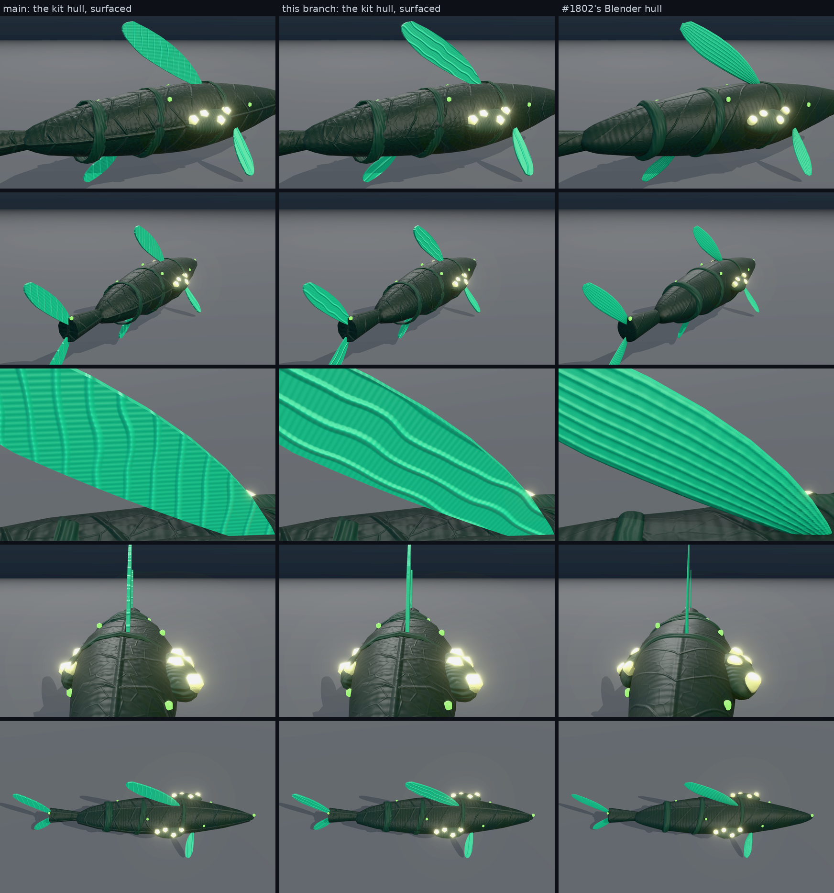
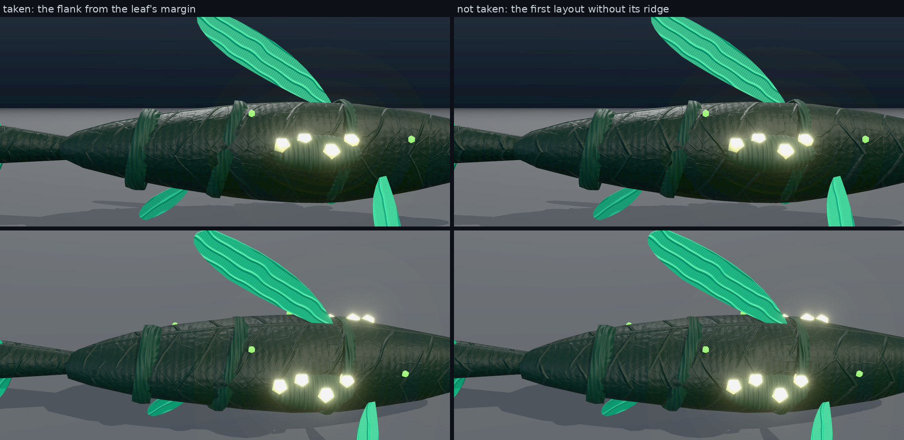
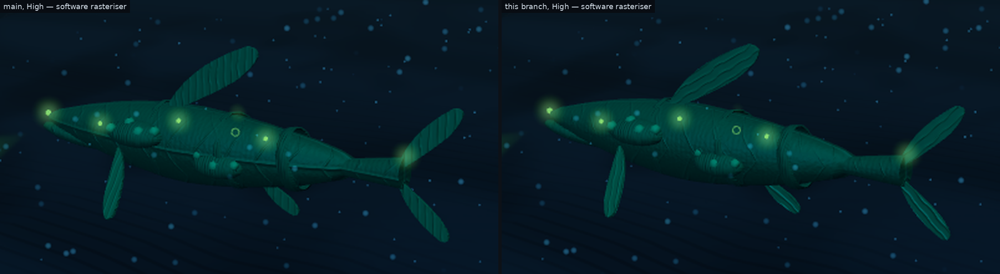
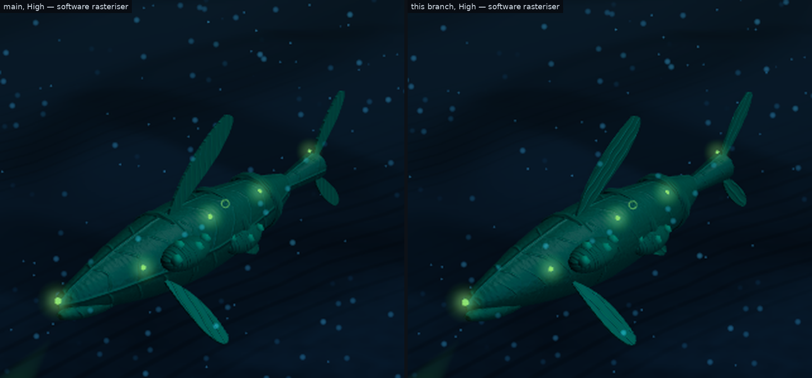
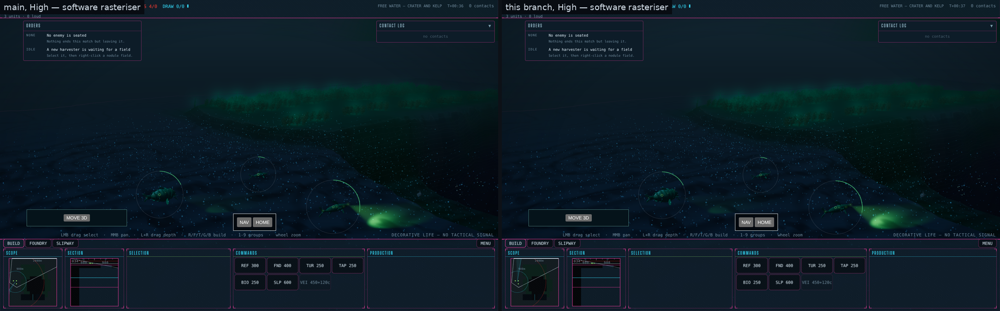
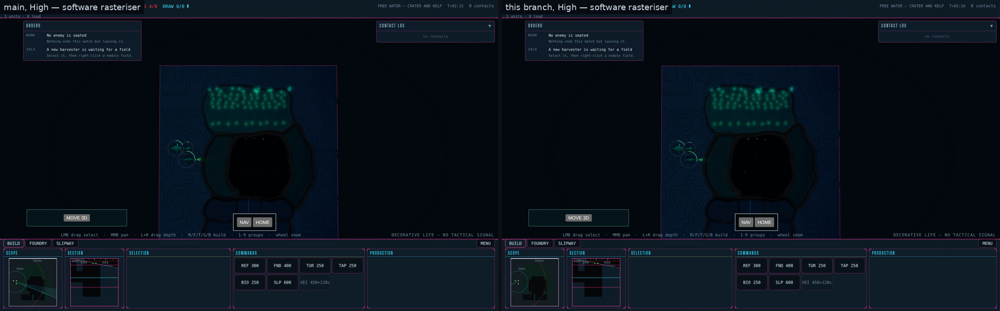
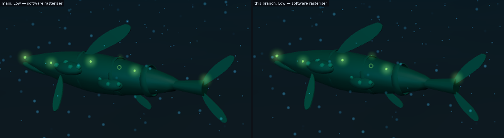
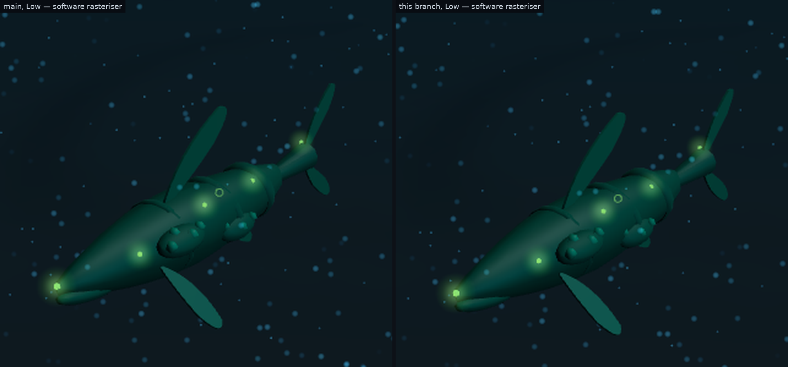
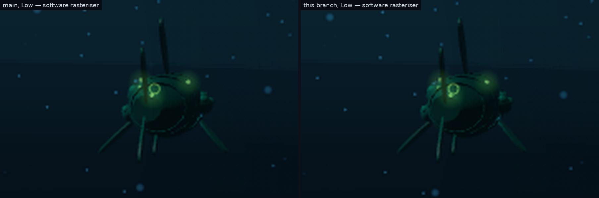
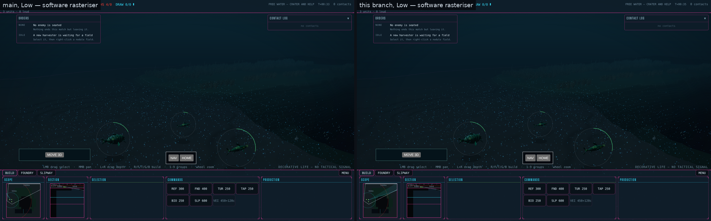

# A fin's rays and a flank's midrib (#1844)

[#1811](../issue-1811/README.md) put a tiled surface on the Commune's kit hulls at the
High graphics quality, and the owner accepted it on 19 November 2026 with two faults
filed. A fin's rays stood square to the keel, so they crossed the Corvette's raked dorsal
blade. And the hull skin's midrib ran as a line along each flank, where the Blender hull
has none.

It is look work in development. **Nothing here is accepted, and a software rasteriser drew
every game frame below** (SwiftShader, the container's only one). The frames to judge are
taken on the named GPU, by the command under "Who captures".

## The decisions

The owner was not at the keyboard, so each call was written as options and the
recommendation taken. Each is the owner's to overturn.

**A fin's rays.**

- **A blade reads the tile in a frame of its own, found from its shape. Taken.** When the
  High template is built, a thin, long part of the membrane gets the principal axes of
  its own surface as a quaternion on its vertices, and the vertex stage turns the
  fragment's place and normal into them. No GLB changed and the fragment pays nothing.
  Its rays run parallel along the blade and off its edge; they do not close on the tip.
- **A fin's chart in the file.** The kit writes each fin's place on itself as a UV, as the
  Blender spike did, and the rays close on the tip. Every Commune model with a fin is
  re-exported, and it is a layout, which the owner declined on 13 November 2026. This is
  the bigger call, and it is where to go if parallel rays are refused.
- **A pattern with no direction.** The fins lose their rays. That changes the navy's shape
  language, which is the owner's.

**A flank's midrib.**

- **A second image for a face that looks abeam. Taken.** The veined skin is drawn once
  more without its midrib, and the plane seen from the side reads that image. The back,
  the bow and the stern keep the image and the read they had, byte for byte. It costs
  477,424 bytes and 1.33 MiB of texture at High, and no tap.
- **The shader draws the midrib** on the planes whose `v` is the beam. No bytes. A drawn
  line does not fade down a mip chain as the image's does, and the image is what the
  owner's swing showed no shimmer on. Adding it to the laterals also changes the back at
  every vein junction.
- **Fade the flank's read near the axis.** It leaves a bald stripe along the flank, which
  is a line by another name.

**Where the flank's laterals meet.** With the ridge gone, the laterals still met along
the axis at their fullest, as a row of arrowheads. The second image is drawn from the
leaf's margin instead: its `v` 0 is half a tile from the midrib, so the laterals off the
back and off the keel meet there at their thinnest, and both trail aft as the back's do.
The other reading kept the first image's layout without its ridge. Both are below.

**What counts as a blade.** At most a quarter as thick as it is deep, and at least 2.35
times as long, by the part's own principal axes. A part's length is root to tip when it
is rooted at one end. What is rooted along its length is short: the trim vanes are 1.8
depths long at most, and the Submersible's paddles 2.0. So the rule stands in the widest
gap the roster leaves above them, between the Spinner's flukes at 2.24 and the
Chorister's at 2.49. Thirty-two of the Commune's 175 membrane parts are blades:

| Model | Blades |
| --- | --- |
| Corvette | 6: the dorsal blade, two pectorals, the keel blade, two tail flukes |
| Cruiser, Harvester, Light Scout | 5 each |
| Chorister, Glider, Reed, Runner, Sower | 2 each |
| Lure | 1: the telson |

The other 143 keep the model's frame, and read as they did. The Spinner's flukes, the
Lure's fan blades and the Submersible's paddles are the nearest misses, and their rays
still stand square to the keel. Both numbers are in the navy's table
(`tools/hull-models/factions/pelagia.mjs`, `SURFACE`), so widening the rule is one number.

[art-direction.md](../../art-direction.md#a-navys-surface) says what a flank and a blade
read.

## On the lit table

The lit table's surface column wears what High draws, through the client's own shader
patch and its own blade rule. Left is the kit hull surfaced on `main`, the middle is this
branch, and right is #1802's Blender hull, which keeps its baked maps. The cameras do not
move between them.

```bash
node tools/hull-renders/inspect.mjs corvette-pelagia --surface pelagia \
  --with docs/concept-art/spikes/corvette-pelagia-blender.glb \
  --view flank:118:14:0.34 --view port-quarter:150:16:0.5 \
  --view dorsal:95:30:0.3:dorsal_blade --view bow-on:0:12:0.3 --view conn:90:55
```



The rays run root to tip on the dorsal blade, the pectorals and the flukes. Bow on, no
ray ticks the blade's leading edge: only the web's fine lines cross it. The rays are
parallel, one every 1.33 m, so three or four cross the dorsal blade's 4.8 m, and each
wanders a quarter metre, as the table always had them. The Blender hull's are eight to a
fin, fine and straight, and close on the tip. On the flank the line along the axis is
gone, and the laterals sweep aft down from the shoulder. The back's midrib is where it
was.

The two readings of the flank, side on and from above the shoulder. Left is the second
image as built, drawn from the leaf's margin. Right is the first image's layout without
its ridge, which leaves the laterals meeting along the axis as arrowheads:



## In the game

**A software rasteriser drew these frames. They guide a round and are not offered for
acceptance.** Each is one run of `tools/hull-models/blender/frames.mjs` at 1440 × 900 in
the free-water crater, HUD on. "Main" is `b9ca3366`'s four client files under the same
run.

The nearest the conn camera comes, off the port quarter and off the bow, each enlarged
three times:





[The whole frame](high-near-port-full.png) of the first, on this branch, with the HUD.

Off the port quarter, main rules every fin across its length and draws a line along the
flank and on along the peduncle. This branch runs the rays along each fin, and neither
line is there. Off the bow the rays no longer tick the dorsal blade's leading edge.

The High slice's Close camera, the Corvette enlarged five times, then Home and Survey at
three quarters:






At Close the Corvette is bow on and about 70 pixels across, and no ray or vein can be
picked out on either, as #1811 found. Whole frames, this branch:
[Close](high-close-full.png) · [Home](high-home-full.png).

[The clip](clip-near-swing.mp4) swings the eye 60° round the Corvette at the nearest
camera's range, at High and 1280 × 720: 61 lossless steps, encoded at CRF 18 and 15
frames a second. A software rasteriser drew it, so it shows the rays holding still on
the fins under a moving camera and is no evidence about shimmer.

### Readings

The four `readings-*.json` files hold a run each. Main and this branch agree on every
count at every camera, at both qualities.

| Camera | Calls, High | Triangles, High | Calls, Low | Triangles, Low |
| --- | --- | --- | --- | --- |
| Home | 55 | 626,614 | 44 | 593,684 |
| The High slice's Close | 55 | 626,614 | 44 | 593,684 |
| Gate 6's close station | 54 | 626,604 | 43 | 593,674 |
| Near, port | 49 | 621,956 | 39 | 589,674 |
| Near, bow | 47 | 621,308 | 36 | 588,378 |
| Survey | 55 | 627,252 | 45 | 594,970 |

### Low does not move

Low builds the template it built before. `packages/frontend/test/navySurface.test.ts`
holds that no part of it carries a blade's frame, and that no hook, key or texture
differs. The frames agree, main on the left:









The two runs are not pixel for pixel, since the marine snow drifts between them.

## What it costs

- **Bytes.** 477,424 for the skin's second image, once, in the client's assets: 1,279,216
  for the five. No GLB changed.
- **Texture memory.** 3.67 MiB once a Commune model has loaded at High, up from 2.33:
  the second 512² image with its mipmaps is 1.33 MiB. None at Low.
- **Taps.** Three a clad fragment, as before. The plane seen from the side reads the
  second image in place of the first.
- **Vertices.** Four floats on each vertex of a membrane part, in the High template
  alone: 16 bytes a vertex. The Corvette's six fins are 552 triangles.
- **The vertex stage** turns a place, a normal and a frame by a quaternion on membrane
  parts. The fragment stage is the same text with or without blades.

## What it does not prove

- **A frame on the named GPU.** Every game frame above is a software rasteriser's.
- **Gate 6's 8 ms.** The change adds no tap, pass, call or triangle, so it is expected to
  read as 046dbaef's did ([issue-1801](../issue-1801/README.md#on-the-named-gpu)). A
  software rasteriser's milliseconds measure the rasteriser, so it is not read here.
- **That parallel rays read as a fin's.** They run along the blade and off its edge. If
  that is refused, the fin's chart in the file is the route left.
- **The other nine models with blades.** Only the Corvette was looked at closely. The
  rule is their shape's, and the nearest misses are named above.
- **A tall hull's flank.** The second image tiles every 16 m. Its laterals meet at their
  thinnest on the axis and at their fullest 8 m above and below it, with no ridge, and
  the Cruiser's skin spans 33 m of height. The Corvette's spans 13 m, so its flank stops
  short of both.

## Who captures

On the owner's desktop, the named GPU of
[graphics-standards.md](../../graphics-standards.md) gate 6, in Edge, headed, with the
dev servers running (`npm run dev`), on this branch:

```bash
QUALITY=high VIEW_W=1920 VIEW_H=1080 node .claude/skills/run-game/scripts/drive.mjs \
  --headed --channel msedge --url 'http://localhost:5173/?study=free-water' \
  --out docs/screenshots/issue-1844/gpu --steps tools/hull-models/blender/frames.mjs
```

`02-close.png`, `04-near-port.png` and `05-near-bow.png` are the frames the issue asks to
be judged, beside #1811's own at the same cameras:
[Close](../issue-1811/gpu/surfaced/02-close.png) ·
[near port](../issue-1811/gpu/surfaced/04-near-port.png) ·
[near bow](../issue-1811/gpu/surfaced/05-near-bow.png). `QUALITY=low` and another `--out`
take the control. `CLIP=1 CLIP_STEPS=120 CLIP_STEP_MS=80 CLIP_FRAMES=<dir>` on the same
command writes the swing's steps as PNGs, which
`ffmpeg -framerate 30 -i <dir>/f%04d.png -c:v libx264 -crf 14 -pix_fmt yuv420p` assembles,
as #1811's swings were.

## Related

- [art-direction.md](../../art-direction.md#a-navys-surface): what the surface is, and
  what a flank and a blade read
- [issue-1811](../issue-1811/README.md): the surface, its frames and the owner's verdict
- [issue-1802](../issue-1802/README.md): the Blender hull the two faults were read against
- [graphics-standards.md](../../graphics-standards.md): gate 6, the High graphics quality
