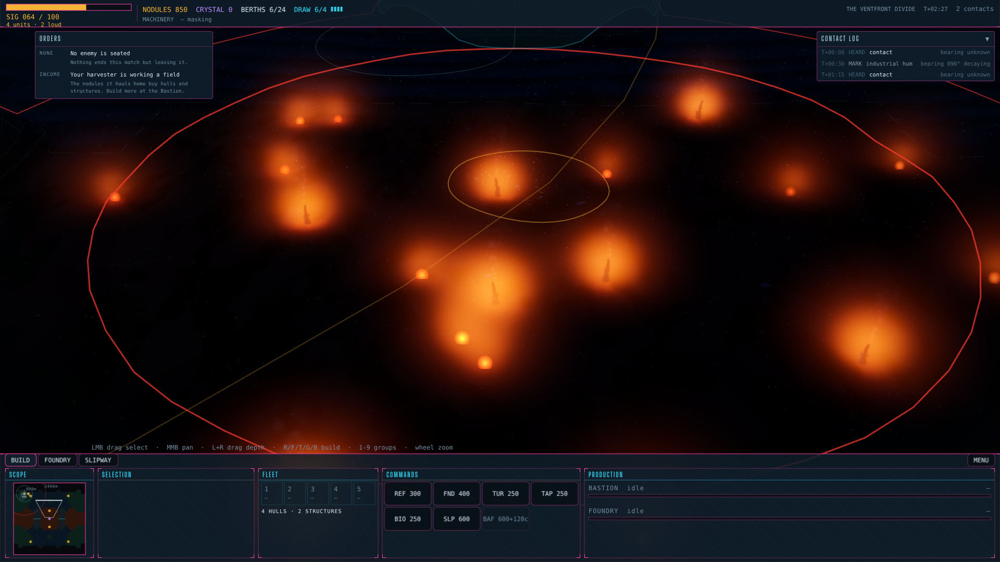
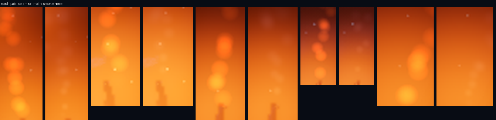

# Every map's vent steam as lit smoke at High (#1853)

The target frame for one increment at the High graphics quality, and the round's frames
beside it: every chimney a map stands breathes lit smoke at High, where the free-water
crater's stand did alone ([art-direction.md](../../art-direction.md#the-vents-at-work)).

**A software rasteriser drew every frame here**, the target among them: SwiftShader, in
headless Chromium, in the cloud container that built the step. They guide a round and are
not offered for acceptance. The frames the owner accepts against are taken on the named
GPU, with the commands under [Who captures](#who-captures).

## The target frame



The owner named this frame in session on 24 November 2026, as `dev-loop`'s "Look work"
asks: one reference image, committed with the camera it is judged at. #1837's critic had
overturned smoke on every map for want of a frame of a vent field, and this is that
frame. The owner saw the Ventfront Divide's middle vent field at High at four cameras,
Low's steam on top and the smoke below, and took two calls: the smoke as #1837 built it,
its numbers unmoved, and this camera. Naming it is not the look's acceptance.

| Frame | Camera |
| --- | --- |
| Field, the target | The Ventfront Divide (`?map=ventfront-divide`), the focus on the ground at plan 3950 / 3400, in the middle vent field; a 1,100 m dolly; `yawDeg` 0, north up; `pitchDeg` 35 |
| Home | `tools/render-stack/capture.mjs`'s home: the own force's centre, a 6,000 m dolly, pitch 55 |
| Close | A low eye across the same stacks: the Field's focus, a 900 m dolly, `yawDeg` −30, `pitchDeg` 12 |
| Survey | `capture.mjs`'s survey over the map's centre, 4000 / 4000: an 18,000 m dolly, pitch 88 |

**What transfers:** each stack stands in its own pool of amber, and a column of pale
puffs climbs out of the pool into dark water and thins. A column is matter in the lit
world, so the water, the bloom and the grade take it with everything else.

**What does not:** a column's brightness. The frame holds no hull, and the acoustic veil
drains a column no hull listens to, as it drains the steam. No beam crosses a column
here; [issue-1855](../issue-1855/README.md#a-beam-across-the-plume) holds that light over
the crater's stand.

## Reproduce

```bash
SETTINGS_JSON='{"reducedMotion":true,"reducedMotionChosen":true}' VIEW_W=1920 VIEW_H=1080 \
  node .claude/skills/run-game/scripts/drive.mjs --url 'http://localhost:5173/?map=ventfront-divide' \
  --out docs/screenshots/issue-1853/software --steps docs/screenshots/issue-1853/frames.mjs
python3 docs/screenshots/issue-1853/columns.py docs/screenshots/issue-1853/software
```

[frames.mjs](frames.mjs) takes Low and then High at the four cameras and writes
[readings.json](software/readings.json) after every frame. Reduced motion holds the
columns' clocks and the camera's sway. [software/main](software/main) holds `main` at
6e520464 through the same module, at Field and Close: Low twice and High once.
[columns.py](columns.py) reads the pairs in a box over each column.

## The frames beside the target

| Camera | Low | High | What High shows now |
| --- | --- | --- | --- |
| Field | [low](software/03-low-field.png) | [high](software/07-high-field.png) | The target's camera: the field's stacks in their pools, a faint pale column over each, clearest where it leaves the pool. On `main` the same stacks carry [strings of amber beads](software/main/07-high-field.png) |
| Close | [low](software/04-low-close.png) | [high](software/08-high-close.png) | The field side on. The stacks stand in a bank of amber, and a column shows as pale puffs over it against dark water. [`main`'s frame](software/main/08-high-close.png) has the beads |
| Home | [low](software/02-low-home.png) | [high](software/06-high-home.png) | No chimney stands in this frame, and nothing in it moved |
| Survey | [low](software/05-low-survey.png) | [high](software/09-high-survey.png) | The vent line as points of amber across the map. No column reads from 18 km, as steam on `main` or as smoke here |



Each pair is one box of the Field frame at four times life size: the steam on `main`,
then the smoke here. [columns-close.png](software/columns-close.png) is Close's.

The clip is [clip-home-to-field.mp4](software/clip-home-to-field.mp4): the camera moved
from Home to Field at High and held there, at 1280 × 720 and six times the speed the
rasteriser drew it. It is taken without reduced motion, so the columns climb.

## What is new in the frame

Read off `readings.json`, here against `main`:

| Camera | Low: calls, triangles | High on `main` | High here |
| --- | --- | --- | --- |
| Home | 70, 167,546 | 81, 200,436 | 81, 200,436 |
| Field | 34, 149,717 | 46, 182,891 | 46, 182,891 |
| Close | 33, 149,717 | 47, 182,891 | 46, 182,891 |
| Survey | 72, 168,114 | 82, 200,720 | 83, 200,720 |

No draw, triangle or pass more. At High the smoke's one `Points` stands where the
steam's one `Points` stood, and the passes are the 8 and 12 they were. The map stands 34
chimneys: 476 puffs of steam, 14 a column, become 1,020 of smoke, 30 a column. One call
comes and goes with the live match at Close and Survey, in both directions and at both
qualities: Low's Close read 34 and 34 on `main` and 33 here.

## Low does not move

A skirmish never frames alike twice. A contact's mark, the log, the fauna figures, the
embers' flicker and the veil all move with the match, and
[the Close map](software/low-control/diff-close-main-vs-branch.png) shows them and no
column. So Low is read where the change is: in a box over each column of the Field
frame, the mean of each pixel's largest channel difference, out of 255.

| Box over a column, Field | `main` against `main`, Low | `main` against these, Low | Steam against smoke, High |
| --- | --- | --- | --- |
| 570, 315 to 600, 395 | 0.02 | 0.03 | 8.83 |
| 935, 490 to 970, 560 | 0.04 | 0.08 | 4.99 |
| 1150, 430 to 1185, 510 | 0.00 | 0.01 | 7.09 |
| 1335, 140 to 1360, 195 | 0.03 | 0.07 | 8.98 |
| 1650, 590 to 1690, 660 | 0.01 | 0.03 | 5.44 |

Low's columns stand within 0.04 of the floor two takes of `main` set, and High's move by
5 to 9. At Close a contact's mark crossed the columns in these takes, so its boxes read
High alone: 5.61 to 10.55. `packages/frontend/test/tutorialLoading.test.mjs` holds the
count: over a Thermal Vein every stack breathes one column, the smoke at High and the
steam at Low, never both.

## Calls

- **The smoke as it stands, on every map.** The owner's, above. The other readings were
  the steam for good on every map but the crater, and holding the step until a field's
  own light is looked at.
- **The Field camera.** The owner's. Close, a 420 m eye and `capture.mjs`'s 1,800 m close
  were shown beside it.
- **The Ventfront Divide's middle field stands for every map.** One field of one map is
  framed. The other Thermal Veins have no frame.
- **No timing run from the named GPU.** "Look work" asks one of an increment that adds a
  pass or per-fragment work, and none of placement alone. This is taken as placement: the
  draw, its program and its counts are #1837's, stood on more chimneys. The other reading
  is that 1,020 puffs up to 24 m wide are more fragments than the crater's 60, which only
  the named GPU can price. The command is below, and gate 6's 8 ms is read at #1637's
  one run.

## Who captures

On the owner's desktop, the named GPU of
[graphics-standards.md](../../graphics-standards.md) gate 6, with the dev servers running
(`npm run dev`):

```bash
UNPACED=1 VIEW_W=1920 VIEW_H=1080 node .claude/skills/run-game/scripts/drive.mjs \
  --headed --channel msedge --url 'http://localhost:5173/?map=ventfront-divide' \
  --out docs/screenshots/issue-1853/gpu --steps docs/screenshots/issue-1853/frames.mjs
CLIP=1 RECORD_VIDEO=docs/screenshots/issue-1853/gpu VIEW_W=1920 VIEW_H=1080 \
  node .claude/skills/run-game/scripts/drive.mjs --headed --channel msedge \
  --url 'http://localhost:5173/?map=ventfront-divide' \
  --out docs/screenshots/issue-1853/gpu --steps docs/screenshots/issue-1853/frames.mjs
```

The first writes eight frames and `readings.json`, whose `queued` GPU time is gate 6's
reading. The second records the clip.

## Related

- [art-direction.md](../../art-direction.md#the-vents-at-work) — the smoke, and the calls
  taken
- [issue-1837](../issue-1837/README.md) — the crater's stand, where the smoke was built
- [The High slice's target frame](../issue-1799/README.md) — the crater's three cameras
- [graphics-standards.md](../../graphics-standards.md) — gate 6, the two graphics qualities
