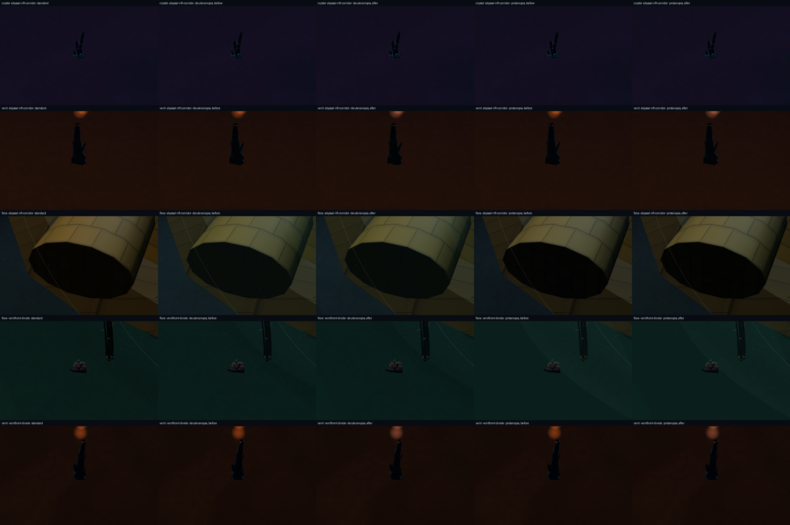
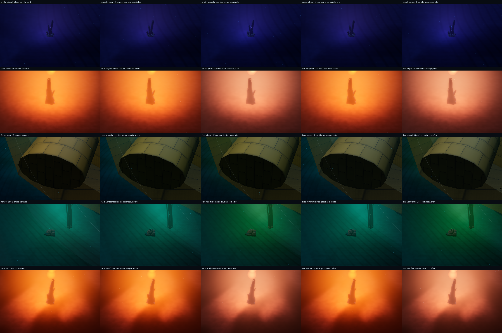
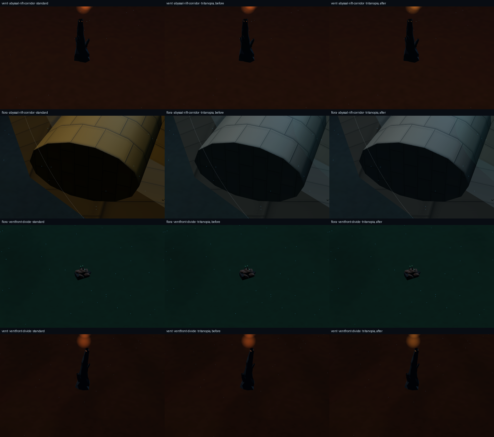
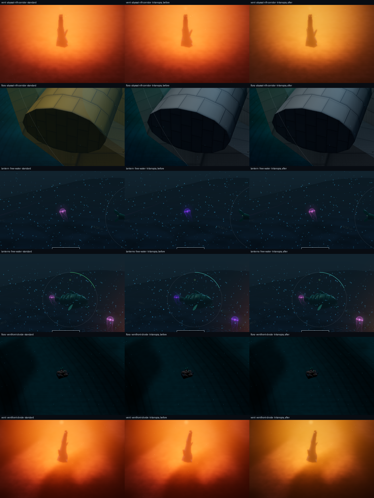

# World light in the colour-vision palettes (#1854)

Frames for [style-neon-noir.md](../../style-neon-noir.md#rule-5-in-the-colour-vision-palettes):
each world-light family a skirmish map stands, close, in the standard, deuteranopia and
protanopia palettes, before the change and after it. Tritanopia's two tokens and its lantern
follow, in a section of their own.

**A software rasteriser drew every frame here**: SwiftShader, in headless Chromium, in the
cloud container that built the change. They guide a round and are not offered for
acceptance. The owner read the four new tokens as an ember, a biolight, a seam and a
trace on 24 November 2026.

## The sheets

A row is a family on a map. The columns are the standard palette, then deuteranopia
before and after, then protanopia before and after. Each cell is the middle 560 by 350
pixels of a 1440 by 900 frame, taken from 150 m.



At Low a world light is a point or a seam (rule 1), so what moves is small: the steam
over a chimney's mouth, the ember beside it and the tip of a coral growth. The Abyssal
Rift's biolight stands under a hull of the own base, and its row shows that hull.



At High the same tokens pool on the ground and scatter in the water, so the change fills
the frame: the vent's light goes from orange to a dusty terracotta, the biolight from teal
to a leaf green, and the seam a shade bluer.

## What the frames hold

- **The standard palette does not move.** [control.json](software/control.json) compares
  the standard column before and after, cell by cell. The most pixels that differ by more
  than 8 in a channel is 113 of 196,000, over the crystal, the same count at both
  qualities. They lie scattered across the whole cell in 38 separate places, a few pixels
  each, which is how two sessions' drifting motes differ and not how a light would.
- **A palette changed mid-match is followed.** [frames.mjs](frames.mjs) writes the palette
  and the quality through the settings store with no reload, and reads back what the view
  draws before each frame. So every deuteranopia and protanopia cell is a ground that
  stood in another palette a moment before.
- **An ember only half follows at Low in these frames.** A dressing rebuild left the old
  ember cloud in the scene, and a stale cloud kept the palette it was last written in. The
  steam, the props, High's pools and its smoke follow whole. The fix came after these frames
  ([#1906](https://github.com/gunnargehtab/Echoes-of-the-Abyss/issues/1906),
  [its frames](../issue-1906/README.md)): one cloud, which follows a change whole.
- **No frame shows ore or a lamp.** `ore-trace` moves by 8.7 dE to a normal eye and stands
  on fields the room places; `civic-lamp` does not move in any palette.

## Tritanopia: the ember, the biolight and the lantern

Tritanopia's `vent-ember`, `flora-biolight` and `jelly-lantern` moved on 25 November 2026
(#1854, #1913). A row is a family on a map, or a drifting jelly in the free-water crater;
the columns are the standard palette, then tritanopia before and after. A software
rasteriser drew these too, and the owner's glance at them is still owed.





- **The ember goes from orange to a yellower orange.** At High its light fills the cell; at Low it
  is the steam over the chimney's mouth and the two points at its lip.
- **The lantern goes from a violet to the standard orchid, a shade pinker.** The crater's
  two rows are High's alone: Low draws no lantern. The second row holds two lanterns
  beside a staged hull and its ring.
- **The biolight barely moves, and that is the finding.** Its token moves 5.7 dE to a
  normal eye and 3.0 to a tritanope: no green stands further from that palette's inks
  ([style-neon-noir.md](../../style-neon-noir.md#rule-5-in-the-colour-vision-palettes)).
  The Ventfront Divide's row is a coral growth 806 m from the base. Over the nearest kelp
  bed, 309 m out, the HUD heard one contact in one run and four in the next, and a ring
  crossed the frame, so it is no control. The Abyssal Rift's biolight stands under a hull of the own base, as above.
- **The standard palette does not move.**
  [control-tritanopia.json](software/control-tritanopia.json) compares the standard
  column before and after. Over the families the most pixels that differ by more than 8
  in a channel is 14 of 196,000. Over the crater it is 208, in the snow that drifts
  between two sessions.

The before set is the same module against servers with `palette.ts` at the base commit,
513ee456. Each set is three runs:

```bash
export SETTINGS_JSON='{"reducedMotion":true,"reducedMotionChosen":true}'
PALETTES=standard,tritanopia node .claude/skills/run-game/scripts/drive.mjs \
  --url 'http://localhost:5173/?study=free-water' \
  --out /tmp/issue-1854/before/free-water --steps docs/screenshots/issue-1854/frames.mjs
CLEAR_M=800 PALETTES=standard,tritanopia FAMILIES=vent,flora \
  node .claude/skills/run-game/scripts/drive.mjs \
  --url 'http://localhost:5173/?map=ventfront-divide' \
  --out /tmp/issue-1854/before/ventfront-divide --steps docs/screenshots/issue-1854/frames.mjs
```

The third is the second against `?map=abyssal-rift-corridor`, with no `CLEAR_M`. The after
set's Ventfront Divide run takes `POSES_FROM=/tmp/issue-1854/before/ventfront-divide/readings.json`
in place of `CLEAR_M` and `FAMILIES`, so both sets frame one site. Then `sheet.py <before>
<after> docs/screenshots/issue-1854/software tritanopia` lays the two sheets.

## Reproduce

```bash
SETTINGS_JSON='{"reducedMotion":true,"reducedMotionChosen":true}' \
  node .claude/skills/run-game/scripts/drive.mjs \
  --url 'http://localhost:5173/?map=ventfront-divide' \
  --out /tmp/issue-1854/after/ventfront-divide --steps docs/screenshots/issue-1854/frames.mjs
```

The same against `?map=abyssal-rift-corridor`, the one skirmish map that stands a crystal.
The before set is the same module against servers started at the base commit, 4f6a48b2,
which has #1853's lit smoke over every chimney at High.
Then `python3 docs/screenshots/issue-1854/sheet.py <before> <after> docs/screenshots/issue-1854/software`
lays the two beside each other. [sites.json](sites.json) is every licensed prop the
default placement stands on the two maps, by family.

## Related

[style-neon-noir.md](../../style-neon-noir.md) · [ui-ux.md](../../ui-ux.md) ·
[graphics-standards.md](../../graphics-standards.md) · [issue-1837](../issue-1837/README.md)
