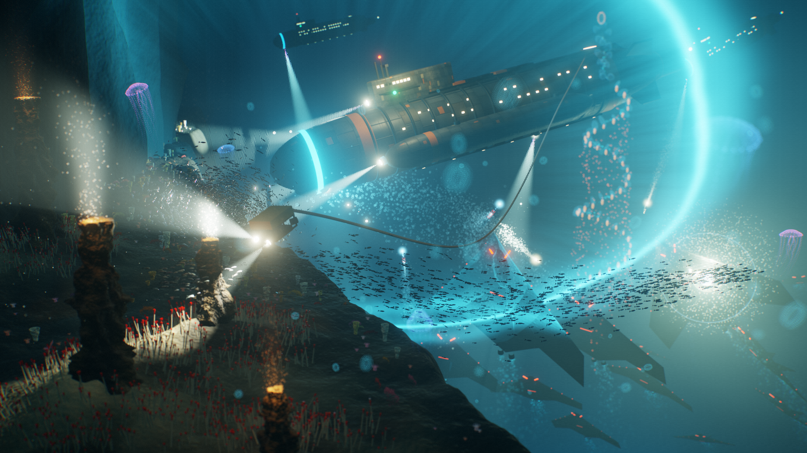
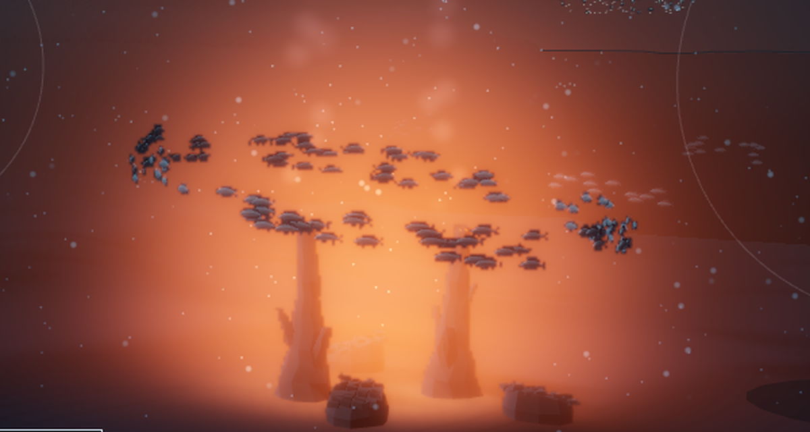

# A dark school before the vent's light (#1856)

Frames for one placement at the High graphics quality: a third stream in the free-water
crater, of outer fish, between the Close eye and the vent stand's light
([free-water-slice.md](../../free-water-slice.md) §5, "A school before the vent's light").
They stand beside [the target frame](../issue-1799/README.md) at its three cameras, with
the HUD on. [issue-1837](../issue-1837/README.md) listed this under "Ideas offered, not
built": the target's schools are dark masses against lit water, and the crater's were
points of light against dark water.

**A software rasteriser drew every frame here**: SwiftShader, in headless Chromium, in the
cloud container that built the step. They guide a round and are not offered for
acceptance. The frames the owner accepts against are taken on the named GPU, with the
commands under [Who captures](#who-captures).

## Reproduce

```bash
SETTINGS_JSON='{"reducedMotion":true,"reducedMotionChosen":true}' VIEW_W=1920 VIEW_H=1080 \
  node .claude/skills/run-game/scripts/drive.mjs --url 'http://localhost:5173/?study=free-water' \
  --out docs/screenshots/issue-1856/software --steps docs/screenshots/issue-1837/frames.mjs
```

[frames.mjs](../issue-1837/frames.mjs) is #1837's module, unchanged: Low and then High at
the target's three cameras, at gate 6's low camera and at the garden close, with
[readings.json](software/readings.json) written after every frame. Reduced motion holds
every body at its loop's start, so two runs frame alike.

## The frames beside the target



| Camera | Low | High | What High shows now |
| --- | --- | --- | --- |
| Home | [low](software/01-low-home.png) | [high](software/06-high-home.png) | The mill as a ring of dark dashes 135 px across, left of the stand, on the rim's ground at the edge of the stand's pool. Its eye is 760 to 825 m off, so a body draws 7 to 8 px and the ring is found by looking. Its lower right arc lies under the NAV and HOME control. Nothing else moved |
| Close | [low](software/02-low-close.png) | [high](software/07-high-close.png) | The mill before the stand's light, 265 to 338 m off: a ring of 120 bodies, each 18 to 22 px long, leaning down to the right, 380 px across and 105 tall. Two of its four schools are ribbons seen broadside, the near one across the chimneys' tops and the far one over them. The other two are the ring's ends, seen end on as knots. It stands between the Light Scout's ring and the Corvette's and reaches neither: at least 64 px clear of the first and 25 of the second, all lap long. Nothing else moved |
| Survey | [low](software/04-low-survey.png) | [high](software/09-high-survey.png) | Unchanged to the pixel: no body draws from 10 km |



The Close frame's stand, at twice its size ([crop.py](crop.py)).

The clip is [clip-home-to-close.mp4](software/clip-home-to-close.mp4): the camera moved
from Home to Close at High and held there, at 1280 × 720 and six times the speed the
rasteriser drew it, so the mill turns six times as fast as it does. It is taken without
reduced motion, and spans 190 s of the match, a lap and a quarter of the mill. The hold
at Close is its last 30 s.

## How dark a body reads

[crop.py](crop.py) reads the Close frame against [#1837's](../issue-1837/software/07-high-close.png),
which holds the same water without the mill. A body is a pixel of the mill's box at least
20 of 255 darker than the water it covers.

| What | Luma, of 255 |
| --- | --- |
| The water a body covers, at its median | 156 |
| A body, at its median | 99 |
| A body, at its darkest | 21 |

So a body reads at 0.65 of the water behind it, over 7,430 px, 12.9% of the box. Marine
snow that left the box since #1837's frame reads as body too; 125 px brightened by as
much, which is the size of that error.

It is a dark body and not the target's. The target's fish are near black on bright teal,
and number in the hundreds. Here the flank a body shows still takes the shared rig, the
Lid's glow and a quarter of the stand's pool, at the cladding's register, `LIFE.ALBEDO`
([art-direction.md](../../art-direction.md#life-in-the-worlds-light)), none of which
this placement touches. Whether 0.65 reads as a silhouette on the named GPU is the
owner's glance.

## What is new in the frame

Read off `readings.json` against [#1837's](../issue-1837/software/readings.json).

| Camera | High before: calls, triangles | High now | Outer fish before, now |
| --- | --- | --- | --- |
| Home | 63, 719,680 | 63, 760,720 | 64, 184 |
| Close | 63, 719,680 | 63, 760,720 | 64, 184 |
| Low | 44, 712,349 | 44, 753,389 | 64, 184 |
| Survey | 63, 720,318 | 63, 761,358 | 64, 184 |

No draw more, and 41,040 triangles: 120 outer fish of 342, in the draws High's outer fish
already take. The twelve passes, the 72 world sources, the 624 fry lights and the 1,655
lantern points are #1837's. Against #1837's own High frames, read as
[issue-1801](../issue-1801/README.md#low-does-not-move) reads a pair, Home differs by
0.13, Close by 0.70, Low by 0.22, Garden close by 0.21 and Survey by 0.00: the mill at
Home and Close, and marine snow. Gate 6's 8 ms is read on the named GPU.

## Low does not move

These Low frames against [#1837's](../issue-1837/README.md#low-does-not-move), taken on
the branch that is now `main`: the mean, over the world area, of each pixel's largest channel difference, out
of 255 ([diff.py](../issue-1801/low-control/diff.py)).

| Camera | #1837's Low against these | `main` against `main`, from #1837 | Calls and triangles |
| --- | --- | --- | --- |
| Home | 0.11 | 0.24 | 44 and 593,684, both |
| Close | 0.24 | 0.41 | 44 and 593,684, both |
| Low | 0.22 | 0.47 | 26 and 587,001, both |
| Survey | 0.00 | 0.00 | 45 and 594,970, both |
| Garden close | 0.21 | 0.35 | 31 and 591,001, both |

Each reading is under the floor two takes of `main` set.
[The Close map](software/low-control/diff-close-1837-vs-branch.png) is marine snow and
nothing else, and the other four lie beside it. In counted work
`packages/frontend/test/freeWaterDecoration.test.ts` holds Low's list unmoved under High's
and no slot of the mill in it.

## Calls taken with these frames

Five, each the owner's to overturn. The first is written with its other readings in
[art-direction.md](../../art-direction.md#life-in-the-worlds-light), and the second and
third in [free-water-slice.md](../../free-water-slice.md) §5.

- **A third stream, of outer fish.** The issue's recommendation, against moving the rim's
  outer stream and against dimming a backlit fry's light.
- **A mill, wholly before the light.** A loop round the stand was the other reading. At a
  100 m radius a fifth of it lies before the light and within the 58 m of the eye's line
  that the whole mill keeps, so a mass of this size would cost five times the triangles.
  On a 34 m loop every body is backlit all lap long.
- **120 bodies, four schools of 30.** The target's schools are hundreds. This is what
  reads as a mass at 18 to 22 px a body, at 41,040 triangles.
- **Last in High's list.** Every slot #1837 stood keeps its index, so its frames do not
  move.
- **What High alone stands has no reservation of its own.**
  [free-water-slice.md](../../free-water-slice.md) §7 reserves 600,000 triangles for
  props and life, and its test sums Low's list. High's own life and vents are counted
  against the frame's cap alone.

One was put to the owner and answered in session on 20 November 2026.
[free-water-slice.md](../../free-water-slice.md) §7 capped the study's frame at 720,000
triangles, and #1837's Survey frame already stood at 720,318. **High's cap is 900,000**,
written into §7 and gate 6's carve-out; Low keeps 720,000. High's frames here stand at
753,389 to 761,358.

## Who captures

On the owner's desktop, the named GPU of
[graphics-standards.md](../../graphics-standards.md) gate 6, with the dev servers running
(`npm run dev`):

```bash
UNPACED=1 VIEW_W=1920 VIEW_H=1080 node .claude/skills/run-game/scripts/drive.mjs \
  --headed --channel msedge --url 'http://localhost:5173/?study=free-water' \
  --out docs/screenshots/issue-1856/gpu --steps docs/screenshots/issue-1837/frames.mjs
CLIP=1 RECORD_VIDEO=docs/screenshots/issue-1856/gpu VIEW_W=1920 VIEW_H=1080 \
  node .claude/skills/run-game/scripts/drive.mjs --headed --channel msedge \
  --url 'http://localhost:5173/?study=free-water' \
  --out docs/screenshots/issue-1856/gpu --steps docs/screenshots/issue-1837/frames.mjs
```

The first writes ten frames and `readings.json`, whose `queued` GPU time at the four
cameras is gate 6's reading. The second records the clip. Neither sets reduced motion, so
the mill turns: a lap takes 150 s, and every body stays before the stand's light all lap
long.

## Related

- [The target frame](../issue-1799/README.md) — the cameras, and who captures
- [issue-1837](../issue-1837/README.md) — the step this placement adds to
- [free-water-slice.md](../../free-water-slice.md) — §5, High's own life
- [art-direction.md](../../art-direction.md#life-in-the-worlds-light) — the call, and its
  other readings
