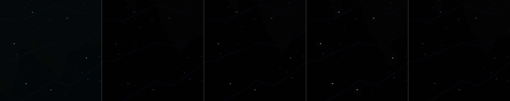
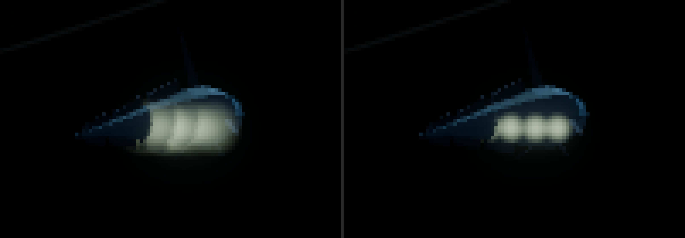

# The deep fish's photophores as world light (#1857)

Frames for one move at the High graphics quality: the six photophore seats a deep fish's
file marks are points of the world pass there, in the fry's `life-glint`, and no dot of
the stipple channel stands on one
([art-direction.md](../../art-direction.md#life-in-the-worlds-light)). Low keeps its dots.
[issue-1837](../issue-1837/README.md) left them the stipple's "until a step moves them".
The frames stand beside [the target frame](../issue-1799/README.md) at its three cameras,
with the HUD on, and at the eyes the move is read from: gate 6's low camera, the garden
close, one in the deep fish's pocket, and one flown nearer in NAV's flight.

**A software rasteriser drew every frame here**: SwiftShader, in headless Chromium, in the
cloud container that built the step. They guide a round and are not offered for
acceptance. The frames the owner accepts against are taken on the named GPU, with the
commands under [Who captures](#who-captures).

## Reproduce

```bash
SETTINGS_JSON='{"reducedMotion":true,"reducedMotionChosen":true}' VIEW_W=1920 VIEW_H=1080 \
  node .claude/skills/run-game/scripts/drive.mjs --url 'http://localhost:5173/?study=free-water' \
  --out docs/screenshots/issue-1857/software --steps docs/screenshots/issue-1837/frames.mjs
SETTINGS_JSON='{"reducedMotion":true,"reducedMotionChosen":true}' VIEW_W=1920 VIEW_H=1080 \
  node .claude/skills/run-game/scripts/drive.mjs --url 'http://localhost:5173/?study=free-water' \
  --out docs/screenshots/issue-1857/software/pocket --steps docs/screenshots/issue-1857/pocket.mjs
```

[frames.mjs](../issue-1837/frames.mjs) is #1837's module, unchanged: Low and then High at
the target's three cameras, at gate 6's low camera and at the garden close. This
container's rasteriser took longer than Playwright's 30 s to hand over a High frame at
Home, so the High five are a second run of the same module, `QUALITY=high`, with that
limit raised to 240 s, and `readings.json` holds both runs.
[pocket.mjs](pocket.mjs) is new, for the one eye those cameras have not got: 250 m from
the middle ring of six along the pocket's north edge, looking north at the deep fish's
2,000 m. 250 m is the least the orbit's dolly stands from its focus, and the focus here
is the ring. It is not the nearest an eye comes to a fish: an orbit focused past a ring
can stand nearer one, and so does NAV's flight. No frame is taken between the two eyes
here. The module's last frame is the eye flown forward from the pocket eye until the
probe reports it within 50 m of the ring's centre. Reduced motion holds every body at its
loop's start, so two runs frame alike, but where the flight stops is read and not timed,
and it stopped 30 m from the centre in both takes here. The Low five were taken before
the owner's second call changed a seat's light, which Low does not draw.

## The frames beside the target


| Camera | Low | High | What High shows now |
| --- | --- | --- | --- |
| Home | [low](software/01-low-home.png) | [high](software/06-high-home.png) | Nothing moved: no deep fish is in the frame |
| Close | [low](software/02-low-close.png) | [high](software/07-high-close.png) | Nothing moved |
| Survey | [low](software/04-low-survey.png) | [high](software/09-high-survey.png) | 22 pixels of the world area moved, 20 of them by more than 2, and no other: the pinpricks the stipple laid over the pocket, along its north edge and among #1713's patches, are gone. From 10 km no seat's light reaches the eye. The match clock in the top strip moved too |
| Low, gate 6's | [low](software/03-low-low.png) | [high](software/08-high-low.png) | The three rings of white pinpricks Low draws into the pocket are gone. The eye is 2 km from them, and the water takes a seat's light on the way. The pocket is dark |
| Garden close | [low](software/05-low-garden.png) | [high](software/10-high-garden.png) | Nothing moved: no deep fish swims in the garden, and the fry's lights are #1837's |
| Pocket | [low](software/pocket/01-low-pocket.png) | [high](software/pocket/02-high-pocket.png) | Six fish 250 m off, each a dark body 12 px long with a pale point on its flank, where Low draws the stipple's dots in the fauna colour |
| Flight | not taken | [high](software/pocket/03-high-flight.png) | One fish about 60 m off, by its 50 px: three points of light apart on its fore flank, on a dark body |



The ring at four times its size ([seats.py](seats.py)): Low's dots, then High at a fry's
point, at 0.4 m at 0.3, at 0.5 m at 0.4, and as built. Only the last is built.



One fish from the flight eye at twelve times its size: the owner's first call, 0.4 m at a
fry's level, and the second, which is built. The seats of a flank stand 0.22 to 0.24 m
apart (`tools/hull-models/props/deep-fish.mjs`, at 0.25, 0.36 and 0.48 of a 2 m body), so
0.4 m discs merge into one lit patch and 0.22 m discs stand apart.

## How a deep fish reads

[seats.py](seats.py) reads the peak of each of the ring's six fish from the pocket eye,
as luma of 255. The lamps are [#1837's readings](../issue-1837/README.md), at Close.

| What | Peak, of 255: the least, the median pair, the most |
| --- | --- |
| Low: the stipple's dots | 133, 158 and 164, 236 |
| High, a fry's point: 0.22 m at 0.3 | 71, 74 and 75, 111 |
| High, the first call: 0.4 m at 0.3 | 108, 123 and 125, 161 |
| High, 0.5 m at 0.4 | 150, 159 and 160, 195 |
| **High, as built: 0.22 m at 0.6** | 102, 107 and 114, 162 |
| The Corvette's lamp, SIG 28 | 165 |
| A dense school of fry, where its lights overlap | 160 |
| The Light Scout's lamp, SIG 6 | 130 |
| The water between the fish | 1 at High, 6 at Low |

The three readings not built were captured on the same tree with
`HIGH_GRAPHICS.LIFE.GLOW.SEAT` set to each, and are kept as their crops above and no
frame. A light 0.22 m wide is under the 1.6 px floor at 250 m, so its level is cut by the
area the floor adds: the built light reads there as a fry's point at twice the level.
The brightest fish of the six shows its flank broadside.

From the flight eye, read with `seats.py --near 270,355,370,425`:

| What | One fish's peak, of 255 | Its pixels over the Corvette's lamp |
| --- | --- | --- |
| The first call: 0.4 m at 0.3 | 186 | 29 |
| **As built: 0.22 m at 0.6** | 184 | 31 |

Both stand over the Corvette's lamp from there. Whether a deep fish's points muddy gate
3's reading of a hull ordered down beside it is the owner's glance
([art-direction.md](../../art-direction.md#life-in-the-worlds-light)).

From gate 6's low camera the rings are gone under every reading. At the pixels of Low's
46 brightest dots there, taking the brightest of each one's nine, the median luma is 255
at Low and 14 as built. A fry's point read 14 too, 0.4 m at 0.3 read 16 and 0.5 m at
0.4 read 22: what is left is marine snow.

## What is new in the frame

Calls and triangles are read off `readings.json` against
[#1867's](../issue-1867/software/readings.json), which is `main`. The dots and the seat
lights are the crater's, one count whatever the camera:
[pocket/readings.json](software/pocket/readings.json) records both at each quality. The
module of #1837, which took the other five cameras, records neither.

| Camera | High before: calls, triangles | High now | Stipple dots before, now | Seat lights before, now |
| --- | --- | --- | --- | --- |
| Home | 66, 763,409 | 65, 763,409 | 156, 0 | 0, 156 |
| Close | 66, 763,409 | 65, 763,409 | 156, 0 | 0, 156 |
| Low | 47, 756,078 | 46, 756,078 | 156, 0 | 0, 156 |
| Survey | 66, 764,047 | 65, 764,047 | 156, 0 | 0, 156 |
| Garden close | 53, 760,726 | 52, 760,726 | 156, 0 | 0, 156 |
| Pocket | not taken | 44, 755,430 | 156, 0 | 0, 156 |
| Flight | not taken | 44, 755,430 | 156, 0 | 0, 156 |

One draw fewer and no triangle more. The 156 lights are points of the fry's cloud, one
draw already, and the stipple cloud with no dot to draw submits none. The eight or
twelve passes, the 72 world sources, the 624 fry lights and the 1,655 lantern points are
`main`'s. 156 dots before is what `packages/frontend/test/tutorialLoading.test.mjs`
counted on `main` at both qualities, and what the pocket's Low frame reports.

Against #1867's own High frames, read as
[issue-1801](../issue-1801/README.md#low-does-not-move) reads a pair, Home and Low differ
by 0.01 and Close, Garden close and Survey by 0.00. This take's snow fell where #1867's
did, as a take's sometimes does ([issue-1837](../issue-1837/README.md#low-does-not-move)),
and what is left is the rings at Low and 22 pixels at Survey. The first take of these
five, at the owner's first call, read 0.14, 0.28, 0.28, 0.25 and 0.00.

The move adds no pass and no per-fragment work, so it is placement, and no timing run
from the named GPU is owed with it (`dev-loop`, "Look work"). Gate 6's 8 ms is read on
the named GPU with the rest of #1637.

## Low does not move

These Low frames against [#1867's](../issue-1867/README.md), which is `main`: the mean,
over the world area, of each pixel's largest channel difference, out of 255
([diff.py](../issue-1801/low-control/diff.py)).

| Camera | #1867's Low against these | `main` against `main`, from #1837 | Calls and triangles |
| --- | --- | --- | --- |
| Home | 0.08 | 0.24 | 44 and 593,684, both |
| Close | 0.18 | 0.41 | 44 and 593,684, both |
| Low | 0.16 | 0.47 | 26 and 587,001, both |
| Survey | 0.00 | 0.00 | 45 and 594,970, both |
| Garden close | 0.16 | 0.35 | 31 and 591,001, both |
| Pocket | 0.08, against `main` taken for it | 0.06, the branch against the branch | 23 and 585,705, both |

Each reading is at or under the floor two takes of one tree set, but the pocket's,
which stands 0.02 over its own floor: the snow of a later take. No frame of `main` existed at
the pocket eye, so `main`'s own files were checked out over the branch's seven under
`packages/` and [pocket.mjs](pocket.mjs) run with `QUALITY=low`: it reports the same 156
dots, and [seats.py](seats.py) reads the same six peaks off it, 133 to 236.
[The pocket's map](software/pocket/diff-low-main-vs-branch.png) is marine snow and
nothing else. In counted work `packages/frontend/test/tutorialLoading.test.mjs` holds
Low's dots, and no light, before High is drawn and after it.

## The clip

[clip-low-to-pocket.mp4](software/clip-low-to-pocket.mp4): the camera moved at High from
gate 6's low eye down to the pocket eye and held there. It opens on the pocket seen from
2 km, dark, with no ring in it. The move is its first 18 s, at forty times the speed the
rasteriser drew it, and the six fish come up out of the dark in its last second. The
hold is its last 7 s, at five times that speed: six pale points 250 m off, each swimming
its ring. It is the middle 1280 × 720 of a 1920 × 1080 recording, so a pixel is a pixel
of the frames above. It is taken without reduced motion and spans 769 s of the match,
three laps and a fifth of the ring.

The target's Home-to-Close clip is not retaken: no deep fish is in either frame, and
both read as #1867's.

## Calls taken with these frames

- **`life-glint`, the fry's token.** The issue's recommendation, against a token of its
  own and against leaving the seats the stipple's.
- **A seat lit wider than a fry's point, and not left the stipple's.** The owner's first
  call, in session on 21 November 2026, on the frames from 250 m: 0.4 m at a fry's level.
- **The low camera's rings go dark at High.** The owner's, with that call: no reading
  kept them, and Low's frame keeps its rings.
- **Three points: a fry's width at twice its level.** The owner's second call, the same
  day, on the flight frame, which overturned the first. Against keeping 0.4 m, and
  against three points held under the Corvette's lamp at about 0.45.
- **A seat's light is lifted as a fry's is**, 0.15 m toward the eye. The body is 0.20,
  0.16 and 0.12 m wide at its three seats, so from abeam the far flank's aft light comes
  about 1 cm clear of the near flank and adds to the near aft seat's. The round's critic
  measured it off the file. A lift of a seat's own would hide it and was not built here:
  it would change these frames. [issue-1876](../issue-1876/README.md) builds it.
- **One cloud.** A seat's light is a point of the fry's cloud at a level of its own, so
  the move adds no draw.

## Who captures

On the owner's desktop, the named GPU of
[graphics-standards.md](../../graphics-standards.md) gate 6, with the dev servers running
(`npm run dev`):

```bash
UNPACED=1 VIEW_W=1920 VIEW_H=1080 node .claude/skills/run-game/scripts/drive.mjs \
  --headed --channel msedge --url 'http://localhost:5173/?study=free-water' \
  --out docs/screenshots/issue-1857/gpu --steps docs/screenshots/issue-1837/frames.mjs
VIEW_W=1920 VIEW_H=1080 node .claude/skills/run-game/scripts/drive.mjs \
  --headed --channel msedge --url 'http://localhost:5173/?study=free-water' \
  --out docs/screenshots/issue-1857/gpu/pocket --steps docs/screenshots/issue-1857/pocket.mjs
CLIP=1 RECORD_VIDEO=docs/screenshots/issue-1857/gpu VIEW_W=1920 VIEW_H=1080 \
  node .claude/skills/run-game/scripts/drive.mjs --headed --channel msedge \
  --url 'http://localhost:5173/?study=free-water' \
  --out docs/screenshots/issue-1857/gpu --steps docs/screenshots/issue-1857/pocket.mjs
```

The first writes ten frames and `readings.json`. The second writes the pocket's three,
the flight frame among them. The third records the clip. None sets reduced motion, so the fish swim: a lap of a ring takes
240 s.

## Related

- [The target frame](../issue-1799/README.md) — the cameras, and who captures
- [issue-1837](../issue-1837/README.md) — the step this move adds to
- [free-water-slice.md](../../free-water-slice.md) — §5, the deep fish and its seats
- [art-direction.md](../../art-direction.md#life-in-the-worlds-light) — the call, and its
  other readings
