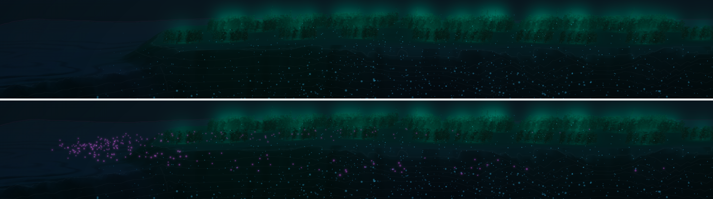
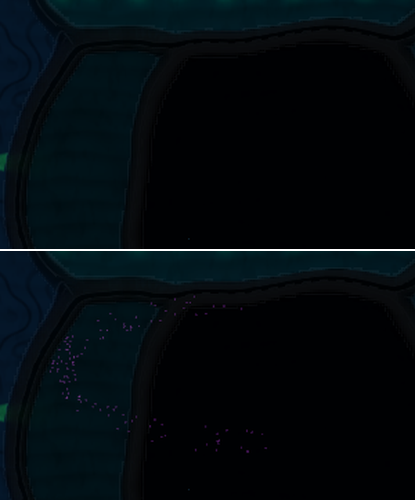
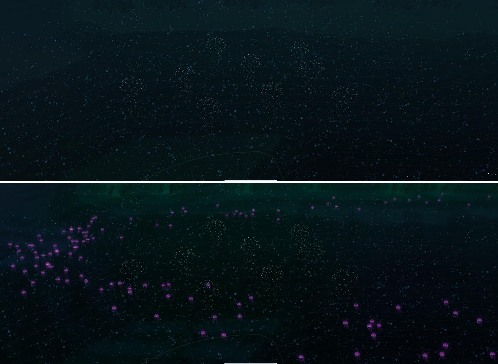
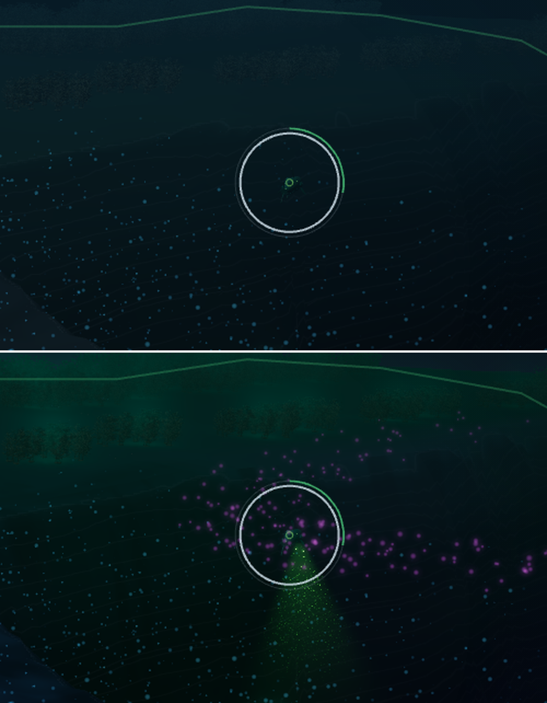

# A far bloom of lanterns over the bowl (#1859)

Frames for one increment at the High graphics quality: a river of 120 lanterns far out
over the free-water crater's bowl, each a whole `env-drift-jelly`
([art-direction.md](../../art-direction.md#a-far-bloom-of-lanterns);
[free-water-slice.md](../../free-water-slice.md) §5, "A far bloom over the bowl"). They
stand beside [the target frame](../issue-1799/README.md) at its three cameras, with the
HUD on. [issue-1837](../issue-1837/README.md) listed this under "Ideas offered, not
built": from Home the bowl beyond the fleet was empty water.

**A software rasteriser drew every frame here**: SwiftShader, in headless Chromium, in the
cloud container that built the step. They guide a round and are not offered for
acceptance. The frames the owner accepts against are taken on the named GPU, with the
commands under [Who captures](#who-captures).

**This is the third cut.** The first drew a lantern as two points and no body. The owner
saw its software frames and took six calls in session on 22 November 2026; the second
cut built them, as a procession turning as one ring. The owner saw that cut's frames the
same day and asked that its movement be thought through as the ocean's currents and
turbulence, which is this cut: the river carried round the eddy over the bowl. All of it is
under [Calls](#calls). The earlier cuts' frames are in this folder's history, at
a2f4e7c9 and 2b397a00.

## Reproduce

```bash
SETTINGS_JSON='{"reducedMotion":true,"reducedMotionChosen":true}' VIEW_W=1920 VIEW_H=1080 \
  node .claude/skills/run-game/scripts/drive.mjs --url 'http://localhost:5173/?study=free-water' \
  --out docs/screenshots/issue-1859/software --steps docs/screenshots/issue-1859/frames.mjs
python3 docs/screenshots/issue-1859/bloom.py docs/screenshots/issue-1859/software
node --import tsx --import ./packages/frontend/test/support/viteAssets.mjs \
  docs/screenshots/issue-1859/river.mjs
node --import tsx --import ./packages/frontend/test/support/viteAssets.mjs \
  docs/screenshots/issue-1859/beads.mjs
```

[frames.mjs](frames.mjs) is #1837's module with one camera and the clip's move changed
and two staged pairs added. It takes Low and then High at the target's three cameras, at
gate 6's low camera, and 400 m from the river's west end in place of the garden close.
Then it stands a Tetherjelly field beside the river and takes it from two cameras, and
last it sends the Corvette out under the river and takes Home's camera again; each pair
at High and at Low. It writes [readings.json](software/readings.json) after every frame.
Reduced motion holds the river where the match's start stands it, so two runs frame
alike. [bloom.py](bloom.py) reads the High frames against
[main-high](software/main-high), the same cameras taken on `main` at ba9b6ba0 with the
module #1837 wrote, and writes the crops below. [river.mjs](river.mjs) prints, from the
river's own slots, what each camera holds. [beads.mjs](beads.mjs) times the writing of
the lanterns' beads.

## The frames beside the target


| Camera | Low | High | What High shows now |
| --- | --- | --- | --- |
| Home | [low](software/01-low-home.png) | [high](software/06-high-home.png) | The river in the water right of the fleet, under the garden's edge: 92 of its 120 lanterns, 1,316 to 2,453 m off, across the frame's last 480 px. Each is a small orchid bell 4 to 7 px across over a faint fall of strands. Its thick middle stands right of centre and its two sides run off east, the far one fading out against the garden's foot. No ring stands in the water it crosses. Nothing else moved |
| Close | [low](software/02-low-close.png) | [high](software/07-high-close.png) | A trace of it: a band of faint bells behind the mill, across the stand's light. This eye's water reaches 630 m and the river's nearest lantern is 992 m off, so 0.08 of its light is left at most. Nothing else moved |
| Survey | [low](software/04-low-survey.png) | [high](software/09-high-survey.png) | A C of points round the west side of the pocket, with a thinner trail over its north and south edges: each lantern a point of one or two pixels, 67 of 255 at the 99th percentile and 100 at most, where two land on one pixel. A bell is under a pixel from 10 km, and a lantern's 331 points land on the same two |

Two more, off the target's three:

| Camera | Low | High | What High shows now |
| --- | --- | --- | --- |
| Low | [low](software/03-low-low.png) | [high](software/08-high-low.png) | Gate 6's fourth camera, over the bowl, looking north: the whole river across the frame's left and middle, 1,288 to 1,993 m off, its west end a knot left of the garden and its sides thinning east across the pocket |
| River | [low](software/05-low-river.png) | [high](software/10-high-river.png) | 400 m from the river's west end, at the lanterns' own depth: what a lantern of it is from near. Translucent bells up to 26 px across, brightest at the lip, each over its strands of beads: the lanterns the fleet has, in a crowd |


Home's bowl at twice its size, `main` above and the step below.



Gate 6's low camera, `main` above and the step below.



Survey's bowl at four times its size, `main` above and the step below.
[bloom-close.png](software/bloom-close.png) is the Close frame's trace.

The clip is [clip-home-to-low.mp4](software/clip-home-to-low.mp4): the camera moved from
Home out over the bowl to gate 6's low camera at High and held there, at 1280 × 720 and
six times the speed the rasteriser drew it, so the river drifts six times as fast as it
does. It is taken without reduced motion, so the softer wave of light runs.
It spans 318 s of the match. The hold over the bowl is its last 15 s, a minute and a
half of the match, in which a lantern beside the stream is carried 51 m east and one
coming back 29 m west.

## How bright the river reads

[bloom.py](bloom.py) counts a pixel as the river's where the frame stands 8 or more of
255 over `main`'s in luma and is pink, inside the box [river.mjs](river.mjs) stands the
river in. The same test the other way round, `main` over the step, is its floor.

| Camera | Pixels of the river, and the floor | Luma at the median, the 99th percentile, the most |
| --- | --- | --- |
| Home | 2,346, 0 | 49, 98, 145 |
| Low | 2,426, 0 | 55, 109, 128 |
| Survey | 215, 0 | 41, 67, 100 |
| Close | 275, 24 | not read: the box also holds one of the five by the fleet |

On the same Home frame the four near lanterns clear of the stand peak at 125, 111, 160
and 130. So a far lantern's brightest pixel stands among the near four, and 99 pixels in
100 of the river stand under every one of them. The held frames show no wave, which adds
20% to a far lantern as it passes and 60% to a near one.
[issue-1837](../issue-1837/README.md#gate-3-gate-7-and-the-limits) read the lamps on its
Close frame: 165, 159 and 130.

## What is new in the frame

Read off `readings.json`, against `main` taken the same day with #1837's module.

| Camera | High on `main`: calls, triangles | High now | Jellies, and their points, before and now |
| --- | --- | --- | --- |
| Home | 65, 763,409 | 65, 834,689 | 5 and 1,655; 125 and 41,375 |
| Close | 65, 763,409 | 65, 834,689 | the same |
| Low | 46, 756,078 | 46, 827,358 | the same |
| Survey | 65, 764,047 | 65, 835,327 | the same |

No draw and no pass more, and 71,280 triangles: 120 lanterns of 594, in the two draws
the five already take, with 39,720 points in the lantern's cloud. The frame stands at up
to 835,327 of the crater's 900,000
([free-water-slice.md](../../free-water-slice.md) §7).

Two costs the counts above do not show.

**Writing the beads.** A lantern's 331 points are placed on the CPU every frame. Written
as #1837 wrote them that was 9.3 ms a frame for 125 jellies; it is 1.3 to 1.8 ms now, and
0.8 ms held under reduced motion, with every light the same to eleven places
([beads.mjs](beads.mjs), in Node on this container, and a stopwatch, not a budget).
`packages/frontend/test/jellyLight.test.ts` holds the work by counting it: 18 sines a
jelly a frame where there were 720.

**Fragments.** [river.mjs](river.mjs) sums the area of every point's disc, a point never
drawn narrower than its 1.6 px floor. The bells' own pixels are not in it: a bell is two
membranes, both sides, over the pixels the table's width gives.

| Camera | Fragments of the glow round the bells | Of the seats and beads | Share of a 1920 × 1080 frame | A bell's width |
| --- | --- | --- | --- | --- |
| Home | 14,995 | 61,042 | 3.7% | 3.6 to 6.8 px |
| Close | 29,098 | 75,639 | 5.1% | 4.1 to 9.0 px |
| Low | 15,952 | 79,621 | 4.6% | 4.5 to 6.9 px |
| Survey | 461 | 79,621 | 3.9% | 0.9 px |
| River, 400 m off | 150,785 | 76,125 | 10.9% | 5.9 to 25.9 px |

No pass and no per-fragment program is new: the river is more of a body #1837 drew, as
the school of #1856 was more of a fish. So this page carries no timing run of its own. Gate
6's 8 ms and the display's 16.7 ms interval are read on the named GPU, and the CPU's
share above is the one to watch there.

## Low does not move

`main` at ba9b6ba0 was taken twice with `QUALITY=low` and #1837's module, and read as
[issue-1801](../issue-1801/README.md#low-does-not-move) reads a pair: the mean, over the
world area, of each pixel's largest channel difference, out of 255
([diff.py](../issue-1801/low-control/diff.py)).

| Camera | `main` against `main` | `main`'s first take against these frames | `main`'s second take against these | Calls and triangles |
| --- | --- | --- | --- | --- |
| Home | 0.09 | 0.07 | 0.16 | 44 and 593,684, all |
| Close | 0.21 | 0.15 | 0.32 | 44 and 593,684, all |
| Low | 0.19 | 0.14 | 0.32 | 26 and 587,001, all |
| Survey | 0.00 | 0.00 | 0.00 | 45 and 594,970, all |

A take differs from a take by where the marine snow has drifted, and by nothing else.
These frames stand nearer `main`'s first take than its two takes stand to each other,
and farther from its second: [issue-1837](../issue-1837/README.md#low-does-not-move)
read 0.03 to 0.60 the same way over four takes of a Low path nothing had changed.
[The Close map](software/low-control/diff-close-main-vs-branch.png) is against the first
take, and is marine snow and nothing else; the other three lie beside it. The River, Field and Mark cameras are new with this page and have no take on
`main`. In counted work `packages/frontend/test/freeWaterDecoration.test.ts` holds Low's
list unmoved under High's, `packages/frontend/test/farBloom.test.ts` holds a circle's
heading the expression it was before an ellipse was a loop, and
`packages/frontend/test/tutorialLoading.test.mjs` holds no lantern in the layer at Low.

## A Tetherjelly field beside the river

The owner's call: before this merges, a field and a river in one frame. The crater's
simulation authors no field, so the study's own hook stands the client's figure of one
(`__freeWaterStudyField`, development builds under `?study=free-water` alone): the rim
and the nine bells a real field draws, at the species' Kelp Forest band, 250 m, centred
`(1,550, 1,930)` inside the river's loop by its west end. It is a figure and no field:
no server holds it, and it bends no sound. Of the river's 120, 23 hang inside its 250 m
rim in plan and 78 within 150 m outside it.

| Camera | Low: the field alone | High: the field and the river |
| --- | --- | --- |
| Field: an orbit looking north over it, 1,100 m off | [low](software/13-low-field.png) | [high](software/11-high-field.png) |
| Home | [low](software/14-low-field-home.png) | [high](software/12-high-field-home.png) |



The Field camera's crop, Low above and High below.
[bloom-field-home.png](software/bloom-field-home.png) is Home's. Read by
[bloom.py](bloom.py):

| What | Field camera | Home |
| --- | --- | --- |
| Pixels of the field's dots, off the Low frame | 1,129 | 448 |
| Those pixels' luma at the median: Low, High | 74, 69 | 71, 70 |
| Pink pixels in the crop: Low, High | 0, 5,172 | 0, 1,762 |
| Those pink pixels' luma at High: the median, the 99th percentile, the most | 61, 114, 153 | 55, 105, 145 |

What the pair shows on this rasteriser: the two do not look alike. A field's bell is a
figure in pale green dots about 56 px across from the Field camera, a lantern a lit
orchid body of 6 to 12 px. And the river is the louder of the two. A dot of the field
reads about 70 of 255 and is one pixel or two; a lantern's pixels read 61 at the median
and 114 at the 99th percentile, and there are four times as many of them in the crop.

The owner saw the second cut's pair in session on 22 November 2026 and ruled two things.
The bloom may go on a map that has fields. And the field is hard to identify even
without the lanterns, in the Low half of the pair: that is the field's own mark, on the
tactical layer, which this step does not touch, so it is filed apart as
[#1882](https://github.com/gunnargehtab/Echoes-of-the-Abyss/issues/1882) and not
changed here.

## Gate 7 and the limits

With the fleet at rest no mark is among the river's lanterns: at Home its nearest pixel
is more than 200 px from the Corvette's ring. The risk the issue names is a mark among
them, so the Mark frame stages one: the Corvette ordered to `(1,350, 1,800)` at its
300 m, picked and at rest, from Home's camera.

| Camera | Low | High |
| --- | --- | --- |
| Mark | [low](software/16-low-mark.png) | [high](software/15-high-mark.png) |



The crop at twice its size, Low above and High below. Read by [bloom.py](bloom.py):

| What | Low | High |
| --- | --- | --- |
| The ring: its radius, and the pixels of its stroke | 45 px, 358 | the same |
| Pink pixels inside the ring, of 5,261 | 0 | 563 |
| The ring's own pixels, luma at the median and the least | 184, 184 | 184, 183 |

A mark is the tactical pass's and is drawn over the world, so no lantern dims the ring:
its stroke reads at High what it reads at Low. What the river changes is what stands
round and inside the ring: 22 bells inside it and 1 across its stroke, by
[river.mjs](river.mjs), with the Corvette's own lamp among them. The owner looked at the
second cut's pair in session on 22 November 2026 against gate 7's three questions: the
ring is found straight away among the lanterns, its loudness arc reads as easily as with
none, and no lantern looks like a contact or a mark. That is a glance at a software
frame and no acceptance; the same module takes this frame on the named GPU. The Corvette
is not the hardest case: the Light Scout's ring is smaller and its loudness arc shorter,
SIG 6 against the Corvette's 28, and no frame stages it.

From Survey the river is a C of points, 67 of 255 at the 99th percentile.
[free-water-slice.md](../../free-water-slice.md) §7 asks that survey keep decoration
below tactical ink, and the ring's stroke reads 184. The owner saw the second cut's
Survey, which read 85 at most, and left it. This cut's reads 100 at its one brightest
pixel, where two lanterns land together.

Limits 2 to 4 hold by construction. The river is an authored list on an authored loop,
drawn once from the fixture's seed, the same for every client, and it drifts on the
match's clock alone. `jelly-lantern` is no faction's hue and no family's
([style-neon-noir.md](../../style-neon-noir.md#world-light--the-terrain-carve-outs)).
No colour-vision palette was captured: those run once, at promotion.

## Calls

The owner's, in session on 22 November 2026. Each is written with its other readings in
[art-direction.md](../../art-direction.md#a-far-bloom-of-lanterns).

On the first cut's software frames:

- **Whole lanterns**, in place of two points and no body.
- **120 of them**, against 30, 60 and 200.
- **On the ellipse along the bowl's north half**, against two circles.
- **In procession, clockwise**, against the other way round and against each on a small
  loop of its own.
- **A softer wave of light**, a third of a near lantern's, against none and against the
  whole one.
- **A Tetherjelly field staged beside it before it merges**, against a rule and against
  trusting hue and form.

On the second cut's:

- **The river from Home and from Survey stand as they are.**
- **A lantern of the river keeps its depth and leans its own way.** The author's call,
  left as it stood.
- **The bloom may go on a map that has fields.**
- **A mark reads among the lanterns**: yes, yes and no to gate 7's three questions.
- **Its movement is the ocean's, currents and turbulence.** This cut: the eddy.

None of those is acceptance, which waits on the named GPU's frames. The author's, taken
in the open, and the owner's to overturn:

- **The eddy itself**: the reading that the stream runs east over the garden and shears
  the slower water over the bowl clockwise, and that the loop closes, which nothing at
  the lanterns' depth makes it do.
- **The eddy's numbers**: the stream side 0.3 faster than the lap's pace and the far
  side as much slower, the far side 0.4 wider, and a wander of 8 to 20 m once in 10 to
  25 minutes.
- **This page carries no timing run.** The river is more of a body #1837 drew.
- **Where the staged field stands**: inside the river's loop by its west end, at 250 m.

## Who captures

On the owner's desktop, the named GPU of
[graphics-standards.md](../../graphics-standards.md) gate 6, with the dev servers running
(`npm run dev`):

```bash
UNPACED=1 VIEW_W=1920 VIEW_H=1080 node .claude/skills/run-game/scripts/drive.mjs \
  --headed --channel msedge --url 'http://localhost:5173/?study=free-water' \
  --out docs/screenshots/issue-1859/gpu --steps docs/screenshots/issue-1859/frames.mjs
CLIP=1 CLIP_HOLD_MS=20000 RECORD_VIDEO=docs/screenshots/issue-1859/gpu VIEW_W=1920 VIEW_H=1080 \
  node .claude/skills/run-game/scripts/drive.mjs --headed --channel msedge \
  --url 'http://localhost:5173/?study=free-water' \
  --out docs/screenshots/issue-1859/gpu --steps docs/screenshots/issue-1859/frames.mjs
```

The first writes sixteen frames and `readings.json`, whose `queued` GPU time at each
camera is gate 6's reading. Its last six are the Field pairs and then the Mark pair,
after the Corvette's run out under the river, which takes about a minute. The second
records the clip and prints where the move starts and ends in it. Neither sets reduced
motion, so the river stands where the match's clock has carried it: it drifts 0.57 m/s
at its fastest, beside the stream, 34 m in a minute.

## Related

- [The target frame](../issue-1799/README.md) — the cameras, and who captures
- [issue-1837](../issue-1837/README.md) — the five lanterns, and where this was offered
- [art-direction.md](../../art-direction.md#a-far-bloom-of-lanterns) — what is built, and
  the calls taken
- [free-water-slice.md](../../free-water-slice.md) — §5, where the river runs
- [graphics-standards.md](../../graphics-standards.md) — gate 6, the two graphics qualities
