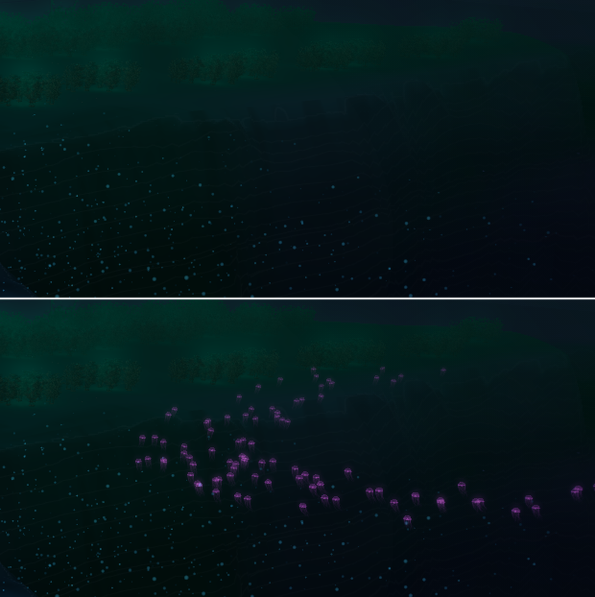

# A far bloom of small lanterns over the bowl (#1859)

Frames for one increment at the High graphics quality: a river of 260 small lanterns far
out over the free-water crater's bowl, each two points of light and no body
([art-direction.md](../../art-direction.md#a-far-bloom-of-lanterns);
[free-water-slice.md](../../free-water-slice.md) §5, "A far bloom over the bowl"). They
stand beside [the target frame](../issue-1799/README.md) at its three cameras, with the
HUD on. [issue-1837](../issue-1837/README.md) listed this under "Ideas offered, not
built": from Home the bowl beyond the fleet was empty water.

**A software rasteriser drew every frame here**: SwiftShader, in headless Chromium, in the
cloud container that built the step. They guide a round and are not offered for
acceptance. The frames the owner accepts against are taken on the named GPU, with the
commands under [Who captures](#who-captures).

## Reproduce

```bash
SETTINGS_JSON='{"reducedMotion":true,"reducedMotionChosen":true}' VIEW_W=1920 VIEW_H=1080 \
  node .claude/skills/run-game/scripts/drive.mjs --url 'http://localhost:5173/?study=free-water' \
  --out docs/screenshots/issue-1859/software --steps docs/screenshots/issue-1859/frames.mjs
python3 docs/screenshots/issue-1859/bloom.py docs/screenshots/issue-1859/software
node --import tsx --import ./packages/frontend/test/support/viteAssets.mjs \
  docs/screenshots/issue-1859/river.mjs
```

[frames.mjs](frames.mjs) is #1837's module with one camera and the clip's move changed:
Low and then High at the target's three cameras, at gate 6's low camera, and 400 m from
the river's west end in place of the garden close. It writes [readings.json](software/readings.json) after
every frame. Reduced motion holds the river where the match's start stands it, so two
runs frame alike. [bloom.py](bloom.py) reads the High frames against
[main-high](software/main-high), the same cameras taken on `main` at ba9b6ba0 with the
same module, and writes the crops below. [river.mjs](river.mjs) prints, from the
constants, what each camera holds.

## The frames beside the target


| Camera | Low | High | What High shows now |
| --- | --- | --- | --- |
| Home | [low](software/01-low-home.png) | [high](software/06-high-home.png) | The river in the water right of the fleet, under the garden's edge: 204 of its 260 lanterns, 1,316 to 2,554 m off, across the frame's last 475 px. Its thick middle is a drift of orchid points 2 to 6 px across, right of centre, and its two sides run off east, the far one fading out against the garden's foot. No ring stands in the water it crosses. Nothing else moved |
| Close | [low](software/02-low-close.png) | [high](software/07-high-close.png) | A trace of it: 58 pixels lifted by 8 of 255 or more, a faint pink haze behind the mill, across the stand's light. This eye's water reaches 630 m and the river's nearest lantern is 994 m off, so 0.08 of its light is left at most. Nothing else moved |
| Survey | [low](software/04-low-survey.png) | [high](software/09-high-survey.png) | A faint dusting of the bowl's west lobe, with a thinner trail over the pocket's north and south edges: 95 pixels, 48 of 255 at most. Every disc is under the 1.6 px floor from 10 km |

Two more, off the target's three:

| Camera | Low | High | What High shows now |
| --- | --- | --- | --- |
| Low | [low](software/03-low-low.png) | [high](software/08-high-low.png) | Gate 6's fourth camera, over the bowl, looking north: the whole river across the frame's left and middle, 1,273 to 2,009 m off, its west end a knot left of the garden and its sides thinning east across the pocket |
| River | [low](software/05-low-river.png) | [high](software/10-high-river.png) | 400 m from the river's west end, at the lanterns' own depth: what a lantern of it is from near. A drift of soft discs up to 24 px across, each in a wider faint glow. No bell and no strands |



Home's bowl at twice its size, `main` above and the step below.


Gate 6's low camera, `main` above and the step below.


Survey's bowl at four times its size, `main` above and the step below.
[bloom-close.png](software/bloom-close.png) is the Close frame's trace.

The clip is [clip-home-to-low.mp4](software/clip-home-to-low.mp4): the camera moved from
Home out over the bowl to gate 6's low camera at High and held there, at 1280 × 720 and
six times the speed the rasteriser drew it, so the river drifts six times as fast as it
does. It is taken without reduced motion, and spans 251 s of the match. The hold over
the bowl is its last 10 s, a minute of the match, in which a lantern on the loop's long
side drifts 26 m.

## How bright the river reads

[bloom.py](bloom.py) counts a pixel as the river's where the frame stands 8 or more of
255 over `main`'s in luma and is pink. The same test the other way round, `main` over the
step, passes no pixel at any of the four cameras.

| Camera | Pixels of the river | Luma at the median, the 99th percentile, the most |
| --- | --- | --- |
| Home | 1,796 | 49, 92, 115 |
| Low | 1,801 | 56, 90, 115 |
| Survey | 95 | 33, 48, 48 |
| Close | 58 | 59, 83, 83, over the stand's light |

On the same Home frame the four near lanterns clear of the stand peak at 125, 111, 160
and 130. So the river's brightest pixel, where two discs overlap, is level with the
dimmest of the five, and 99 pixels in 100 of it stand under every one of them.
[issue-1837](../issue-1837/README.md#gate-3-gate-7-and-the-limits) read the lamps on its
Close frame: 165, 159 and 130.

## What is new in the frame

Read off `readings.json`, against `main` taken the same day with the same module.

| Camera | High on `main`: calls, triangles | High now | Lantern points before, now |
| --- | --- | --- | --- |
| Home | 65, 763,409 | 65, 763,409 | 1,655, 2,175 |
| Close | 65, 763,409 | 65, 763,409 | 1,655, 2,175 |
| Low | 46, 756,078 | 46, 756,078 | 1,655, 2,175 |
| Survey | 65, 764,047 | 65, 764,047 | 1,655, 2,175 |

No draw, no triangle, no pass and no byte of target more: the river is 520 points, two a
lantern, in the draw the five jellies' 1,655 already take. What grows is the fragments
that draw shades, by a program #1837 wrote. [river.mjs](river.mjs) sums each disc's area:

| Camera | Fragments of the bells' discs | Of the glow round them | Share of a 1920 × 1080 frame |
| --- | --- | --- | --- |
| Home | 3,247 | 23,088 | 1.3% |
| Close | 6,107 | 43,427 | 2.4% |
| Low | 3,225 | 22,933 | 1.3% |
| Survey | 523 | 702 | 0.1% |
| River, 400 m off | 32,787 | 233,152 | 12.8% |
| An eye inside the river's thickest water | 146,319 | 1,040,492 | 57.2% |

The last row is arithmetic and no frame: an eye 60 m from the river's line, looking along
it. It is the worst a camera can ask, and the glow is seven eighths of it. No pass and no
per-fragment program is new, so this page carries no timing run of its own; gate 6's
8 ms is read on the named GPU, and whether these fragments are owed a run is the owner's
call.

## Low does not move

`main` at ba9b6ba0 was taken twice with `QUALITY=low` and #1837's module, and read as
[issue-1801](../issue-1801/README.md#low-does-not-move) reads a pair: the mean, over the
world area, of each pixel's largest channel difference, out of 255
([diff.py](../issue-1801/low-control/diff.py)).

| Camera | `main` against `main` | `main`'s first take against these frames | `main`'s second take against these | Calls and triangles |
| --- | --- | --- | --- | --- |
| Home | 0.09 | 0.00 | 0.09 | 44 and 593,684, all |
| Close | 0.21 | 0.01 | 0.20 | 44 and 593,684, all |
| Low | 0.19 | 0.01 | 0.18 | 26 and 587,001, all |
| Survey | 0.00 | 0.00 | 0.00 | 45 and 594,970, all |

A take differs from a take by where the marine snow has drifted. These frames fall on
`main`'s first take and stand as far from its second as the two takes of `main` stand
from each other, so no camera tells the branch from `main`.
[The Home map](software/low-control/diff-home-main-vs-branch.png) is against the first
take, and the other three lie beside it. The River camera is new with this page and has
no take on `main`; its Low frame holds open water and no lantern. In counted work
`packages/frontend/test/tutorialLoading.test.mjs` holds no lantern of the river, no point
of it and no lantern's cloud in the layer at Low.

## Gate 7 and the limits

No mark is among the river's points in these frames: at Home its nearest pixel is more
than 200 px from the Corvette's ring, and the fleet rests on the rim. A hull ordered into the bowl
puts a ring under the river, and gate 7's glance at it there is the owner's, on the named
GPU.

Limits 2 to 4 hold by construction. The river is an authored list on an authored loop,
drawn once from the fixture's seed, the same for every client, and it drifts on the
match's clock alone. `jelly-lantern` is no faction's hue and no family's
([style-neon-noir.md](../../style-neon-noir.md#world-light--the-terrain-carve-outs)).
No colour-vision palette was captured: those run once, at promotion.

## Calls taken with these frames

Six, each written with its other readings in
[art-direction.md](../../art-direction.md#a-far-bloom-of-lanterns), and each the owner's
to overturn:

- **A far lantern is two points and no body**: a soft disc 3 to 6 m across for its bell,
  and the glow in the water round it.
- **It draws in the lantern's own cloud**, so the step adds no draw.
- **The river runs on an ellipse along the bowl's north half**, and fills 230 degrees of
  it, thickest at its middle. A circle the bowl holds whole shows Home's eye a hook at
  the frame's edge.
- **It keeps one level.** No stroke and no wave: it moves by drifting alone.
- **From near it is a drift of soft discs**, and stays one: [the River
  frame](software/10-high-river.png). No point fades for the camera.
- **It is told from a Tetherjelly field by hue and form.** A crowd of lanterns is nearer
  a field's look than one lantern was, and the crater authors no field to stand beside
  it.

Three more are numbers, TUNABLE until a frame is accepted: 260 lanterns, a disc's light
at 0.3, as a near lantern's seat, and a lap in 13,500 s, which is a drifting jelly's
pace on the average.

## Who captures

On the owner's desktop, the named GPU of
[graphics-standards.md](../../graphics-standards.md) gate 6, with the dev servers running
(`npm run dev`):

```bash
UNPACED=1 VIEW_W=1920 VIEW_H=1080 node .claude/skills/run-game/scripts/drive.mjs \
  --headed --channel msedge --url 'http://localhost:5173/?study=free-water' \
  --out docs/screenshots/issue-1859/gpu --steps docs/screenshots/issue-1859/frames.mjs
CLIP=1 CLIP_HOLD_MS=20000 RECORD_VIDEO=docs/screenshots/issue-1859/gpu VIEW_W=1920 VIEW_H=1080 \
  node .claude/skills/run-game/scripts/drive.mjs --headed --channel msedge \
  --url 'http://localhost:5173/?study=free-water' \
  --out docs/screenshots/issue-1859/gpu --steps docs/screenshots/issue-1859/frames.mjs
```

The first writes ten frames and `readings.json`, whose `queued` GPU time at the five
cameras is gate 6's reading. The second records the clip and prints where the move
starts and ends in it. Neither sets reduced motion, so the river stands where the match's
clock has carried it: it drifts 0.44 m/s at its fastest, 26 m in a minute.

## Related

- [The target frame](../issue-1799/README.md) — the cameras, and who captures
- [issue-1837](../issue-1837/README.md) — the five lanterns, and where this was offered
- [art-direction.md](../../art-direction.md#a-far-bloom-of-lanterns) — what is built, and
  the calls taken
- [free-water-slice.md](../../free-water-slice.md) — §5, where the river runs
- [graphics-standards.md](../../graphics-standards.md) — gate 6, the two graphics qualities
