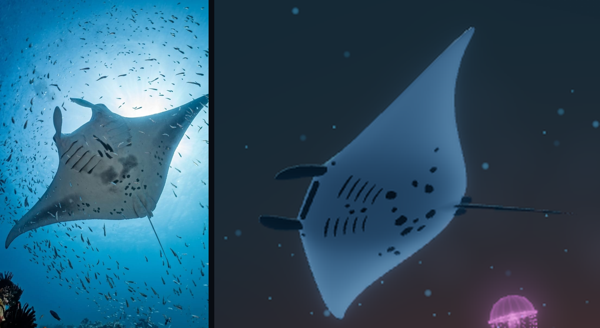

# A manta over the rim at High (#1867)

The owner named this frame in session on 21 November 2026, for
[#1637](https://github.com/gunnargehtab/Echoes-of-the-Abyss/issues/1637): "we need a
manta", and "here is the target from below". It is the target the manta is judged
against, as `dev-loop`'s "Look work" asks: one reference image, committed with the camera
it is judged at. The photograph is the owner's, who holds its rights and said so in
session before it was committed.


`target-manta.jpg` is 768 × 1,211: a manta seen from below against the light, a school
round it.

The owner took three calls in session the same day, before any frame. The photograph is
committed. The manta is a new model that the High graphics quality alone stands, and
`env-rim-ray` and the frame Low draws do not move. It keeps the rim ray's 18 m: the fish
round the target's manta are about a thirtieth of its span, and the crater's fry are
0.5 m.

## What transfers

- **The plan.** A disc about 2.3 times as wide as it is long: a leading edge that runs
  nearly straight from the head and sweeps back, wings drawn out to narrow tips that curl,
  and a trailing edge concave toward each tip.
- **The head.** A wide mouth across the front, between two cephalic lobes held forward
  like paddles and toed in.
- **The belly.** Pale, with five gill slits a side in two rows that close toward the
  tail, dark blotches between and behind them, and a grey that deepens toward the wings'
  trailing margin and tips.
- **The tail.** A thin whip about as long as the disc.
- **Where it is seen from.** Below, the belly to the eye.
- **The school.** Small fish all round it, a thirtieth of its span and smaller.

## What does not

- **The sun, and the figure it makes.** There is none below the Lid, so no shafts and
  no caustics ([art-direction.md](../../art-direction.md#two-layers-two-laws), limit 1).
  The target's manta is a mid tone against brighter water, the light behind it. The
  Lid's glow lights no water behind a body brighter than a pale belly under it, so the
  crater's manta is the reverse: a pale belly on darker water
  ([art-direction.md](../../art-direction.md#a-manta-shows-its-belly), on the belly's
  register).
- **The reef.** The coral at the frame's foot is the photograph's place and not the
  crater's.
- **The camera as a station of play.** Play is commanded from above and behind the fleet.
  The eye that sees a belly is the target's low Close camera
  ([issue-1799](../issue-1799/README.md)).

## Cameras

The manta is judged in [the High slice's](../issue-1799/README.md) three frames, and its
glide is placed for Close, the one low eye of the three
([free-water-slice.md](../../free-water-slice.md) §5, "A manta before the Close eye").
[glide.mjs](glide.mjs) prints what that eye sees of it over a lap.

## The frames beside the target

**A software rasteriser drew every frame here**: SwiftShader, in headless Chromium, in the
cloud container that built the step. They guide a round and are not offered for
acceptance. The frames the owner accepts against are taken on the named GPU, with
[issue-1837](../issue-1837/README.md)'s commands under "Who captures" and this folder as
`--out`.

```bash
SETTINGS_JSON='{"reducedMotion":true,"reducedMotionChosen":true}' VIEW_W=1920 VIEW_H=1080 \
  node .claude/skills/run-game/scripts/drive.mjs --url 'http://localhost:5173/?study=free-water' \
  --out docs/screenshots/issue-1867/software --steps docs/screenshots/issue-1837/frames.mjs
python3 docs/screenshots/issue-1867/belly.py
```

[frames.mjs](../issue-1837/frames.mjs) is #1837's module, unchanged: Low and then High at
the target's three cameras, at gate 6's low camera and at the garden close, with
[readings.json](software/readings.json) written after every frame. Reduced motion holds
every body at its loop's start and the manta's wings at the file's pose, so two runs
frame alike.



The target, and the Close frame's manta at three times its size ([belly.py](belly.py)).

| Camera | Low | High | What High shows now |
| --- | --- | --- | --- |
| Home | [low](software/01-low-home.png) | [high](software/06-high-home.png) | The manta as a pale fleck about 20 px across at the frame's foot, 650 m off: under the Harvester's ring and just over the controls' hint line. That eye is over the Lid and sees a quarter of the belly past the bank. It reads as a body by its paleness and not by its plan. The snow in the Corvette's beam is #1855's (below) |
| Close | [low](software/02-low-close.png) | [high](software/07-high-close.png) | The manta in the upper middle of the frame, 100 m off and 14 m of drawn height over the eye, 270 px from lobe to wingtip: its belly to the eye, pale against the water, the gill slits in two rows and the blotches dark on it, the two lobes ahead and the whip tail behind. It stands over the jellies and clear of every ring, panel and lamp. The snow in the Corvette's beam is #1855's (below) |
| Survey | [low](software/04-low-survey.png) | [high](software/09-high-survey.png) | Unchanged but for the clock: no body draws from 10 km |

Gate 6's low camera and the garden close show no manta, at either quality.

The clip is [clip-home-to-close.mp4](software/clip-home-to-close.mp4): the camera moved
from Home to Close at High and held there, at 1280 × 720 and six times the speed the
rasteriser drew it, so the manta glides and strokes six times as fast as it does. It is
taken without reduced motion, with #1837's module, `CLIP=1` and `CLIP_HOLD_MS=150000`,
and spans T+00:03 to T+06:04 of the match. The rasteriser reaches Close at about
T+03:30, with the manta on the far side of its loop, a pale body turning over the
stand's glow. The hold then runs through its second lap's near pass: it comes on from
the right, its belly opens to the eye at about T+05:08, its wings at two ends of a
stroke in frames a few seconds apart, and it leaves the frame's left by T+05:40.

## How the belly reads

[belly.py](belly.py) reads the Close frame against
[#1856's](../issue-1856/software/07-high-close.png), which holds the same water without
the manta. The manta is every pixel of its box that differs from that water by 8 of 255 or
more.

| What | Luma, of 255 |
| --- | --- |
| The water the manta covers, at its median | 42 |
| The belly, at its median | 81 |
| The belly, at its ninth decile | 112 |
| The belly, at its palest | 130 |
| A mark, a lobe or the tail, at its median | 22 |

So the belly reads at about twice the water behind it, and its margin at three times.
[#1837](../issue-1837/README.md) read the same frame's lamps at 165, 159 and 130 and its
lanterns' lips at 189, 177 and 164, so the belly's palest pixel is level with the
quietest hull's lamp and under every other. At a body's register, 0.16, before the
belly had its own, it read 13 against the water's 38: a silhouette
([art-direction.md](../../art-direction.md#a-manta-shows-its-belly)).

## What is new in the frame

Read off `readings.json` against [#1856's](../issue-1856/software/readings.json). That
capture was taken before #1855 merged, and this one after: the snow lit in the
Corvette's beam is #1855's, one call, and is in these frames at Home and Close and not
in that step's.

| Camera | #1856's High: calls, triangles | High now |
| --- | --- | --- |
| Home | 63, 760,720 | 66, 763,409 |
| Close | 63, 760,720 | 66, 763,409 |
| Low | 44, 753,389 | 47, 756,078 |
| Survey | 63, 761,358 | 66, 764,047 |

The manta is 2,689 triangles at every camera: its batch is not culled. It is two calls,
one a material, belly and the rest. The third call over #1856's capture is #1855's beam
snow: [its own readings](../issue-1855/software/readings.json) hold 64 calls at Close
where #1837's held 63, at the same 719,680 triangles. Low's calls and
triangles are those of #1856 at all five cameras, to the triangle, and Low's frames
differ from that step's by marine snow and the clock alone.

## What the frames do not show

- **The stroke at its own pace.** The stills hold it under reduced motion, and the
  clip runs it at six times its pace, a few frames a second.
  `packages/frontend/test/mantaWing.test.ts` holds its shape.
- **The target's figure.** A mid tone against brighter water; here a pale belly on
  darker water ("What does not", above).
- **A school round it.** The fry's ribbon passes 63 m of depth under the manta and reads
  as its own thing, left of it. The target's fish are all round the body.
- **The target's light.** The sun behind the target's manta is not the crater's to have.

## Owed before this merges

`mantaWing.ts` adds per-fragment work, the Lid's glow through the wing, so by
`dev-loop`'s "Look work" this increment carries one unpaced, queued timing run from the
named GPU in its pull request. This container has a software rasteriser and cannot take
it. With the dev servers up, on the owner's desktop:

```bash
UNPACED=1 VIEW_W=1920 VIEW_H=1080 node .claude/skills/run-game/scripts/drive.mjs \
  --headed --channel msedge --url 'http://localhost:5173/?study=free-water' \
  --out docs/screenshots/issue-1867/gpu --steps docs/screenshots/issue-1837/frames.mjs
```

`readings.json`'s `queued` GPU time at High is the reading. It is a reading and not
acceptance.

## Open for the owner

Eight calls wait, each written with its options in
[art-direction.md](../../art-direction.md#a-manta-shows-its-belly),
[free-water-slice.md](../../free-water-slice.md) §5 or
[asset-prompts-3d.md](../../asset-prompts-3d.md) Block 4: the belly's register over a
vessel's cladding, the light through the wings, the smoothed skin, the stroke, the
4,000-triangle row, the `fish-belly` token in
[style-neon-noir.md](../../style-neon-noir.md), the 40 degree bank, and the fine
unpushed facets.

## Related

- [issue-1799](../issue-1799/README.md) — the High slice's target frame and its cameras
- [art-direction.md](../../art-direction.md#life-in-the-worlds-light) — how a body is lit
  at High
- [free-water-slice.md](../../free-water-slice.md) — the crater, and the life it stands
- [asset-prompts-3d.md](../../asset-prompts-3d.md) — Block 4, the prompt the model
  answers
