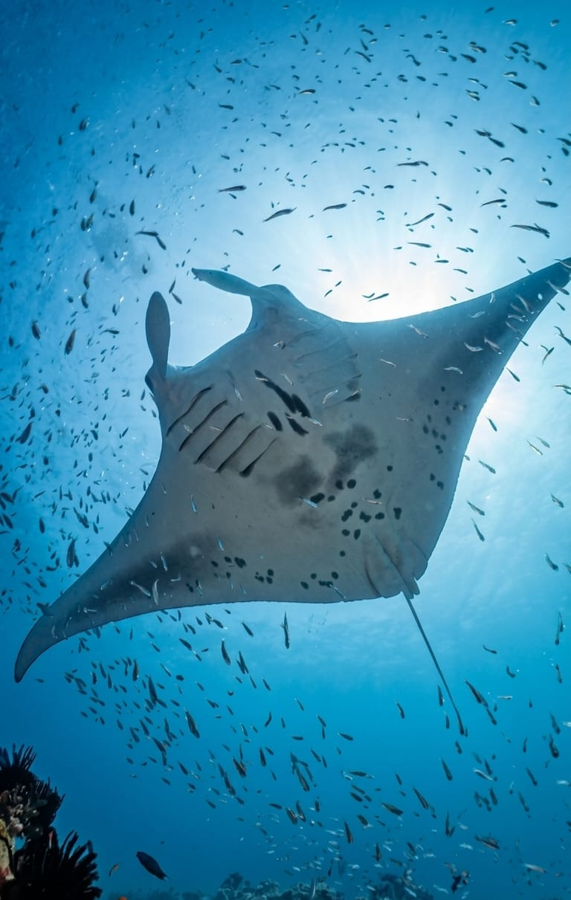

# A manta over the rim at High (#1867)

The owner named this frame in session on 21 November 2026, for
[#1637](https://github.com/gunnargehtab/Echoes-of-the-Abyss/issues/1637): "we need a
manta", and "here is the target from below". It is the target the manta is judged
against, as `dev-loop`'s "Look work" asks: one reference image, committed with the camera
it is judged at. The photograph is the owner's, who holds its rights and said so in
session before it was committed.

`target-manta.jpg` is 768 × 1,211: a manta seen from below against the light, a school
round it.

The owner took three calls in session the same day, before any frame. The photograph is
committed. The manta is a new model that the High graphics quality alone stands, and
`env-rim-ray` and the frame Low draws do not move. It keeps the rim ray's 18 m: the fish
round the target's manta are about a thirtieth of its span, and the crater's fry are
0.5 m.

## What transfers

- **The plan.** A disc about 2.3 times as wide as it is long: a leading edge that runs
  nearly straight from the head and sweeps back, wings drawn out to narrow tips that curl,
  and a trailing edge concave toward each tip.
- **The head.** A wide mouth across the front, between two cephalic lobes held forward
  like paddles and toed in.
- **The belly.** Pale, with five gill slits a side in two rows that close toward the
  tail, dark blotches between and behind them, and a grey that deepens toward the wings'
  trailing margin and tips.
- **The tail.** A thin whip about as long as the disc.
- **Where it is seen from.** Below, the belly to the eye and the light behind it, so the
  body is a mid tone against brighter water and its thin edges are the palest of it.
- **The school.** Small fish all round it, a thirtieth of its span and smaller.

## What does not

- **The sun.** There is none below the Lid, so no shafts and no caustics
  ([art-direction.md](../../art-direction.md#two-layers-two-laws), limit 1). The light
  behind the manta is the Lid's glow.
- **The reef.** The coral at the frame's foot is the photograph's place and not the
  crater's.
- **The camera as a station of play.** Play is commanded from above and behind the fleet.
  The eye that sees a belly is the target's low Close camera
  ([issue-1799](../issue-1799/README.md)).

## Cameras

The manta is judged in [the High slice's](../issue-1799/README.md) three frames, and its
glide is placed for Close, the one low eye of the three. Where it glides, and the frames
beside this one, are written here by the pull request that places it.

## Related

- [issue-1799](../issue-1799/README.md) — the High slice's target frame and its cameras
- [art-direction.md](../../art-direction.md#life-in-the-worlds-light) — how a body is lit
  at High
- [free-water-slice.md](../../free-water-slice.md) — the crater, and the life it stands
- [asset-prompts-3d.md](../../asset-prompts-3d.md) — Block 4, the prompt the model
  answers
