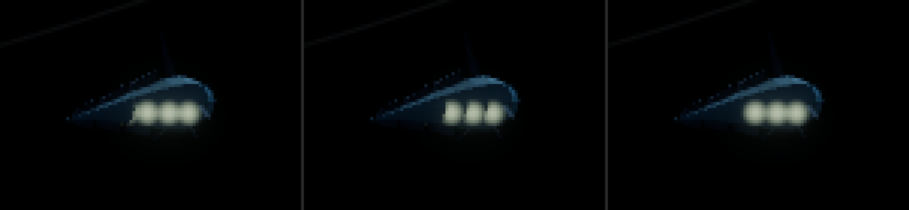
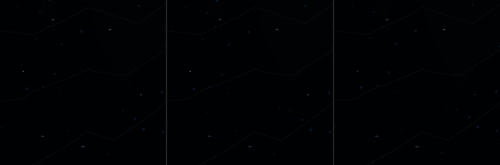

# A seat's light lit by the way it faces (#1876)

Frames for one fix at the High graphics quality: a deep fish's seat light is whole while
its seat faces the eye and dark once the seat is turned from it
([art-direction.md](../../art-direction.md#life-in-the-worlds-light)). Before it, the
far flank's aft light came 1.3 cm through the body from abeam and added to the near one
([issue-1857](../issue-1857/README.md), "Calls taken with these frames"). Low draws no
seat light and does not move.

**A software rasteriser drew every frame here**: SwiftShader, in headless Chromium, in the
cloud container that built the fix. They guide a round and are not offered for
acceptance. The frames the owner accepts against are taken on the named GPU, with
[issue-1857's commands](../issue-1857/README.md#who-captures) and this folder for `--out`.

## Reproduce

```bash
SETTINGS_JSON='{"reducedMotion":true,"reducedMotionChosen":true}' VIEW_W=1920 VIEW_H=1080 \
  node .claude/skills/run-game/scripts/drive.mjs --url 'http://localhost:5173/?study=free-water' \
  --out docs/screenshots/issue-1876/software --steps docs/screenshots/issue-1837/frames.mjs
SETTINGS_JSON='{"reducedMotion":true,"reducedMotionChosen":true}' VIEW_W=1920 VIEW_H=1080 \
  node .claude/skills/run-game/scripts/drive.mjs --url 'http://localhost:5173/?study=free-water' \
  --out docs/screenshots/issue-1876/software/pocket --steps docs/screenshots/issue-1857/pocket.mjs
```

Both modules are unchanged: #1837's takes the target's three cameras, gate 6's low
camera and the garden close, and #1857's takes the pocket eye, 250 m from a ring of six,
and one frame flown to 30 m from the ring's centre. This container's rasteriser takes
longer than Playwright's 30 s to hand over a High frame at Home, so every run here had
that limit raised to 240 s. Reduced motion holds every body at its loop's start.

## What the fix shows



One fish from the flight eye at twelve times its size
(`seats.py --near 270,355,370,425`): `main` before the fix, the first reading tried, and
what is built. The first reading gave a seat's light a lift of its own, 0.04 m, so that
no far light could reach the near flank. It hid them, and the flank cut the near discs
into ovals. Its frames are kept as this crop and the one below.

| What | One fish's peak, of 255 | Its pixels over the Corvette's lamp, 165 |
| --- | --- | --- |
| Before: a fry's lift, 0.15 m, and no facing | 184 | 31 |
| A lift of 0.04 m | 183 | 26 |
| **As built: lit by its facing, a fry's lift** | 184 | 31 |

The flight eye sees this fish's flank nearly square, so its three near seats are whole.
They read as they did before the fix, to the pixel count, so no far light showed in
this frame before either: it shows that the fix leaves a flank seen square alone, and
the next shows what it takes away.



The ring from 250 m at four times its size ([seats.py](../issue-1857/seats.py)), in the
same order. Each fish's peak, as luma of 255, in the order `seats.py` holds them:

| Fish | Before | A lift of 0.04 m | **As built** | What moved it |
| --- | --- | --- | --- | --- |
| 1 | 114 | 95 | 95 | A far flank's light no longer shows |
| 2 | 114 | 112 | 109 | The same |
| 3, at the ring's left, end on | 162 | 161 | 113 | Both flanks' seats stand near edge on to the eye |
| 4, at the ring's right, end on | 106 | 106 | 64 | The same |
| 5 | 102 | 73 | 73 | A far flank's light no longer shows |
| 6 | 107 | 80 | 80 | The same |

Fish 1, 5 and 6 read alike under the lift and under the facing, which hide a far
light two different ways. The two fish seen end on are the fix's cost: a seat's light
fades from 60 degrees off square to nothing edge on, and a fish swimming at the eye or
away from it shows every seat near edge on. The ring's six peak at 64 to 113 where
they peaked at 102 to 162.

## What holds it

`packages/frontend/test/lifeLight.test.ts`, "faces each of a deep fish's seats off its
own flank, so the far flank's is dark": each seat's facing is read off its facet in the
file, is whole from abeam on its own side and dark from abeam on the other. The same
file holds the program's two cosines to `HIGH_GRAPHICS.LIFE.GLOW.SEAT.FACE`, and
`packages/frontend/test/tutorialLoading.test.mjs` holds a unit facing on each of the
156 seat lights and none on a fry's or a lantern's. Run against `main`'s copies of the
four source files the fix touches, four of those tests fail; on the fix all 21 pass.

## The other cameras

The program every light of the two clouds draws with changed, a fry's and a lantern's
with a seat's, so the ten frames of [frames.mjs](../issue-1837/frames.mjs) are retaken
and read against [#1857's](../issue-1857/README.md), which is `main`: the mean, over the
world area, of each pixel's largest channel difference, out of 255
([diff.py](../issue-1801/low-control/diff.py)).

| Camera | Low | High | Calls and triangles at High, before and now |
| --- | --- | --- | --- |
| Home | [0.17](software/01-low-home.png) | [0.09](software/06-high-home.png) | 65 and 763,409, both |
| Close | [0.33](software/02-low-close.png) | [0.20](software/07-high-close.png) | 65 and 763,409, both |
| Low, gate 6's | [0.34](software/03-low-low.png) | [0.18](software/08-high-low.png) | 46 and 756,078, both |
| Survey | [0.00](software/04-low-survey.png) | [0.00](software/09-high-survey.png) | 65 and 764,047, both |
| Garden close | [0.29](software/05-low-garden.png) | [0.18](software/10-high-garden.png) | 52 and 760,726, both |
| Pocket | [0.09](software/pocket/01-low-pocket.png) | [0.09](software/pocket/02-high-pocket.png) | 44 and 755,430, both |
| Flight | not taken | [0.02](software/pocket/03-high-flight.png) | 44 and 755,430, both |

No draw, triangle or pass more: the fix is one attribute of three floats a light, and a
dot product a point in the vertex program. That is no pass and no per-fragment work, so
no timing run from the named GPU is owed with it (`dev-loop`, "Look work"). The 624 fry
lights, the 156 seat lights and the 1,655 lantern points stand as they did. High's
readings are marine snow, and at the pocket eye the six fish besides.
[issue-1857](../issue-1857/README.md)'s first take of the same five read 0.14 to 0.28
against `main`'s before it, on frames no deep fish shows in.

## Low does not move

The Low column above is the control. Two takes of `main` set its floor on
[issue-1837](../issue-1837/README.md#low-does-not-move): 0.24 at Home, 0.41 at Close,
0.47 at Low, 0.00 at Survey and 0.35 at the garden close, and each reading here is at or
under it. The pocket's Low reads 0.09 against a floor of 0.06 on
[issue-1857](../issue-1857/README.md#low-does-not-move), which is snow: `seats.py`
reads the same six peaks off it, 133 to 236, and the frame reports the same 156 dots.
Low draws neither cloud, and `packages/frontend/test/tutorialLoading.test.mjs` holds
its dots and no light.

## The clip

[clip-low-to-pocket.mp4](software/clip-low-to-pocket.mp4): #1857's move, retaken on the
fix. The camera goes at High from gate 6's low eye down to the pocket eye and holds
there. The move is its first 19 s, at twelve times the speed the rasteriser drew it, and
the hold its last 7 s, at five times: the ring's fish as pale points 250 m off, the
brightest of them at 100 to 127 of 255 across four frames sampled. It is the middle
1280 × 720 of a 1920 × 1080 recording, taken without reduced motion, and spans
260 s of the match, a lap of the ring and a twelfth.

The target's Home-to-Close clip is not retaken: no deep fish is in either frame.

## Calls taken with these frames

- **Lit by its facing.** The owner's second call, in session on 21 November 2026, on the
  0.04 m lift's flight frame. Against keeping that lift, and against going back to a
  fry's lift alone.
- **A lift of 0.04 m.** The first call, the issue's recommendation, built and overturned.
- **Whole within 60 degrees of square, dark edge on.** TUNABLE, with the look. A narrower
  fade would keep an end-on fish brighter and show the flank cutting a disc past about
  50 degrees, where a fry's lift stops clearing it.
- **The facing is the facet's normal in the file**, and no radial guess from the body's
  axis: the two triangles of each seat face one way.

## Related

- [issue-1857](../issue-1857/README.md) — the move this fixes, its modules and who
  captures
- [The target frame](../issue-1799/README.md) — the cameras
- [art-direction.md](../../art-direction.md#life-in-the-worlds-light) — the call, and its
  other readings
