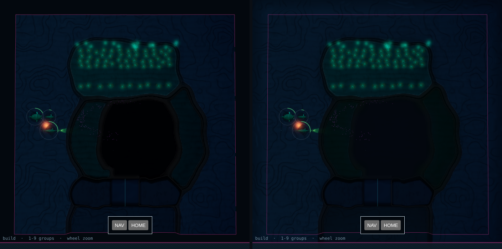

# The crater from above (#1891)

Frames for one increment at the High graphics quality: the free-water crater as the
Survey camera sees it ([art-direction.md](../../art-direction.md#the-crater-from-above);
[free-water-slice.md](../../free-water-slice.md) §9, "Crater walls"). They stand beside
[the target frame](../issue-1799/README.md) at its three cameras, with the HUD on.

**A software rasteriser drew every frame here**: SwiftShader, in headless Chromium, in the
cloud container that built the step. They guide a round and are not offered for
acceptance. The frames the owner accepts against are taken on the named GPU, with the
commands under [Who captures](#who-captures).

**The step has two parts, and both are here.** The first put water over each floor and
shade under each wall. The second draws the ground on past the map's edge. A critic read
the first alone; what it found is under [Calls](#calls).

## Reproduce

```bash
SETTINGS_JSON='{"reducedMotion":true,"reducedMotionChosen":true}' VIEW_W=1920 VIEW_H=1080 \
  node .claude/skills/run-game/scripts/drive.mjs --url 'http://localhost:5173/?study=free-water' \
  --out docs/screenshots/issue-1891/software --steps docs/screenshots/issue-1891/frames.mjs
python3 docs/screenshots/issue-1891/crater.py docs/screenshots/issue-1891/software
node --import tsx --import ./packages/frontend/test/support/viteAssets.mjs \
  docs/screenshots/issue-1891/shade.mjs
```

[frames.mjs](frames.mjs) is #1859's module with its staged pairs taken out. It takes Low
and then High at the target's three cameras and at gate 6's low camera, and writes
[readings.json](software/readings.json) after every frame. [crater.py](crater.py) reads
the Survey frames against [main](software/main), the same cameras taken on `main` at
d24e7588 with the same module, and writes the crop below. [shade.mjs](shade.mjs) prints
what the column and the shade take and how the ground past the edge falls, from their
own functions.

## The one cause

The issue names three things in the Survey frame: the ground stops on a square, the
pocket draws black, and the cut's sides are ruled. Read on `main`'s frame, the black is
the deep pocket, floor 2,400 m, and not the bowl at 1,500 m. It reads 1.0 of 255 at High
beside open water at 7.0.

**At the survey dolly High's light and water do not work at the crater's scale.** The
water's reach is 32 km from 10 km out, so the swim from the eye leaves every floor 0.91 of
its light at any depth. The light is shaded by the slope under a pixel and by ground
within 45 m of it. So a 900 m wall reaches the frame as its 80 m scarp alone: a dark band
of one width round every floor. What is left is the fixture as drawn: panels, outlines, a
hole and a square. At Home and Close the eye's own swim is the medium, and neither shows
the fault.

## The frames beside the target


| Camera | Low | High | What High shows now |
| --- | --- | --- | --- |
| Home | [low](software/01-low-home.png) | [high](software/05-high-home.png) | As on `main`, but for the shade under the garden's scarp. The column takes nothing at this dolly |
| Close | [low](software/02-low-close.png) | [high](software/06-high-close.png) | As on `main` |
| Survey | [low](software/04-low-survey.png) | [high](software/08-high-survey.png) | The bowl and the pocket are one basin under water. The pocket reads as deep water, and its coast and isobaths are faint over it. The ring keeps its kelp green and is darker toward its walls. The rim's ground and its bench lines run on past the rim line and sink into the dark over 2 km, and the exit pool's channel runs out south. The rim line is still a square, as chart ink on ground that goes on. The cut's sides are still ruled |

One more, off the target's three:

| Camera | Low | High | What High shows now |
| --- | --- | --- | --- |
| Low | [low](software/03-low-low.png) | [high](software/07-high-low.png) | Gate 6's fourth camera, over the bowl: the far floor a little darker under its walls. The column takes nothing at this dolly |



Survey's crater, `main` on the left and the step on the right.

The clip is [clip-home-to-survey.mp4](software/clip-home-to-survey.mp4): the camera moved
from Home up and out to Survey at High, at 1280 × 720. The column comes in between
2,000 m and 5,000 m of dolly on the way.

## What the floors read

[crater.py](crater.py) finds the map's square by its rim line and reads the mean luma,
out of 255, of a 12 px square about a cell centre of each floor.

| Place, and its floor | Low on `main` | Low now | High on `main` | High now |
| --- | --- | --- | --- | --- |
| Outside rim, west, 600 m | 22.5 | 22.5 | 18.0 | 18.2 |
| Northern garden, 400 m | 25.4 | 25.4 | 35.7 | 35.7 |
| Bowl, west ring, 1,500 m | 19.0 | 19.0 | 14.0 | 11.6 |
| Bowl, east ring, 1,500 m | 16.0 | 16.0 | 10.4 | 10.3 |
| Deep pocket, 2,400 m | 7.3 | 7.3 | 1.0 | 7.0 |
| Southern wall | 16.4 | 16.4 | 11.0 | 11.2 |
| Exit pool, 1,500 m | 18.3 | 18.3 | 11.9 | 10.5 |
| 300 m past the west edge | 7.0 | 7.0 | 7.0 | 13.0 |
| Open water, 2,400 m west of the map | 7.0 | 7.0 | 7.0 | 7.0 |

The order holds: the garden, the rim, the bowl, the pocket, each deeper floor darker.
On `main` the pocket stood a seventh of the water beside the map. Low's pocket reads 7.3
by the rule that keeps a trench at its own fill
([map-visuals.md](../../map-visuals.md) §6), and High's now stands beside it. Past the
west edge the rim's 18.2 has fallen to 13.0 at 300 m, and by 2,400 m the frame is the open
water it was.

What each term takes, by [shade.mjs](shade.mjs):

| Floor, metres | Kept through the column at the survey dolly |
| --- | --- |
| 400 | 0.96 |
| 600 | 0.92 |
| 1,500 | 0.60 |
| 2,400 | 0.27 |

| Place | Open to the water above | Share of the Lid's glow kept |
| --- | --- | --- |
| Outside rim, west | 0.97 | 0.98 |
| Northern garden | 0.99 | 0.99 |
| Bowl, west ring | 0.59 | 0.75 |
| Bowl, east ring | 0.60 | 0.76 |
| Deep pocket, its middle | 0.63 | 0.78 |
| Deep pocket, 250 m from its west wall | 0.54 | 0.72 |
| Exit pool | 0.48 | 0.69 |

The least open vertex of the ground is 0.25 open and keeps 0.55.

| Past the edge, metres | Off the west rim: depth, kept through the column | Off the exit pool: depth, kept |
| --- | --- | --- |
| 0 | 620 m, 0.92 | 1,504 m, 0.60 |
| 250 | 709 m, 0.89 | 1,547 m, 0.58 |
| 500 | 977 m, 0.81 | 1,708 m, 0.52 |
| 1,000 | 1,800 m, 0.48 | 2,250 m, 0.32 |
| 1,500 | 2,625 m, 0.21 | 2,766 m, 0.18 |
| 2,000 | 3,000 m, 0.13 | 3,000 m, 0.13 |

## What is new in the frame

Read off `readings.json`, against `main` taken the same day with the same module.

| Camera | High on `main`: calls, triangles | High now | Lit ground's bytes, before and now |
| --- | --- | --- | --- |
| Home | 65, 834,689 | 66, 850,817 | 2,796,203; 13,981,014 |
| Close | 65, 834,689 | 66, 850,817 | the same |
| Low | 46, 827,358 | 47, 843,486 | the same |
| Survey | 65, 835,327 | 66, 851,455 | the same |

The water and the shade add no draw, pass, triangle or byte: the shade is written into
the alpha of the relief texture the lit ground already reads, which held 255. The ground
past the edge is the one new draw, of the world pass: 15,904 triangles of its own and 224
more in the skirt, which now hangs from its longer boundary. Its lit bake is two textures
1,024 px a side, 11,184,811 bytes with their mips. The frame stands at up to 851,455 of
the crater's 900,000 ([free-water-slice.md](../../free-water-slice.md) §7).

Three costs the counts do not show.

**Per-fragment work.** Three programs gained arithmetic and none a texture read. Every
fogged draw of the world pass multiplies its swim by one more exponential. The lit ground
multiplies the Lid's glow by the alpha of a texel it already fetched. The ink overlay adds
one term to an exponent it already took. And the ground past the edge is a new draw of
the lit ground's program, over the pixels it covers: most of the Survey frame's water,
and little of the other three. By `dev-loop`'s "Look work" that owes one
unpaced, queued timing run from the named GPU, which this container cannot take: the
commands are under [Who captures](#who-captures), and `queued` in its `readings.json` is
the reading. It is not in this page yet.

**Reading the shade.** 115 to 160 ms in Node on this container, when the ground is built
at High: 16,641 vertices, 16 bearings and 26 steps a bearing. A stopwatch, not a budget.

**Baking the ground past the edge.** 831 to 862 ms in Node on this container, when the
ground is built at High: 794,560 pixels, one read of the drawn ground each.

Both are read again whole on a ground delta, inside the frame it arrives in. The study's
delta was whole already: its rounded ground re-reads its whole grid
(`perspectiveTerrain.ts` `patchHeightGrid`). Its fixture authors no delta.

## Low does not move

`main` at d24e7588 was taken twice with `QUALITY=low` and this module, and read as
[issue-1801](../issue-1801/README.md#low-does-not-move) reads a pair: the mean, over the
world area, of each pixel's largest channel difference, out of 255
([diff.py](../issue-1801/low-control/diff.py)).

| Camera | `main` against `main` | `main`'s first take against these frames | `main`'s second take against these | Calls and triangles |
| --- | --- | --- | --- | --- |
| Home | 0.25 | 0.05 | 0.21 | 44 and 593,684, all |
| Close | 0.43 | 0.12 | 0.38 | 44 and 593,684, all |
| Low | 0.51 | 0.10 | 0.41 | 26 and 587,001, all |
| Survey | 0.00 | 0.00 | 0.00 | 45 and 594,970, all |

A take differs from a take by where the marine snow hangs, and by nothing else. These
frames stand nearer each of `main`'s takes than the two stand to each other.
[The Survey map](software/low-control/diff-survey-main-vs-branch.png) has no pixel marked,
and the other three lie beside it. In counted work
`packages/frontend/test/water.test.ts` holds the column out of the fog's Low half and at
0 on every shipped map, `packages/frontend/test/surveyInk.test.ts` holds it out of
Low's ink, and `packages/frontend/test/rendererSmoke.test.ts` boots the study and a
shipped map at Low, at High and at Low again: no column and no ground past the edge at
Low, on either.

## High at the other cameras

The shade is in the ground's bake and the ground past the edge is a mesh, so every
camera has both. `main`'s High against these,
read the same way:

| Camera | Mean difference | Pixels moved by more than 2 |
| --- | --- | --- |
| Home | 0.39 | 2.2% |
| Close | 0.20 | 0.8% |
| Low | 0.78 | 8.1% |
| Survey | 2.78 | 26.3% |

Home and Close stand inside what two takes of one tree differ by. Gate 6's low camera
looks across the bowl's floor, which the shade darkens, and Survey is the step. The
ground past the edge is in all four, and shows at Survey: at the other three it lies
behind the eye or past the water's reach.

## Gate 7 and the limits

No mark, ring or lamp is drawn differently. One tactical draw is: the survey ink, which
now fades by the water over the ground it lies on. Over the pocket a stroke keeps 0.27 of
its strength at the survey dolly and over the bowl 0.60. Under 2,000 m of dolly it loses
nothing, so the ink a player reads beside a hull is Low's.

That is a call the owner took, below. What it costs is on the Survey frame: the pocket's
coast and its isobaths are faint, and the pocket is told by its water. The thermocline's
double rule lies on the bowl's scarps at 1,200 m, where a stroke keeps 0.72. Gate 7's
glance at this frame is the owner's, on the named GPU.

[free-water-slice.md](../../free-water-slice.md) §7 asks that Survey keep decoration
below tactical ink. The far bloom's points read 67 of 255 at the 99th percentile
([issue-1859](../issue-1859/README.md#gate-7-and-the-limits)) and hang at 160 m, where
the column takes nothing, over a bowl whose ink it now thins. The owner left the bloom's
Survey as it stood on 22 November 2026, before this step. It is not read again here.

Limits 1 to 4 hold by construction. The column, the shade and the ground past the edge
read the map's own cells and the drawn ground alone, the same for every client. None
answers a hull, and the ground past the edge takes the veil of the edge beside it, so no
hull is heard out there. No light is added: both only take
light away, and the water's own light comes back in its biome's hue, at the ramp's
brightness. No colour-vision palette was captured: those run once, at promotion.

## Calls

The owner's, in session on 22 November 2026, on a software rasteriser's frames of four
prototypes. Each is written with its other readings in
[art-direction.md](../../art-direction.md#the-crater-from-above).

- **Water over each floor and shade under each wall, then ground past the edge,**
  falling away into the deep. Against water alone, against stopping before the edge, and
  against reshaping the ground. The owner was told about 8,000 triangles for the ground
  past the edge. It is 15,904.
- **The survey ink takes the column at High.** Against leaving the ink as Low draws it.
  It amends "Two layers, two laws" and [map-visuals.md](../../map-visuals.md) §4, rule 6.

Neither is acceptance, which waits on the named GPU's frames. The author's, taken in the
open:

- **The column is the study's alone, and comes in by the dolly,** whole from 5,000 m.
  Two readings not taken. Every dolly, which would move the water of step 1's accepted
  frames. And whole from 8,000 m, the knee of the study's reach: on the first clip the
  pocket stayed a hole most of the way up, keeping 0.72 of its light at 5,000 m.
- **Its reach, 2,100 m,** which leaves the bowl 0.60 of its light and the pocket 0.27.
- **The shade takes 0.6 of what the walls hide.** At the whole of it the ring read 7.6
  to 9.2 beside the pocket's 6.7, and depth is luminance.
- **The shade is the Lid's alone.** A pool and a searchlight are not under it.
- **The shade is in the ground's bake, at every camera.** The reading not taken: brought
  in with the column's knee, which leaves Home, Close and gate 6's low camera as `main`
  draws them and stands the walls' shade up as the camera pulls out. Taken, gate 6's
  low camera moves 8.1% of its pixels by more than 2, and the named GPU's read covers it.
- **A ground delta reads the shade and the outer ground again whole.** The reading not
  taken: only within the shade's 800 m of the change. The study's delta re-read its
  whole grid before this step, and its fixture authors none.
- **The sources' volumes do not take the column.** None of the crater's stands deeper
  than 620 m.
- **Past the edge the ground is the edge's own, held, and falls to the map's floor over
  2,000 m.** Two readings not taken. A level shelf faded by distance, which needs a fade
  of its own and ends in a line. And an authored surround, which is a place the world
  bible does not have.
- **It is baked at the map's own 7.8125 m a pixel,** 11.2 MB. The reading not taken:
  half that density, a quarter the bytes, and softer than the map's ground beside it.
- **No ink is drawn on it, and the rim line stays.** The chart ends at the rim.
- **It carries no silt detail.** The map's ground beside it does, so near the edge a
  low camera can tell the two apart.
- **This page waits on a timing run** it cannot take.

A critic read the first part alone and returned four findings, each mended here. A
sentence of [ui-ux.md](../../ui-ux.md) §14 still said the tactical layer is drawn the
same at both qualities. This page said the shade is never read in a frame, and a ground
delta reads it in one. The shade's reach to every camera was taken with no other reading
beside it. And [art-direction.md](../../art-direction.md#the-crater-from-above) quoted
a prototype's figures for the pocket.

## Who captures

On the owner's desktop, the named GPU of
[graphics-standards.md](../../graphics-standards.md) gate 6, with the dev servers running
(`npm run dev`):

```bash
UNPACED=1 VIEW_W=1920 VIEW_H=1080 node .claude/skills/run-game/scripts/drive.mjs \
  --headed --channel msedge --url 'http://localhost:5173/?study=free-water' \
  --out docs/screenshots/issue-1891/gpu --steps docs/screenshots/issue-1891/frames.mjs
CLIP=1 RECORD_VIDEO=docs/screenshots/issue-1891/gpu VIEW_W=1920 VIEW_H=1080 \
  node .claude/skills/run-game/scripts/drive.mjs --headed --channel msedge \
  --url 'http://localhost:5173/?study=free-water' \
  --out docs/screenshots/issue-1891/gpu --steps docs/screenshots/issue-1891/frames.mjs
```

The first writes eight frames and `readings.json`, whose `queued` GPU time at each camera
is gate 6's reading and this step's timing run. The second records the clip and prints
where the move starts and ends in it.

## Related

- [The target frame](../issue-1799/README.md) — the cameras, and who captures
- [issue-1859](../issue-1859/README.md) — the frames this step was read against
- [art-direction.md](../../art-direction.md#the-crater-from-above) — what is built, and
  the calls taken
- [free-water-slice.md](../../free-water-slice.md) — §9, the crater's walls
- [map-visuals.md](../../map-visuals.md) — §4, the survey ink
- [graphics-standards.md](../../graphics-standards.md) — gate 6, the two graphics qualities
