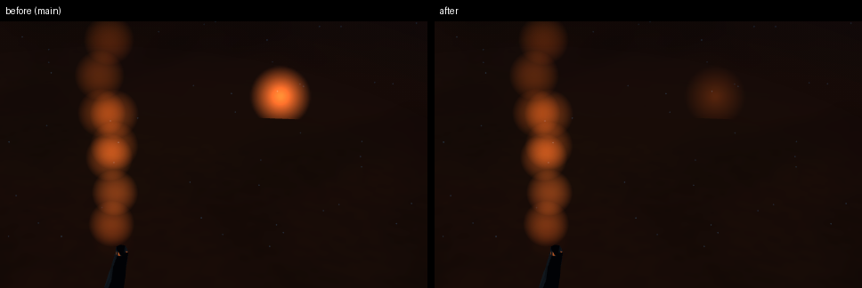

# One ember cloud, not four (#1906)

Frames for [style-neon-noir.md](../../style-neon-noir.md#world-light--the-terrain-carve-outs):
an ember draws `vent-ember` at 0.55 times its flicker. Before the fix every dressing
rebuild left the previous ember cloud in the scene, and the fields and the map each
rebuild after the ground, so a match drew stale clouds adding on top of the live one.

**A software rasteriser drew both frames**: SwiftShader, in headless Chromium. They guide
a round and are not offered for acceptance.

The left half is `main`, the right half this change. Each is the same 480 by 300 pixel
window of a 1440 by 900 frame, taken at Low in the standard palette from 150 m over the
vent at (1547, 3299) on the Ventfront Divide. The chimney's steam on the left of each is
the control: it is not part of the ember cloud and does not move.

- The ember's centre pixel, at (915, 152) in the frame, reads (255, 142, 54) on `main` and
  (84, 35, 13) after.
- The window holds 314 pixels with a channel at 250 or more on `main`, and none after.

Each frame catches the ember at its own flicker step, so the two centres are not one step
apart: what the pair shows is a saturated disc against an ember inside its price.

## Reproducing

[frames.mjs](../issue-1854/frames.mjs) took both frames, with
`PALETTES=standard QUALITY=low FAMILIES=vent`, the before run reading the after run's
pose from [readings-after.json](readings-after.json). [beside.py](beside.py) lays the
pair beside each other and prints the window's readings.
