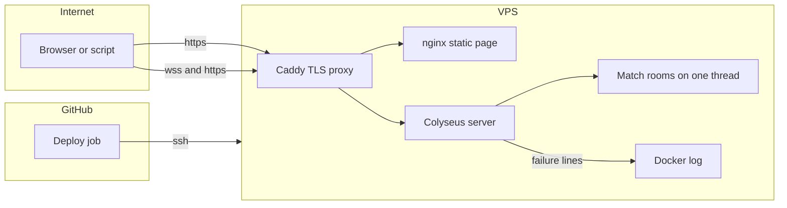

# Threat model: the game server

What a stranger on the internet can do to the match server once
`.github/workflows/deploy.yml` puts it on a public host, and what each risk is worth fixing
first. Written for #1920 with the `security-threat-model` skill from
`tech-leads-club/agent-skills`, against `main` at `6c70fa1e`. The skill's output
contract fixes the section order below.

## Executive summary

Three threats rank high, and each needs nothing but the public URL. The worst is about the
game: every opaque contact handle is a keyed permutation whose only secret is the 32-bit
match seed. A client can recover that seed offline from the handles it holds, in about 80
seconds on one core, and the seed is also the key of the lies the Echo Layer tells. The
other two are about the host, which runs every room on one Node event loop. Every anonymous
`POST` to `/matchmake/create/match` builds a full world on that loop, and a client that
joins its own rooms holds a running simulation per socket, with no cap on either. The
per-message wire bounds, the origin lock and the error-report route are sound for what
they cover.

## Scope and assumptions

**In scope:** the 32 client messages and `CLIENT_SHAPE` in `packages/shared/src/wire.ts`;
`packages/backend/src/rooms/MatchRoom.ts` and `lobby.ts`; the per-observer handles in
`packages/backend/src/sim/systems/echoLayer.ts` and `packages/shared/src/echo.ts`; the HTTP
routes in `packages/backend/src/index.ts` and `src/http/`; `deploy/` and the deploy job.

**Out of scope:** the client bundle except where it renders server text, the balance and
render tooling under `tools/`, CI other than `deploy.yml`, and the VPS's own hardening (SSH,
firewall, OS updates), which no file here describes.

**Assumptions**, each recorded rather than confirmed, as #1920 asks of an unattended run:

1. The playtest link is shared with a small group, but the host is public: anyone who learns
   the name can reach ports 80, 443 and 3000.
2. There are no accounts, cookies or personal data. The assets are hidden match state and
   the host's availability.
3. One backend container runs one Node process, so every room shares one event loop
   (`deploy/compose.playtest.yml`).
4. The VPS's Docker daemon keeps its default `json-file` log driver, with no size cap.
5. Caddy replaces a client's own `X-Forwarded-For` rather than appending to it, as Caddy 2
   does for a peer outside `trusted_proxies`, which `deploy/Caddyfile` does not set.

**Open questions that would move a ranking:** whether the backend will ever run as several
processes, since until then the VPS's core count does not change TM-002 or TM-003; whether
its Docker daemon caps log size (TM-004); and whether the link will ever be posted publicly
rather than handed out (every likelihood below).

## System model

### Primary components

- **Caddy** (`deploy/Caddyfile`): terminates TLS on 443 for the page and on 3000 for the
  game server, and reverse-proxies both. Port 80 answers Let's Encrypt's HTTP challenge and
  redirects everything else. No rate limit, no header rules.
- **Frontend container**: nginx serving the static Vite bundle (`packages/frontend/Dockerfile`).
- **Backend container**: Node 22 as user `node` (`packages/backend/Dockerfile`), running
  Colyseus 0.18.17 with `@colyseus/ws-transport` 0.18.4. It serves express routes and the
  matchmaker, and steps every `MatchRoom` at 60 Hz on one thread.
- **Deploy job** (`.github/workflows/deploy.yml`): builds both images on a GitHub runner
  and loads them over SSH with `PLAYTEST_SSH_KEY`.

### Data flows and trust boundaries

- **Browser → Caddy (80, 443).** Page assets over HTTPS; 80 only redirects or answers the
  certificate challenge. Public, unauthenticated.
- **Browser or any script → Caddy (3000) → backend, HTTP.** `GET /`, `GET /health`,
  `GET /rooms/match` (public room rows: map, seats, filled), `POST /matchmake/*`, and the
  error-report `POST` at `REPORT_PATH`. No authentication: `MatchRoom` has no `onAuth`.
  `guardOrigins` (`src/http/cors.ts`) refuses a non-safe method whose `Origin` the policy
  refuses, and passes one with no `Origin` at all. The report route is rate-limited per
  address, capped at 8,192 bytes and read field by field (`src/http/reports.ts`).
- **Client → backend, WebSocket.** Colyseus messages, at most 4 KiB each (the transport's
  default `maxPayload`). Each passes a per-session budget of 240 messages a second, then its
  shape in `CLIENT_SHAPE`, with arrays capped at 256 ids (`WIRE` in
  `packages/shared/src/constants.ts`). An order then needs `commandSlot`, a seat in a
  running match, and `Match` re-checks ownership and ranges. A lobby message (`faction`,
  `ready`, `addAi`, `removeAi`, `aiDifficulty`) needs a row in the roster instead, and the
  lobby phase, except `ready`, which also votes a rematch after a result. Its rules are the
  pure functions in `lobby.ts`.
- **Backend → client, WebSocket.** Per observer: the resolved Echo snapshot under opaque
  handles, `assigned`, the mission view, mission lines and `missionOver`. Broadcast: the
  `MatchState` schema (lobby rows only), `ground` deltas, `phase`, `gameOver`. Per join:
  map, terrain, resource nodes.
- **Runner → VPS, SSH.** Images and compose files, with the host key pinned by
  `PLAYTEST_KNOWN_HOSTS`. Fires only on a green `push` to `main` or a manual run on `main`.

#### Diagram

## Assets and security objectives

| Asset | Why it matters | Objective |
| --- | --- | --- |
| Hidden match state: positions, phantoms, true bearings | The game is hidden information; a client that learns it holds a maphack (`CLAUDE.md`, "Server-authoritative is a hard rule") | C |
| The match seed | It keys every contact and mark handle (`contactHandle`, `markHandle`) and every scattered lie (`scatterLie`), and reproduces the match | C |
| The backend's event loop | Every live room steps on it; one stalled step stalls every match | A |
| The host's disk | Failure lines and Caddy's certificates live on it | A |
| Match integrity: orders, seats, results | A seat commanded by someone else, or a result forged, breaks the playtest's evidence | I |
| `PLAYTEST_SSH_KEY` and the host | The key is root-equivalent on the VPS, since its user runs Docker | C, I |

## Attacker model

### Capabilities

- Any internet host can reach ports 443 and 3000, open any number of WebSockets, and send
  any HTTP request, with or without an `Origin`.
- A player can run a modified client: read every byte the server sends, send any message
  that fits the shapes, and compute offline for as long as they like.
- An attacker on IPv6 can draw fresh source addresses from a /64.

### Non-capabilities

- No one can read another observer's snapshot: it is sent per client, and the handles in
  it are keyed per slot.
- No one can reach the backend or nginx except through Caddy: `compose.playtest.yml` resets
  both containers' port lists.
- A fork's pull request cannot deploy: the switch job requires a `push` event on `main`.
- No one can steal a seat by its public `sessionId`: Colyseus reconnects on a separate
  `reconnectionToken` (`Room.hasReservedSeat` in `@colyseus/core`).

## Entry points and attack surfaces

| Surface | How reached | Trust boundary | Notes | Evidence |
| --- | --- | --- | --- | --- |
| `POST /matchmake/create/match`, `joinOrCreate`, `joinById` | HTTPS on 3000 | Internet → backend | Anonymous; no rate limit; a create builds a `Match` synchronously in `onCreate` | `MatchRoom.onCreate`, `newMatch` |
| Room options | Body of the matchmake request | Internet → room | `mapId` and `missionId` looked up; `driftCarry` and `spent` validated; Free Water refused in production | `validDriftCarry`, `validateSpent`, `freeWaterMap` |
| Join option `name` | Join request | Client → every client in the room | Cut to 32 characters, then rendered as React text | `MatchRoom.onJoin`; `Lobby.tsx` |
| 32 client messages | WebSocket | Client → room | Budget, then shape; an order then needs `commandSlot` and ownership in `Match` | `onClientMessage`, `isValidClientMessage` |
| Lobby messages | WebSocket, in the lobby phase | Client → roster | A roster row; seat and navy rules as pure functions | `allocateSlot`, `canChooseFaction`, `everyoneIsReady` in `lobby.ts` |
| Contact and mark handles | Every Echo snapshot | Room → client | Keyed by the seed and the slot alone | `keyedHandle` in `echo.ts` |
| Error reports | `POST` at `REPORT_PATH` | Internet → server log | 30 a minute per address, 8,192 bytes, fields allow-listed | `mountReports`, `ReportLimiter` |
| `GET /rooms/match`, `/health`, `/` | HTTPS on 3000 | Internet → backend | Public rows of public rooms only | `index.ts` |
| Port 80 | HTTP | Internet → Caddy | Certificate challenge and redirect only | `deploy/compose.playtest.yml` |
| Deploy | SSH from the runner | GitHub → VPS | Host key pinned; host name checked by regex | `deploy.yml`, "Everything the deploy needs is set" |

## Top abuse paths

1. **Unmask the fog, offline.** Goal: a maphack. Join any skirmish with a modified client →
   keep the first few contact handles the Echo snapshots carry → invert `keyedHandle` under
   every 32-bit seed until each handle maps to a small mint index → the match seed in about
   80 seconds → each new handle's mint index shows which contacts a scattered ping
   fabricated, since phantoms are minted first (`docs/systems-echo.md` §3), and the seed is
   the key `scatterLie` hides true bearings behind.
2. **Stall every match with curl.** Goal: take the playtest down. Loop
   `POST /matchmake/create/match` with no `Origin` → each request builds a world on the
   room thread (about 25 ms each once warm, measured below) → at a few dozen a second the
   event loop has no time left, and every live match's steps and sockets wait.
3. **Hold the host with sockets.** Goal: the same, sustained. Open sockets that each create
   a private skirmish, add three Veteran AI seats with `addAi` and send `ready` → each holds
   a running 60 Hz match with four commanders (13 to 15 ms of CPU per match second in its
   first minute, more as fleets grow) → about 75 such rooms fill the one event loop, and
   more cores do not help a single process. A mission room starts on join, so one socket
   is one running mission.
4. **Fill the disk through the report route.** Goal: kill the host slowly. Send 30 maximal
   reports a minute per address, from many IPv6 addresses → each writes a line of up to
   about 4.5 KB to a Docker log nothing caps → the disk fills and the containers fail.
5. **Spend the room's budget on orders.** Goal: lag one match. A seated player sends 240
   messages a second, each naming 256 ids → each id is looked up and refused if not theirs
   → the cost is bounded by the budget, but no test counts it.
6. **Take over the host through the pipeline.** Goal: root on the VPS. Compromise `main` or
   the `PLAYTEST_SSH_KEY` secret → the next deploy runs any image the attacker built, as a
   user that runs Docker.

## Threat model table

| Threat ID | Threat source | Prerequisites | Threat action | Impact | Impacted assets | Existing controls (evidence) | Gaps | Recommended mitigations | Detection ideas | Likelihood | Impact severity | Priority |
| --- | --- | --- | --- | --- | --- | --- | --- | --- | --- | --- | --- | --- |
| TM-001 | A player with a modified client | A seat in any match; a few handles from its own snapshots | Brute-force the 32-bit seed from `keyedHandle`, then read mint order and the scatter lies' key | Phantoms told apart from real contacts; the bearing lie likely undone; `world.rng`'s draws predictable | Hidden match state; the seed | Handles are per slot; the seed is named in no wire message (`echo.ts`, `contactHandle` comment) | A 32-bit key that fits a known-plaintext search; the comment assumes only a sort must be resisted | Key handles with a secret of at least 128 bits drawn from `crypto.randomBytes` per match, held server-side and recorded in the replay; keep `world.rng`'s seed out of the handle key | None possible server-side: the search is offline | Medium: one script and no server contact, but it takes the insight and a modified client | High: it defeats the deception the game's central system rests on, undetectably | **High** |
| TM-002 | Any internet host | The public URL | Flood `POST /matchmake/create/match`; each builds a `Match` on the room thread | Every live match stalls; the playtest is down while it lasts | Event loop | `guardOrigins` refuses a foreign `Origin`; an unjoined room is disposed after 15 s (`COLYSEUS_SEAT_RESERVATION_TIME`) | A request with no `Origin` passes; no rate limit | Rate-limit `/matchmake` per address in Caddy or in the `guardOrigins` wrapper; build the world on first join, not on create | Log creates per address a minute; alert on step lag | High: a curl loop, no SDK, no socket | High: every match on the host stops while it runs | **High** |
| TM-003 | Any internet host | The public URL and the Colyseus SDK | Open many sockets, each holding a running room | The one event loop is spent on rooms nobody watches | Event loop | Per-session message budget; rooms close 180 s after a result (`LIFECYCLE.POST_MATCH_S`) | No cap on live rooms, or on rooms and sockets per address; AI seats cost one message each | A cap on concurrent rooms, and on rooms and sockets per address | A gauge of live rooms and AI seats | Medium: a short script against the SDK, about 75 sockets | High: every match on the host lags for as long as the sockets stay open | **High** |
| TM-004 | Any internet host | Many source addresses | Flood the report route | Disk fills | Disk | 30 per minute per address, 8,192-byte body, 10,000 addresses tracked (`REPORTS`) | Per address only; the log has no cap | Cap the backend's Docker log (`max-size`, `max-file`) in `compose.playtest.yml`; add a global report ceiling | Disk-usage alert | Low: days of traffic from many addresses for a small VPS disk | Medium: the host fails, but slowly and visibly | Medium: raised a step because no existing control touches the gap, the log's size |
| TM-005 | A seated player | A seat | Saturate the message budget with id-heavy orders | One room's step slows | Event loop | 240 messages a second, 256 ids, 4 KiB payload, ownership in `Match` | The per-message cost is not counted | Count the worst order's work as `Match.worstStepWork` does a step's | Log a session that spends its whole budget | Low: the budget binds a script to 240 messages a second | Low: refused ids cost a lookup each | Low |
| TM-006 | A player | A seat | Read a broadcast channel for another player's actions | A leak past the fog | Hidden match state | `ground` is written only by mission beats; mission views are slot-gated; `MatchState` holds lobby rows only | `missionLine` goes to every client in a mission room, safe only because a mission seats one (`maxClients = 1`) | Gate `missionLine` on the player slot, as the mission view is | A test that a two-seat mission room is refused | Low: no channel found that carries another seat's state today | Medium: a leak would be a maphack | Low: the controls hold every channel found |
| TM-007 | A player | A seat | Name a handle, a unit or a seat it was not issued | An order on another's hull | Match integrity | `entityForHandle` per slot; ownership in `Match`; `removeAi` refuses a human row; reconnection by token | None found | None | None | Low: every path checked refuses it | Medium: a forged order changes a result | Low: the controls hold |
| TM-008 | Whoever holds `main` or the deploy key | Write access to `main`, or the secret | Ship a hostile image | Root-equivalent on the VPS | Host; key | Deploy only from green `main`; fork events refused; host key pinned; images built on the runner | A Docker user is root-equivalent; `caddy:2.10-alpine` is pinned by tag, not digest | Pin images by digest; use a deploy user limited to `docker load` and `compose up` | Audit `docker` commands on the host | Low: needs a stolen credential or a merged hostile change | High: the whole host | Medium |

## Criticality calibration

- **Critical:** a client reads another player's unresolved state with no work, or anyone
  runs code on the host. None found.
- **High:** a client undoes the fog with offline work (TM-001); anyone takes the whole host
  down with a script (TM-002, TM-003).
- **Medium:** the host degrades slowly or needs operator error (TM-004); a pipeline
  compromise, given a stolen credential (TM-008).
- **Low:** one room lags (TM-005); a leak that needs a config change to open (TM-006); an
  attack every check already refuses (TM-007).

## Focus paths for security review

| Path | Why it matters | Related Threat IDs |
| --- | --- | --- |
| `packages/shared/src/echo.ts` | `keyedHandle` and `scatterLie` share the seed as their only secret | TM-001 |
| `packages/backend/src/sim/systems/echoLayer.ts` | Mints every handle and phantom; `entityForHandle` gates orders | TM-001, TM-007 |
| `packages/backend/src/sim/rng.ts` | `randomSeed` draws the 32-bit seed | TM-001 |
| `packages/backend/src/index.ts` | Mounts matchmaking with no admission control | TM-002, TM-003 |
| `packages/backend/src/http/cors.ts` | `guardOrigins` passes a request with no `Origin` | TM-002 |
| `packages/backend/src/rooms/MatchRoom.ts` | Builds a world in `onCreate`; the budget; per-client sends | TM-002, TM-003, TM-005, TM-006 |
| `packages/backend/src/rooms/lobby.ts` | Seat allocation and the start rule an `addAi` flood leans on | TM-003, TM-007 |
| `packages/backend/src/http/reports.ts` | The only anonymous write into the host's disk | TM-004 |
| `deploy/compose.playtest.yml`, `deploy/Caddyfile` | No log cap, no proxy rate limit | TM-002, TM-004 |
| `.github/workflows/deploy.yml` | The SSH key and the event guard | TM-008 |

## Evidence

Measured on `main` at `6c70fa1e`, in this repository's container, with 4 cores.

- **TM-001.** A script inverted `keyedHandle` under candidate seeds and accepted one when
  eight held handles all mapped below index 64. Over 2^24 seeds it found only the true seed,
  in 309 ms, which projects to 79 seconds for all 2^32 on one core.
- **TM-002.** Against a local server, `curl -X POST -d '{"private":true}'` to
  `/matchmake/create/match` with no `Origin` returned 200 and a room id. Forty in parallel
  took 982 ms, about 25 ms of the one thread each. The first `Match` built in a fresh
  process, on the default map, took 39 to 45 ms.
- **TM-003.** A skirmish with four Veteran AI seats cost 13.2 to 14.6 ms of CPU per match
  second over its first minute, across two runs. The Prologue cost 1.8 to 2.0 ms.

## Findings filed

Each high-ranked abuse path is its own `finding` issue, and fixes land in their own pull
requests: TM-001 in #1959, TM-002 in #1960 and TM-003 in #1961.

TM-001's handle half is fixed. Contact and mark handles are keyed by a 128-bit secret
drawn per match from `crypto.randomBytes`, held server-side, recorded in the replay, and
never the seed (`packages/backend/src/sim/handleKey.ts`, #1959). The tables above still
describe `6c70fa1e`. The seed still keys `scatterLie` and the phantom dice; whether
another channel leaks it is not yet checked.

## Quality check

- **Entry points:** every route `index.ts` mounts, the matchmaker, the 32 client messages,
  the lobby messages, the report route, port 80 and the deploy are in the surface table.
- **Trust boundaries:** each appears in a threat. Browser to nginx on 443 serves static
  files only, and no threat was found there.
- **Runtime and CI:** TM-008 is the only CI threat, and it is kept apart from the runtime ones.
- **User context:** none given, since the run was unattended. The five assumptions above
  stand in for it, and the open questions say which would move a ranking.

## Related

[systems-echo.md](systems-echo.md) §3 (what the handles hide) ·
[tech-stack.md](tech-stack.md) (the server and its budgets) ·
[invariants.md](invariants.md) · [playtest-checklist.md](playtest-checklist.md) ·
`SETUP.md` (Deployment)
